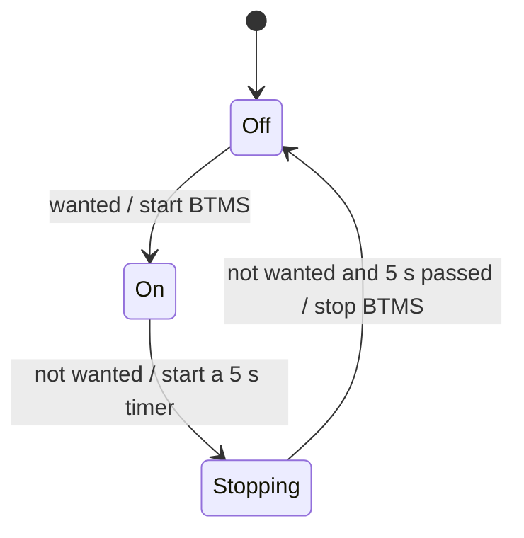
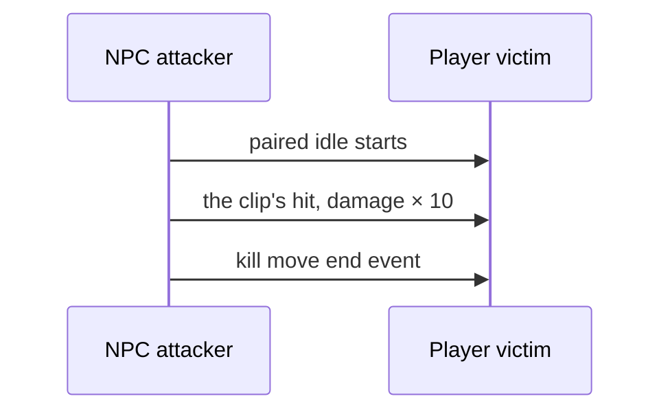
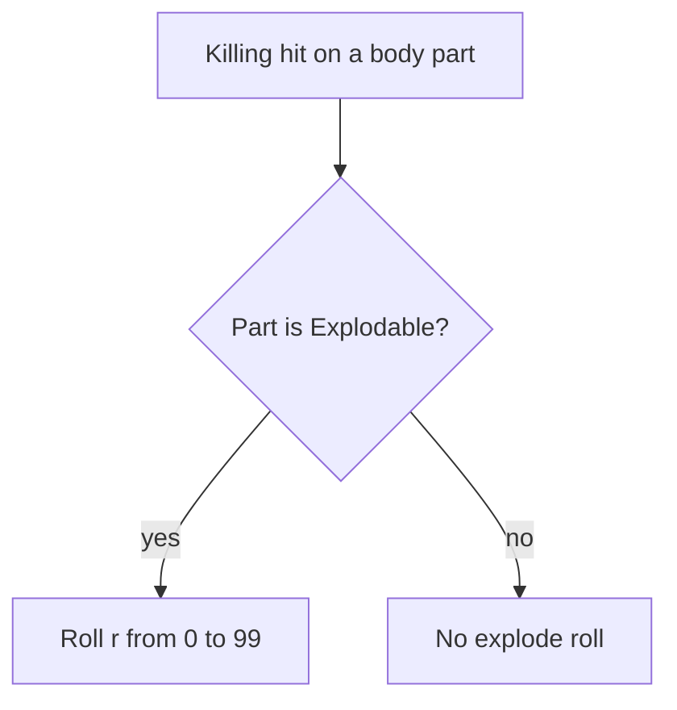
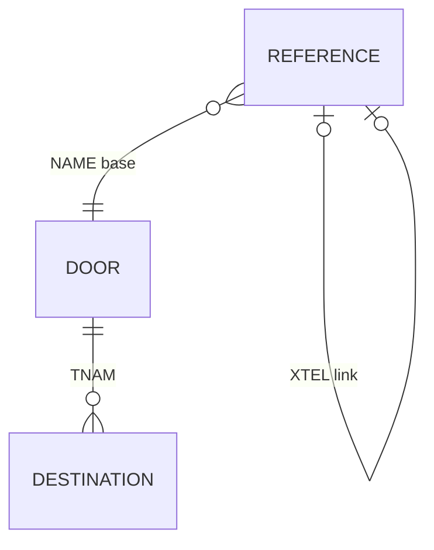
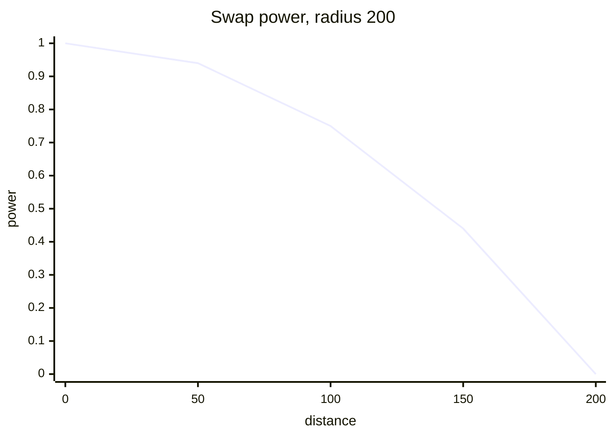

# Mermaid diagrams for game behaviour

Sections: Choosing the type, State diagram, Sequence diagram, Flowchart, Entity relationship
diagram, Chart of a formula, Timeline of timers, Syntax traps, Checking a diagram.

## Choosing the type

Ask what the behaviour is about, then pick the first row that fits.

| The information | Type | Game example |
| --- | --- | --- |
| One thing that is in one state at a time, and events move it | `stateDiagram-v2` | A combat group's record of a target: Normal, Alert, Combat, Lost |
| Several parts that pass messages or events in a fixed order | `sequenceDiagram` | A kill move: the attacker's idle, the victim's event, the hit, the end event |
| A procedure, a check list, or a formula with branches | `flowchart TD` | Finding a target for a random door |
| Records and the links between them | `erDiagram` | A `DOOR` base with its `TNAM` destinations and an `XTEL` link |
| How a value changes with one input | `xychart-beta` | Explosion swap power against distance |
| Timers and waits that overlap in time | `gantt` | A bark wait running while a search update ticks |
| Rules from a mix of inputs, with no order and no flow | A Markdown table, not a diagram | Which marker type plays which discovery music |

Two common mistakes:

- A state diagram for a procedure. If the "states" are steps that always run in the same order
  and nothing waits for an event, it is a flowchart.
- A flowchart for something that waits. If the thing stays put until an event arrives, and the
  same event means different things in different states, it is a state diagram.

## State diagram

Use it when the thing remembers where it is. Label each transition `event, condition / action`.
Put entry actions in a `note`.



Nest states for a mode that has its own sub-states, such as `state Combat { ... }`.

## Sequence diagram

Use it when the order of messages between named parts matters, and each part reacts to the one
before. Name the participants with the game's roles, not OpenSky types.



Use `Note over A,B:` for a state both parts share, and `alt` or `opt` blocks for a message that
is sent only sometimes.

## Flowchart

Use it for a procedure that runs to the end without waiting. Diamonds `{...}` are questions,
boxes `[...]` are steps. Label each branch: `-- yes -->`.



Use `TD` (top down) by default, and `LR` for a short chain of three or four steps.

## Entity relationship diagram

Use it when the behaviour depends on which record points at which. Write the record type and its
role, and label each link with the field signature.



## Chart of a formula

Use it when the shape of a curve matters more than its formula: a falloff, a cap, a ramp. Give
the formula in the prose too. Sample enough points to show the bend.



## Timeline of timers

Use it when two or more timers run at once and their overlap is the point. Use seconds with
`dateFormat X` and `axisFormat %S`.

```mermaid
gantt
    dateFormat X
    axisFormat %S
    section Group
    Search update      :0, 1
    Search update      :1, 2
    section Barks
    LostIdle wait      :0, 12
```



## Syntax traps

- A label with parentheses, brackets, or braces needs double quotes:
  `D["s = 0.2 + 0.8 × (150 − m) / 150"]`. Without them the parser reads a new shape.
- Do not name a flowchart node `end`; it closes a block. Use `Done` or `End`.
- Use `<br/>` for a line break inside a label.
- `<` and `>` are fine inside a quoted label or a transition label.
- Keep a diagram to about 15 nodes. Split a larger one by phase, each with its own heading.

## Checking a diagram

GitHub draws the diagram only if it parses. Render each block locally before you commit:

```sh
mmdc -i diagram.mmd -o /tmp/diagram.svg -p puppeteer.json
```

`puppeteer.json` names the browser: `{"executablePath": "/Applications/Google
Chrome.app/Contents/MacOS/Google Chrome"}`. Copy the block out of the page into
`diagram.mmd` first, outside the repo.
