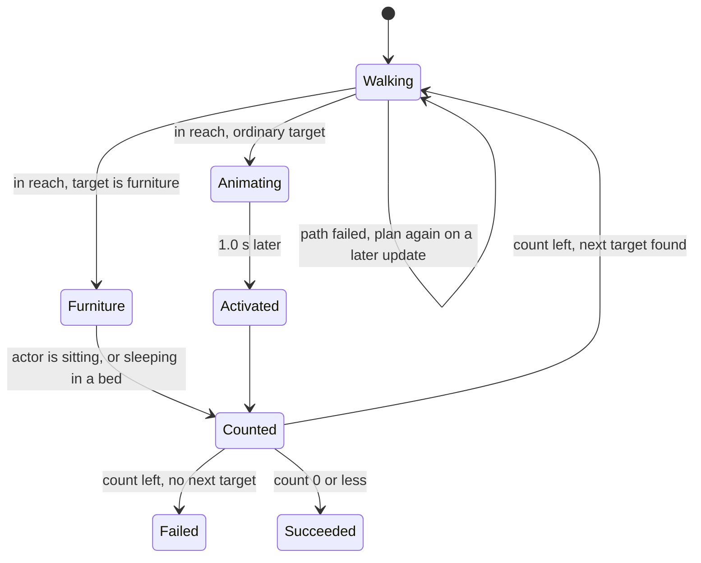

# Activate procedure

An Activate procedure walks an actor to a target reference and activates it. Its inputs are the
target, "Number to Activate", and a destination. The opening's furniture packages use it: for
example `MQ101TorolfUseFurnitureStart` (`000D95F3`) runs the template `ActivateSpecialFurniture`
(`000A31E4`), a Sequence with one Activate procedure, with Number to Activate 1 and the
`RailLeanMarker` furniture `000D95F2` as its target.

## Reach

The target is in reach when both hold:

- the horizontal distance is at most 300 units plus the target's bound radius, and at least 100;
- the height difference is at most 200 units plus the bound radius, and at least 100.

The bound radius is the radius of the reference's 3D bound. A light adds its light radius, and the
map marker static counts as 1000. The walk to an ordinary target ends within 5° of facing it.

A furniture target is walked to with a radius of the larger of the reach and 150 units, and a
facing tolerance of 10°. `Skyrim.esm` sets both; without it they are 25 units and 1°. The actor
then walks to the furniture marker, with a radius of 50 units (25 without `Skyrim.esm`), and ends
facing the marker's heading. In some movement states that radius is ten times larger; which states
is not known.

When the target moves more than the smaller of 0.75 × reach and 300 units from the walk's goal,
the walk is planned again.

## At the target

An ordinary target: the actor sends its activate action to its animation, waits 1.0 second of
frame time, then activates the target. A target whose model carries an extra-data block named
`INT` skips the action and the wait.

A furniture target: the actor uses the furniture. The procedure counts one and succeeds as soon as
the actor is sitting, or sleeping for a bed. It does not keep running while the actor uses the
furniture. What makes the actor get up later was not found.

An actor target is activated on each update until the activation succeeds, with no timer.

## Counting

Each activation takes from Number to Activate the smaller of the count left and the target's item
count; for a plain reference that is 1. The count drops even when the activation is refused, and a
refused activation is not tried again. So with a count of 1, the actor activates its target once
while it holds the package.

The procedure fails at once when the target is missing, deleted, or disabled, or when the target's
base object is the procedure's own object filter and that reference reports itself blocked. No
retry interval for busy furniture was found.

## A blocked path

While the path has failed and the target is still valid, the procedure plans the path again on
later updates. It has no retry timer, no give-up time, and no time-out failure of its own.

## Low process levels

The procedure runs in full at the High and Middle-high [process levels](/engine/ai-process-levels.md).
At Middle-low and Low it runs a cheap version with no animation and no wait:

- out of reach, it starts a simple move to the target; when the move cannot start, it takes the
  next target or fails;
- in reach, it activates at once;
- a furniture target is counted, and the procedure succeeds, without the actor sitting.

## Where OpenSky differs

OpenSky counts Number to Activate for as long as the actor holds the package. The count is kept
outside the procedure, so a tree that starts again sees the activations already made. Example:
`ActivateSpecialFurniture` is a Sequence with the repeat flag round one Activate. After Torolf
activates the rail, the Sequence starts again, finds the count spent, and ends the package.

- A furniture target seats the actor in one of its markers. The procedure counts one and succeeds
  once the actor is sent to sit, and the actor stays there.
- An ordinary target waits 1.0 s at the target, then activates it. OpenSky does not send the
  activate action to the animation, and does not read the `INT` extra data.
- A procedure that starts with a count of 0 or less succeeds at once, without a walk. The game
  page above gives the count test only after an activation; this start rule is OpenSky's.
- Each loaded cell's activate children are indexed once, so an activation does not walk every
  loaded reference.

[WARNING] OpenSky has no reach rule: the walk goes to the target's origin, or to the furniture
marker. It has no cheap version for the low process levels, because an actor there has no package
tree in OpenSky ([unloaded actors](/engine/unloaded-actors.md)). It takes 1 from the count, not the
target's item count.
