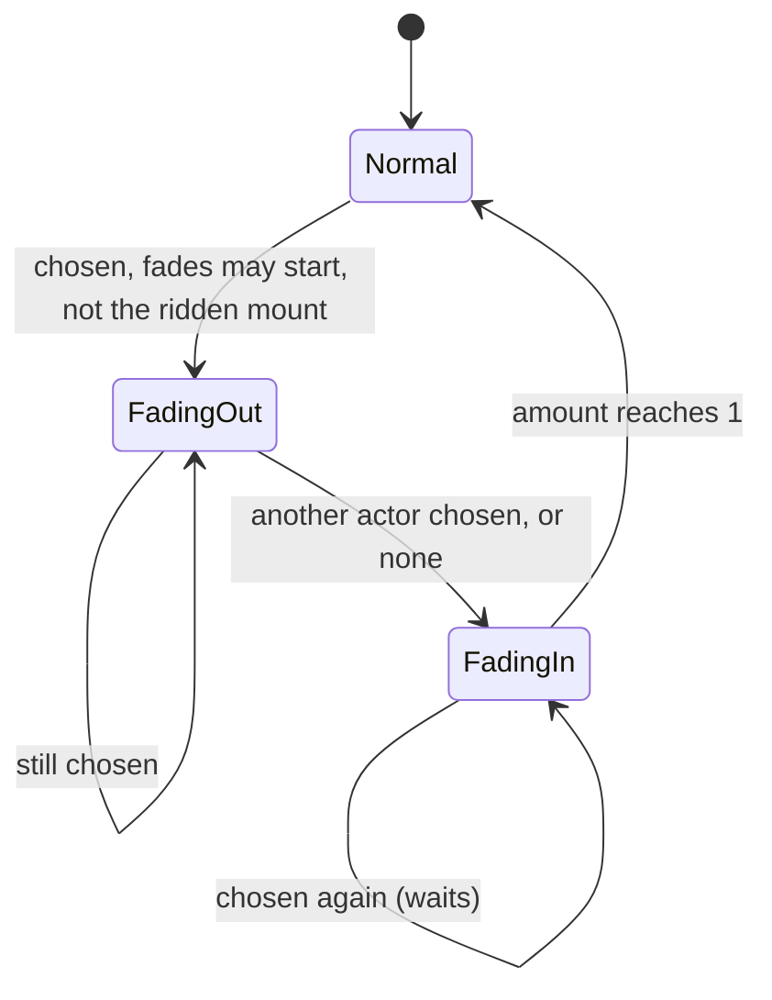

# Actor fade near the camera

An actor fades out while the camera is too close to it, so the view never shows the inside of a
body. The fade draws with the game's 4 x 4 screen-door pattern: a pixel with threshold `t` from
the pattern hides while the actor's visible share is below `t`. Distances below are in game
units.

## Which actor fades

Two tests run each frame, inside the camera's collision update for the actor the camera follows.
That actor is the camera target, normally the player.

Test A finds another actor between the pivot and the eye:

- One sphere sweeps from the pivot to the eye the camera wants this frame. The same sweep pushes
  the camera in front of walls. The sphere radius is 15, and 5 in the bleedout camera and while a
  kill-move camera runs.
- The pivot is the target's position plus a height. For the player, it is the current
  third-person pivot height. For an NPC target, it is 0.75 times its bounding-box height times
  its scale. The bleedout camera uses its own pivot.
- The sphere touches statics, animated statics, trees, terrain, traps, ground, large debris, the
  living ragdoll of an actor, and an actor's movement capsule. It does not touch a dead ragdoll.
  So a living actor is hit through its movement capsule or through a bone of its ragdoll.
- The hits are walked from the pivot outwards. A hit on the player's own collision is skipped. A
  hit whose scene node is hidden is skipped, and so is a hit with no scene node, unless it is on
  the ground layer.
- A hit on an actor does not stop the camera. That actor becomes the candidate, and the contact
  point is kept. A later actor hit replaces it, so the candidate is the actor nearest the eye.
- The first hit on anything else blocks: the walk stops, and the end point becomes that contact
  point. With no blocker, the end point is the wanted eye.
- The candidate stays only when its contact point is nearer to the end point than 30 plus the
  bounding-sphere radius of the scene node that owns the body it hit. For a ragdoll hit, that
  node is the bone. For a capsule hit, it is likely the actor's root node.

Test B asks whether the eye is inside the camera target itself. This is how the player fades:

- Normally a sphere of radius 20 sits at the camera point after the wall push. The target is
  "inside" when that sphere overlaps the target's movement capsule. When the eye is above the
  capsule's base, the test point first moves down by the target's height minus 124. The height
  is the bounding-box height times the scale.
- While the target uses furniture (sits, sleeps, likely also rides, and the dead player), the
  target is "inside" when the eye is within 45 of one body node, likely the head.
- When Test B says "inside" and Test A found no candidate, the player is the candidate.

Test A wins, so at most one actor is chosen in a frame.

## Which cameras start a fade

| Camera | Effect |
| --- | --- |
| Third person, horse, dragon riding, furniture, idle orbit, bleedout | Both tests run, and a new fade may start |
| First person, the kill-move camera | Both tests run, but no new fade starts: the old actor fades back in, and a player fading out fades back in |
| Free camera, iron sights, the inventory menu camera, a camera change in progress | No test runs; every fade keeps its state |

Entering or leaving the third-person, bleedout, horse, or dragon camera fades the stored actor
back in and forgets it. So does the start or end of a kill-move camera. The game has no special
case for the race menu, the dialogue camera, or scene cameras such as the opening cart. The cart
puts the player in first person, so no rider fades there.

## One actor at a time

The camera stores one faded actor.

- The same candidate as last frame changes nothing.
- When the candidate changes, the old actor fades back in if it was fading out for the camera.
  The new one starts fading out, and is stored, only when a fade may start in this camera, it is
  in the normal state, and it is not the mount the player rides. An actor still fading back in
  is not stored; it is tried again each frame and fades out once its fade-in ends.
- Several actors can fade back in at the same time.
- A dead actor's ragdoll is not touched by the sweep, so a dead body neither fades nor blocks. A
  disabled actor has no visible node, so its hits are skipped. A non-actor object on an actor
  layer, such as large debris, blocks.

## How far an actor fades

The fade has two stages.

The fade amount goes from 1 (shown) to 0 (gone):

- It moves in a straight line, over 0.5 s for an NPC and 0.001 s for the player, both ways. These
  are the teleport fade times.
- It does not depend on distance. The tests only choose the actor.
- A fade-out that starts at 0 first resets to 1. A fade-in that starts at 1 or more first sets
  it to 0.

The drawn alpha follows the amount:

- The target alpha is `amount × (1 - 0.01 × invisibility)` (invisibility clamped to 0 to 100),
  times one more factor that is normally 1. A script's own alpha on the actor replaces it.
- The player's target is never below 0.1, so the player stays a tenth visible.
- The drawn alpha moves toward the target at 1 per second, and at most 0.1 in one frame. A
  target above 1.5 asks for a snap: the drawn alpha jumps to the target minus 2.
- Only actors in the high process level get the alpha.

Example: Test A chooses Ralof. His amount falls from 1 to 0 in 0.5 s. His drawn alpha follows at
1 per second, so he is gone after about 1 s. When the camera moves away, his amount rises back
to 1 in 0.5 s, and he is whole again about 1 s later.

## Other dither fades of an actor

These use the same amount and the same drawn alpha:

- A teleport fades an NPC out over 0.5 s, moves it, and fades it back in over 0.5 s. The player
  is instant. Some actors skip the fade-in.
- A dismissed summon fades out over 1.5 s and is removed at 0.
- Another fade-out ends by disabling or removing the actor.
- A combat behaviour fades an actor out, waits 3 s, turns it, and fades it back in.
- While an actor is in a teleport, summon, or remove fade, the camera fade does not change it.

The distance fade of a reference, an actor included, is separate
([reference fade](graphics-options.md#reference-fade)).

## OpenSky

OpenSky follows the rule, with these choices:

- Each frame, every living actor near the sweep but the ridden mount publishes its bodies: its
  ragdoll's bone capsules where its animation holds them, so riders who share one root on a cart
  stay apart. An actor without a ragdoll publishes its movement capsule. A hull body becomes the
  sphere around its points.
- A bone body's node bound is taken as the body's own bound: half its length plus its radius. A
  movement capsule's bound is half its height.
- The pivot is the player's feet plus the third-person pivot height. The target is the player's
  movement capsule, and its height is the capsule height.
- A seated player measures from the seat idle's head bone.
- Third person starts fades; first person holds them; the free camera and a loading screen
  freeze them. A blocker before an actor does not end the sweep, because the third-person
  camera has already pulled the eye in front of it.
- Invisibility, a script's alpha, and the high process level do not change the camera fade yet.

`state frame` lists the faded actors under `actorCameraFade`, with how far each is drawn faded.
