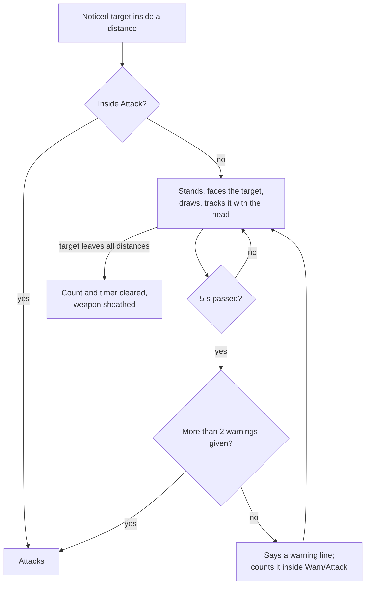

# Aggro radius

An actor that is not hostile can still warn a stranger near it and then attack. This page belongs
to [combat behaviour](combat-behavior.md), and the check that starts it to
[detection](detection.md).

The AI Data tab has an Aggro Radius Behavior box with three distances: Warn, Warn/Attack, and
Attack (<https://ck.uesp.net/wiki/AI_Data_Tab>). A vanilla skeever is unaggressive and uses
this rule, with 2,048 and 1,024 units for the two outer distances. So it attacks a player who
stays near it, although its faction reaction to the player is neutral.

The game runs the rule on each [detection](detection.md) result of 0 or more, so the
actor must at least have noticed the target. The rule starts a warning when all of these hold:

- the box is ticked;
- the target is nearer than the largest of the three distances, measured in 3D;
- the target is alive and is not already a target of the actor's combat group;
- the actor would attack the target by the reaction test below;
- the actor is not already warning.

The reaction test is not the actor's normal hostility rule:

| Actor's Aggression | Actor's reaction to the target | Qualifies |
| --- | --- | --- |
| Frenzied | Any | Yes |
| Other | Enemy or Neutral | Yes |
| Other | Ally or Friend | Only when the target's own Aggression is Frenzied |

The perk entry point Get Should Attack can change the result. An actor that is a teammate of the
player qualifies only for a target in combat with the player or with the actor itself. When the
target is a teammate of the player, or an actor the player commands, the test is run against the
player in its place. Apart from that, the rule is the same for an NPC target as for the player,
so a warning actor also warns a stranger NPC that comes near.

An actor already in combat uses the Attack distance alone and starts combat at once. The
target can be the player or an NPC.

While it warns:

- The game gives the actor a warning package that holds the target and the three distances.
  At its start the actor turns to the target's position.
- The actor stands idle, draws its weapon, and holds the target as its head-tracking target at a
  high priority.
- The right-hand weapon decides the turn. With a bow, a crossbow, or a staff, the actor turns its
  body toward an aim point that leads the target by the ammunition's projectile speed and
  gravity, within 10 degrees. It does not pull the string and plays no aim idle. With a melee
  weapon, bare hands, or a spell, it turns to face the target's position. A mage does not ready
  its spell.
- A timer runs while the target is inside any distance. Every 5 s the actor says a warning
  line. The line needs the actor to face the target within 20 degrees (80 while moving) and to
  detect it. The timer then starts again.
- The warning counts only inside the Warn/Attack distance. `GetTrespassWarningLevel` returns
  the count, and `GetActorAggroRadiusViolated` returns 1 while the actor warns.
- At a timer end with more than 2 warnings counted, the actor attacks. So it warns three
  times and attacks after about 20 s. Inside the Warn distance alone it warns for ever.
- Inside the Attack distance it attacks at once.
- An actor with Aggression 0 and Confidence 0, both together, flees where another would attack.
- A warning actor can change to a nearer actor that it detects now, or detected in the last 5 s,
  inside the largest distance.
- When the target leaves all three distances, the count and the timer are cleared, the actor
  sheathes, and it keeps its head on the target for 5 s. The target then drops to the lowest
  head-tracking priority, so any other look target wins. The head follows the target's live
  position, not the place where it left. The warning ends when the target is
  gone or dead, or when the actor has not detected it for more than 5 s.
- An actor that is attacked while it warns attacks (the wiki).

The line has the Trespass subtype (`TRES`) and is aimed at the target. A package can give its
own warning count in place of 2; that part is not confirmed. A second read on 2026-11-22 found
no path that only the player can start.

OpenSky runs the rule each step for every living actor that is not hostile and is not the
player's teammate:

- A distance of 0 is off. The target is the nearest noticed one of the player, the player's
  teammates, and other NPCs. For the player's side the actor's reaction to the player must be
  Neutral or Enemy; for an NPC, its reaction to that NPC. The Frenzied case is not built.
- The timer, the count, and the attack follow the game's numbers above.
- A warning actor stops, turns, draws, and holds its head on the target. With a bow or a
  crossbow it turns to where its arrow would meet the target. It sheathes when the target
  leaves without a fight, and keeps its head on the target for 5 s more. A later look target
  replaces it, which stands in for the lowest priority.
- An NPC target that the actor attacks becomes its foe, so the two fight. The actor stays
  neutral to the player.
- At each interval it says a Trespass line (`TRES`) when it faces the target within 20 degrees
  and detects it. An actor with no such line, such as a skeever, stays silent.
- `GetActorAggroRadiusViolated` returns 1 while the actor warns. `GetTrespassWarningLevel`
  returns the larger of a guard's count and this count.
- An actor with Confidence 0 is provoked, and the normal [combat](combat-behavior.md)
  flee rule then makes it flee, whatever its Aggression. In the game only Aggression 0 with
  Confidence 0 flees at once; whether the game's combat then makes the other one flee too was
  not checked.
- The target is chosen again each step, so a nearer actor takes over at once.
- `state actors` shows each actor's zone as `aggro`.
