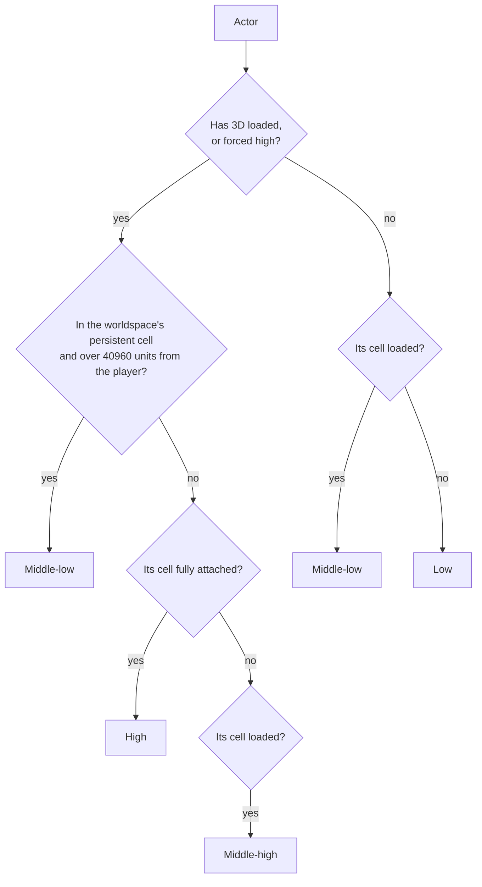
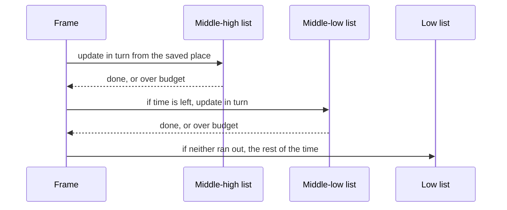

# AI process levels

The game does not update every actor's AI every frame. It sorts actors into four process levels.
Near actors update every frame. Far actors update less often, inside a time budget per frame.

OpenSky builds the rule and runs the Low level by it; [in OpenSky](#in-opensky) says what it
leaves out.

| Level | Name |
| --- | --- |
| 0 | High |
| 1 | Middle-high |
| 2 | Middle-low |
| 3 | Low |

## Choosing the level

The level is chosen again for each actor. The actor keeps its level while the player is in a
transition, and the player's mount keeps it in some player states. Otherwise:

The 40960 units are 10 exterior cells of 4096 units. The player's mount is never moved down by
that distance. The meaning of "fully attached" and "loaded" is inferred from the cell's load state.

When the level changes, the actor moves to the other level's list. On leaving High, its packages
and extra state are built again. An actor found on a list that no longer matches its level is
moved.

## How often each level updates

| Level | Update |
| --- | --- |
| High | Every frame, with the real frame time |
| Middle-high | In turn, when 0.05 / `TimeScale` game hours have passed since its last update |
| Middle-low | In turn, when 0.15 / `TimeScale` game hours have passed |
| Low | When 0.30 / `TimeScale` game hours have passed |

The time is measured in game hours. A last update of −1 forces a first update, and a last update
later than now, after midnight, forces one too.

Example: at `TimeScale` 20, one game hour is 180 real seconds. Middle-high then updates every
0.05 / 20 × 180 ≈ 0.45 seconds, middle-low every 1.35 seconds, and low every 2.7 seconds.

## The frame budget

The middle and low levels share a time budget each frame. With fps = 1 / frame time:

| fps | Budget |
| --- | --- |
| 30 or more | 5 ms |
| Below 10 | 0.5 ms |
| Between | (0.5 + 5) × fps / (10 + 30) ms |

The formula in between adds where an even ramp would subtract, so the budget jumps at both edges.
At 20 fps it gives 2.75 ms.

The time is checked after every 10 actors. Over budget, the pass stops, and the next frame goes on
from the same place. Each level uses the same actor update.

Most likely, the actor update does nothing unless the actor's cell is fully attached. So an actor
in a cell that is loaded but not attached, the middle-high level, runs no packages and no
detection. The update also skips an actor without 3D and an actor in certain life states. What
the middle-low and low levels skip in detail was not found.

## Procedures by level

A package procedure runs in full at High and Middle-high, with walking, animation, and furniture
use. At Middle-low and Low it runs a cheap version with no animation and no wait, and these actors
have no 3D, so no collision shape. For example, an [Activate procedure](activate-procedure.md#low-process-levels)
at Low counts a furniture target without the actor sitting down.

## In OpenSky

OpenSky loads and attaches a cell in one step, so a loaded actor is always High, and
Middle-high stays empty. An actor that no loaded cell holds is Low
([unloaded actors](unloaded-actors.md#in-opensky)), or Middle-low when it stands in the
exterior of the loaded worldspace: the game keeps a worldspace's persistent cell loaded, and
OpenSky gives no such actor a body.

Both levels update by the rule: every 0.15 / `TimeScale` game hours a Middle-low pass starts,
and every 0.30 / `TimeScale` a Low pass. In a pass each actor in turn takes its package and its
place. The time is read after every 10 actors. Over the frame's budget, the pass stops and goes
on in the next frame from the same place.

`openskycli game state assist` shows under `processLevels` the count of actors on each level,
`lowUpdateGameSeconds`, the pass (`lowPassPlace` of `lowPassLength`), `budgetMilliseconds`, and
`overBudgetCount`, the passes that stopped over budget.
