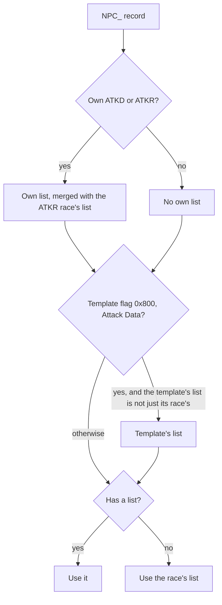
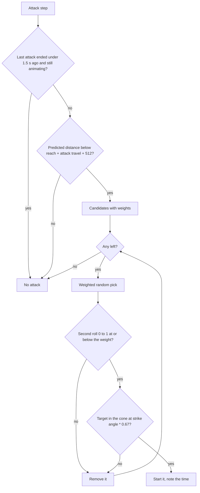

# Attack data

Each `ATKD` + `ATKE` pair on a `RACE` or an `NPC_` is one attack. `ATKE` is the animation event
that starts it, and `ATKD` holds 44 bytes of values. The event name is the key of the attack
list.

## Which list an actor uses



- The `ATKR` merge: an own attack whose event the attack race lacks is removed. When the two
  lists still differ in length, each attack-race entry the own list lacks is added. An added
  entry is shared with the attack race, not copied. When both have an event, the own entry wins.
  An NPC with only `ATKR` gets the whole attack-race list.
- The race fallback checks whether a list exists, not whether it is empty. An NPC whose own list
  is empty keeps the empty list.
- With the Traits template flag (0x1), the race comes from the template. An NPC that used its
  old race's list moves to the new race's list.
- A race change at run time moves a list that came from the old race to the new race's list. A
  new race with `DATA` flag 0x4000000 or 0x8000000 skips this step.
- At run time the game reads the list of the reference's base `NPC_`.

## Values

| Value | Default | What it changes |
| --- | --- | --- |
| Damage multiplier | 1 | The skill-scaled weapon damage ([melee damage](/engine/melee-damage.md#skill-sneak-attacks-and-armour)) |
| Attack chance | 1 | The attack's weight in the AI's random pick |
| Spell | none | Cast on the target with the hit |
| Flags | 0 | See below |
| Attack angle | 0 | Degrees added to the attacker's heading before the hit cone test |
| Strike angle | `fCombatHitConeAngle` (35) | Half-angle of the hit cone, in degrees |
| Stagger | 0 | A factor of the stagger the hit gives |
| Attack type | none | A keyword a condition function compares with the attack under way |
| Knockdown | 0 | Above 0, the hit pushes the target away with this force |
| Recovery time | 0 | Seconds before the AI picks this attack again |
| Stamina multiplier | 1 | The stamina cost of the attack |

Flags:

| Bit | Effect |
| --- | --- |
| `0x1` | Ignore weapon. No reader is known |
| `0x2` | Bash: pays the bash stamina cost. The general attack pick leaves it out |
| `0x4` | Power attack: pays the power attack cost, marks the hit as a power attack, applies the power attack damage entry point, and is the only kind picked in power-only mode |
| `0x8` | Left hand: the general attack pick leaves it out. At the hit frame it picks the hitting hand when the hand the hit event names holds no weapon, and it sets the hand of the object cast |
| `0x10` | Rotating: the hit test does not add the attack angle |
| `0x80000000` | Override data. No reader is known |

## The hit cone

A target is inside an attack's cone when
`|heading + attackAngle - directionToTarget| <= strikeAngle * mult`, with the difference wrapped
to plus or minus 180 degrees.

| Use | `mult` |
| --- | --- |
| The hit test | 1 |
| The AI's attack pick | `fCombatAttackStrikeAngleMult` (0.67) |
| An attack while moving | `fCombatAttackMovingStrikeAngleMult` (1.5) |
| A defender deciding to block | `fCombatBlockAttackStrikeAngleMult` (1.25) |
| A dead target | The use's value times `fCombatDeadActorHitConeMult` (2) |

Example: a 35 degree strike angle hits a living target up to 35 degrees off the heading. The AI
starts that attack only within `35 * 0.67`, about 23 degrees.

At the hit frame the attack first pays its stamina, then finds what it hits:

- An NPC can hit only its current combat target. The target must be in the cone, with
  `mult` 1, and within reach. An attack without attack data uses a 35 degree strike angle.
- Reach is the weapon's reach times the actor's scale, or `fCombatBashReach` (141) during a bash.
  The distance runs from centre to centre, less both actors' radii. It is measured flat when the
  two overlap in height, else in 3D.
- An attacker with no combat target, normally the player, hits the loaded actor in reach and
  cone with the smallest angle off its heading. Only the player can hit a dead actor this way.
- When the attack finds no actor, a physics cast runs along the swing: 150 units for a
  one-handed weapon, 112 for a two-handed sword or axe, and 64 bare-handed. It can strike
  objects. An actor the cast finds counts for an NPC only when it is that NPC's combat target.
- An attack hits one actor. With the Set Sweep Attack perk entry point, it also hits every other
  loaded actor within reach and within twice the cone.

The hit frame also sets the time of the actor's last attack, which the
[attack chance](/formats/combat-style.md#attack-and-bash-chances) reads.

## The AI's pick



The time a previous attack ended is noted when its attack state went back to none or reached the
combo window. The attack travel is the longest forward travel of the actor's attack clips plus a
per-fighter distance.

The strike time of each attack is divided by the swinging hand's weapon speed. The reach check
uses it to predict where both actors stand at the strike. The bash pick uses `fCombatBashReach`
(141) as its reach. A started attack's event goes to the behaviour graph; when the graph refuses
it, the attack is removed and the pick draws again.

An attack is a candidate only when all of these hold:

- the actor's current behaviour graph has timing data for its `ATKE` event;
- its recovery time has passed since it last started;
- the attacker's Stamina is above 0, or the attack costs no stamina.

Its weight starts at the attack chance. Against a staggered target it is multiplied by the
attacker's [combat style](/formats/combat-style.md) `CSME` power attack staggered value for a
power attack, else by attack staggered. Otherwise, a power attack against a blocking target,
with the attacker inside the target's hit cone (`fCombatHitConeAngle`, 35 degrees), is multiplied
by power attack blocking. A weight of 0 or less drops out.

The second roll makes a weight below 1 a plain chance as well. Example: two attacks, weights 1
and 0.5. The second is drawn a third of the time, then passes its own roll half of those times.

The general attack pick leaves out bash (`0x2`) and left-hand (`0x8`) attacks, and can be held to
power attacks only. With no target, every weight there is 10. A weapon in the left hand runs its
own attack loop, whose pick takes only left-hand attacks that are not bashes. The bash pick takes
only bash attacks that are not left-hand ones
([combat blocking](/engine/combat-blocking.md#bash)).

## Stamina

| Attack | Cost |
| --- | --- |
| Normal | 0 |
| Bash | `fStaminaBashBase` (35) times the stamina multiplier |
| Power bash | `fStaminaPowerBashBase` (55) times the stamina multiplier |
| Power attack | `(weight * fStaminaAttackWeaponMult + fStaminaAttackWeaponBase) * fPowerAttackStaminaPenalty`, then the power attack stamina entry point, then times the stamina multiplier |

`weight` is the weapon's weight, or 1 unarmed. The entry point uses the right-hand weapon. Every
cost is paid at the hit frame, not when the swing starts. Stamina at 0 or below after the payment
delays stamina regeneration.
Example: a power attack with a 10-weight sword costs `(10 * 1 + 20) * 2 = 60` before perks.

## Stagger

```text
stagger = (attacker AV 9 * fStaggerAttackMult + fStaggerAttackBase)
          / (target Mass * fStaggerMassMult + fStaggerMassBase)
          * conditions * weapon * ATKD stagger
```

`fStaggerAttackMult` is 0.01, `fStaggerAttackBase` 0.5, `fStaggerMassMult` 1, and
`fStaggerMassBase` 0. Mass is actor value 36. The conditions multiply when they hold: a
recoiling target by `fStaggerRecoilingMult` (1.5), a running target by `fStaggerRunningMult`
(1.5), and a blocking target by `fStaggerBlockingMult` (0 in `Skyrim.esm`). The weapon factor is
`fStaggerShieldMult` (1) with a shield, `fStagger2WeapMult` (0.5) for a two-handed weapon, bow, or
crossbow, and `fStagger1WeapMult` (0.2) otherwise. The result is at least `fStaggerMin` (0).

A melee weapon or unarmed hit with a stagger above 0 staggers an NPC only on an
`iStaggerAttackChance` roll (50 %). A bash, a bow, crossbow, or staff hit always staggers, and
the player is always staggered. A bash that lands while the target draws or swings an attack
makes the target play its large recoil instead of a stagger.

## Knockdown

A knockdown above 0 pushes the target away from the attacker with that force, the same push an
explosion's knockdown uses ([explosions](/engine/explosions.md)). The push comes from the
attacker's position, not from the impact point. It needs an attacking actor, and a killing blow
skips it. The player is pushed like any other target.

The push reaches only a target that:

- is not dying, dead, or knocked down already;
- has a race without the Immobile flag (`0x200`) and without No Knockdowns (`0x400000`);
- is not restrained.

A living target whose race has No Knockdowns is staggered instead. The stagger magnitude is the
force after the incoming stagger perk entries, at most 1. A target that can ragdoll falls down,
and its ragdoll takes an impulse equal to the force from the attacker's position. A target that
cannot ragdoll at that moment slides away along the ground instead, at `force / 100 * 600` units
a second for `force / 100 * 1.25` seconds.

Example: a knockdown of 40 on an actor that cannot ragdoll. It slides at 240 units a second for
0.5 seconds.

## Bash

The combat AI decides to bash in its block loop, from its combat style's bash chances
([combat style](/formats/combat-style.md#attack-and-bash-chances)). A bash starts only while the
actor's own attack state is none and its item can bash
([combat blocking](/engine/combat-blocking.md#bash)). A bash runs the same weighted
pick as a swing, over the attacks with flag `0x2`, so the attack chances choose between a bash
and a power bash. Vanilla `NordRace` gives `bashStart` a chance of 0.5 and `bashPowerStart` 0.33.
The bash says the Bash combat topic and lasts until the attack state is back to none. While the
actor bashes, its melee reach is `fCombatBashReach` (141).

Every hit landed in the bash state is a bash, with the Block skill:

| Attacker | Damage before perks |
| --- | --- |
| With a shield | Shield armour rating times `lerp(Block / 100, fShieldBashMin 0.05, fShieldBashMax 0.25)` |
| Without a shield | Weapon base damage, 1 unarmed, times `lerp(Block / 100, 0.1, fWeaponBashMax 0.25)` |

The player uses 0.1 to 0.25 with a shield and 0.1 to 0.5 without one. The damage is then changed,
in order, by the Mod Bashing Damage entry point, the attack's damage multiplier (`bashStart` 0.5,
`bashPowerStart` 1.5), a per-reference scale, the Mod Power Attack Damage entry point for a power
bash, and the Calculate Weapon Damage entry point. A bash has a knockdown of 0, so it pushes
nothing.

Example: an NPC with Block 50 bashes with a shield of armour rating 20. It deals
`20 * 0.15 * 0.5 = 1.5` before perks with `bashStart`, or 4.5 with `bashPowerStart`.

A power bash differs from a bash only by its attack data: the power flag, damage 1.5 instead of
0.5, stagger 1.5 instead of 0.5, and the power bash stamina cost. A power attack (`0x4`) speaks
the power attack combat topic instead of the attack topic.

## Where OpenSky differs

OpenSky builds the AI's pick, the hit cone at contact, the attack's stamina and stagger, and the
knockdown push. These parts are not built yet:

- Reach at contact is OpenSky's swing volume, not the edge-to-edge distance. There is no physics
  cast after a miss, and no sweep.
- A bash plays a fixed bash clip, not the attack's own bash animation
  ([combat blocking](/engine/combat-blocking.md#in-opensky)).

`openskycli game state assist` lists each NPC's picked attack under `attackPicks`.
