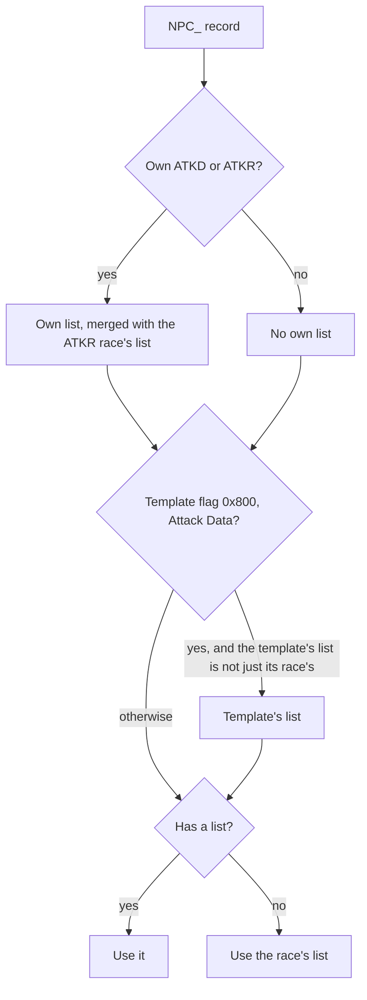
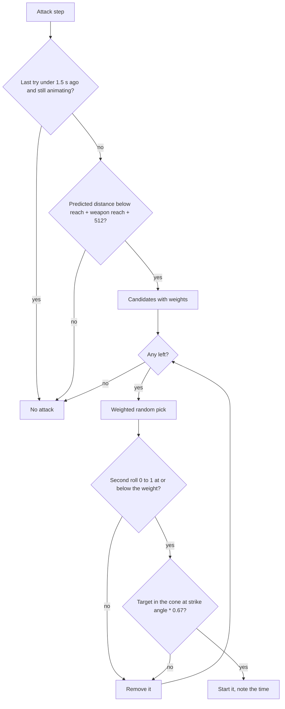

# Attack data

Each `ATKD` + `ATKE` pair on a `RACE` or an `NPC_` is one attack. `ATKE` is the animation event
that starts it, and `ATKD` holds 44 bytes of values. The event name is the key of the attack
list.

## Which list an actor uses



- The `ATKR` merge: an own attack whose event the attack race lacks is removed. When the two
  lists still differ in length, each attack-race entry the own list lacks is added. An added
  entry is shared with the attack race, not copied. When both have an event, the own entry wins.
  An NPC with only `ATKR` gets the whole attack-race list.
- The race fallback checks whether a list exists, not whether it is empty. An NPC whose own list
  is empty keeps the empty list.
- With the Traits template flag (0x1), the race comes from the template. An NPC that used its
  old race's list moves to the new race's list.
- A race change at run time moves a list that came from the old race to the new race's list. A
  new race with `DATA` flag 0x4000000 or 0x8000000 skips this step.
- At run time the game reads the list of the reference's base `NPC_`.

## Values

| Value | Default | What it changes |
| --- | --- | --- |
| Damage multiplier | 1 | The skill-scaled weapon damage ([melee damage](/engine/melee-damage.md#skill-sneak-attacks-and-armour)) |
| Attack chance | 1 | The attack's weight in the AI's random pick |
| Spell | none | Cast on the target with the hit |
| Flags | 0 | See below |
| Attack angle | 0 | Degrees added to the attacker's heading before the hit cone test |
| Strike angle | `fCombatHitConeAngle` (35) | Half-angle of the hit cone, in degrees |
| Stagger | 0 | A factor of the stagger the hit gives |
| Attack type | none | A keyword a condition function compares with the attack under way |
| Knockdown | 0 | Above 0, the hit pushes the target away with this force |
| Recovery time | 0 | Seconds before the AI picks this attack again |
| Stamina multiplier | 1 | The stamina cost of the attack |

Flags:

| Bit | Effect |
| --- | --- |
| `0x1` | Ignore weapon. No reader is known |
| `0x2` | Bash: pays the bash stamina cost. The general attack pick leaves it out |
| `0x4` | Power attack: pays the power attack cost, marks the hit as a power attack, applies the power attack damage entry point, and is the only kind picked in power-only mode |
| `0x8` | Left hand: the general attack pick leaves it out |
| `0x10` | Rotating: the hit test does not add the attack angle |
| `0x80000000` | Override data. No reader is known |

## The hit cone

A target is inside an attack's cone when
`|heading + attackAngle - directionToTarget| <= strikeAngle * mult`, with the difference wrapped
to plus or minus 180 degrees.

| Use | `mult` |
| --- | --- |
| The hit test | 1 |
| The AI's attack pick | `fCombatAttackStrikeAngleMult` (0.67) |
| An attack while moving | `fCombatAttackMovingStrikeAngleMult` (1.5) |
| A defender deciding to block | `fCombatBlockAttackStrikeAngleMult` (1.25) |
| A dead target | The use's value times `fCombatDeadActorHitConeMult` (2) |

Example: a 35 degree strike angle hits a living target up to 35 degrees off the heading. The AI
starts that attack only within `35 * 0.67`, about 23 degrees.

## The AI's pick



An attack is a candidate only when all of these hold:

- the actor's current behaviour graph has timing data for its `ATKE` event;
- its recovery time has passed since it last started;
- the attacker's Stamina is above 0, or the attack costs no stamina.

Its weight starts at the attack chance. Against a staggered target it is multiplied by the
attacker's [combat style](/formats/combat-style.md) `CSME` power attack staggered value for a
power attack, else by attack staggered. Otherwise, a power attack against a blocking target,
with the attacker inside the target's hit cone (`fCombatHitConeAngle`, 35 degrees), is multiplied
by power attack blocking. A weight of 0 or less drops out.

The second roll makes a weight below 1 a plain chance as well. Example: two attacks, weights 1
and 0.5. The second is drawn a third of the time, then passes its own roll half of those times.

The general attack pick leaves out bash (`0x2`) and left-hand (`0x8`) attacks, and can be held to
power attacks only. With no target, every weight there is 10.

## Stamina

| Attack | Cost |
| --- | --- |
| Normal | 0 |
| Bash | `fStaminaBashBase` (35) times the stamina multiplier |
| Power bash | `fStaminaPowerBashBase` (55) times the stamina multiplier |
| Power attack | `(weight * fStaminaAttackWeaponMult + fStaminaAttackWeaponBase) * fPowerAttackStaminaPenalty`, then the power attack stamina entry point, then times the stamina multiplier |

`weight` is the weapon's weight, or 1 unarmed. The entry point uses the right-hand weapon.
Example: a power attack with a 10-weight sword costs `(10 * 1 + 20) * 2 = 60` before perks.

## Stagger

```text
stagger = (attacker AV 9 * fStaggerAttackMult + fStaggerAttackBase)
          / (target Mass * fStaggerMassMult + fStaggerMassBase)
          * conditions * weapon * ATKD stagger
```

`fStaggerAttackMult` is 0.01, `fStaggerAttackBase` 0.5, `fStaggerMassMult` 1, and
`fStaggerMassBase` 0. Mass is actor value 36. The conditions multiply when they hold: a
recoiling target by `fStaggerRecoilingMult` (1.5), a running target by `fStaggerRunningMult`
(1.5), and a blocking target by `fStaggerBlockingMult` (0 in `Skyrim.esm`). The weapon factor is
`fStaggerShieldMult` (1) with a shield, `fStagger2WeapMult` (0.5) for a two-handed weapon, bow, or
crossbow, and `fStagger1WeapMult` (0.2) otherwise. The result is at least `fStaggerMin` (0).

## Knockdown

A knockdown above 0 pushes the target away from the attacker with that force, the same push an
explosion's knockdown uses ([explosions](/engine/explosions.md)).
