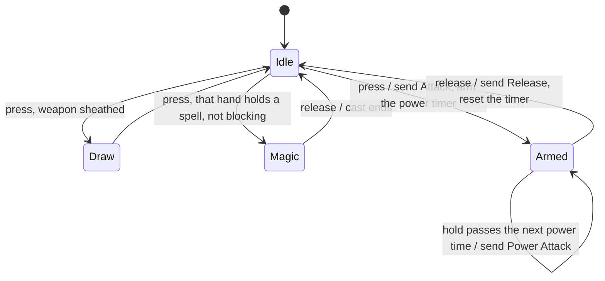

# Attack input

The player has one attack button per hand. The game sends an action to the player's behaviour
graph for each press, hold, and release. Pressing both buttons at almost the same time makes one
dual press.

OpenSky builds the melee part for a weapon in the left hand
([melee combat](melee-combat.md#the-left-hand)). The left punch, the repeated power
attacks of a long hold, and the wait for both buttons after a dual press are not built.

## The actions

| Action | `DOBJ` code |
| --- | --- |
| Left Attack | `AALA` |
| Left Release | `AALR` |
| Right Attack | `AARA` |
| Right Release | `AARR` |
| Dual Attack | `AADA` |
| Dual Release | `AADL` |
| Left Power Attack | `ALPA` |
| Right Power Attack | `AAPA` |
| Dual Power Attack | `ADPA` |

The Ready and Interrupt actions are not sent by the buttons.

## Merging two presses

The game merges the two buttons only when one of these holds:

- a spell is readied, which dual casting needs;
- both hands hold nothing, fists, or melee weapons;
- the dual press is already active.

So a bow, a crossbow, a staff, a shield, or a torch in either hand stops the merge, unless a spell
is readied.

When it merges, the first press waits. If the other button comes within 0.05 seconds, both become
one dual press, and its hold time counts from the first press. Otherwise, after 0.05 seconds or on
release, the single press goes on. After a dual press, all attack input waits until the other
button is released too.

## Each button

- Right button: with a spell in the right hand and no block, it casts, charges while held, and
  releases. Else it sends Right Attack. While blocking, the same press is a bash, and a held bash
  is a power bash.
- Left button: the same, with Left Attack. While blocking, it arms no power timer. A shield, a torch,
  or an empty left hand takes the same path. The action data and the idle tree then decide whether
  Left Attack is a swing, a punch, or nothing.
- Dual press: with spells in both hands, it starts a dual cast, or draws first. Else it sends Dual
  Attack and arms the power timer. The melee dual press does not check for a sheathed weapon.

With the weapon sheathed, a press of either button only draws, as Ready Weapon does: the same draw,
with the same clip and sounds. It sends no attack and arms no power timer. A press while the draw
runs is dropped too, and holding the button through the draw starts nothing: the player presses again
once the weapon is out. Ready Weapon toggles between drawn and sheathed, but an attack button only
ever draws. A draw that does not finish within 3 seconds is given up. A dead, dying, or bleeding-out
player, a menu that pauses the game, and a script lock on the player's controls all stop the press
before this check.

The rule holds for a bow and a crossbow too: the first press draws the weapon, and the next press
draws the string. With a bow or crossbow out, the attack button belongs to archery alone. It starts
no melee swing and no power attack.

Hand items, as `GetEquippedItemType` numbers them: −1 nothing, 0 fists, 1 to 6 melee weapons, 7
bow, 8 staff, 9 spell, 10 shield, 11 torch, 12 crossbow.

## Power attacks

The first power attack fires when the hold passes 0.3 seconds. Each next one fires 2 seconds after
the one before. So a held button sends power attacks at about 0.3, 2.3, and 4.3 seconds. The timer
sends the Left, Right, or Dual Power Attack for the hand it was armed for. Release resets it.

## Kill moves

No kill move rule depends on the hand. Each hand's attack runs the idle tree under its own
action: `ActionLeftAttack`, `ActionLeftPowerAttack`, `ActionDualAttack`, and
`ActionDualPowerAttack` beside the two right-hand ones. The kill moves for each hand are idle data in
`Skyrim.esm`, such as the `KillMoveDualWieldA` idle ([paired animations](paired-animations.md#kill-moves)).
