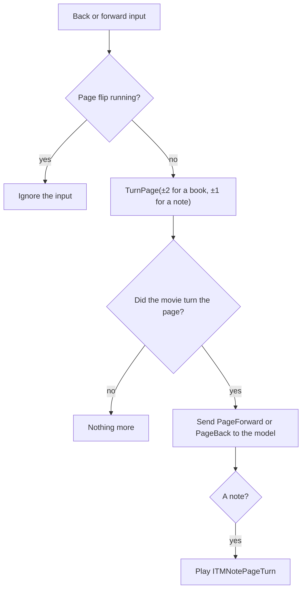

# Books

Using a book or a note in the inventory closes the inventory and opens the book menu on its
text. Activating a book that lies in the world opens it too, without picking it up. The text
is the `BOOK` record's `DESC`, from the `.dlstrings` table
([localized strings](../formats/strings.md)). A record with the note flag opens as a note.

## Reading

Reading takes effect when the book opens, as in the game:

- A skill book raises its skill once ([skill books](skill-advancement.md)).
- A spell tome teaches its spell ([spellcasting](spellcasting.md)).

## The movie

`Interface\book.swf` lays the text out on pages itself. `BookMenu.onLoad` registers three
callbacks:

| Call | What it does |
| --- | --- |
| `SetBookText(text, isNote)` | Loads the text, with the game's HTML tags |
| `TurnPage(delta)` | Turns the pages. OpenSky sends 2 for a book and 1 for a note |
| `PrepForClose` | Lets the movie end its page animation |

Left and right arrows turn the pages, and Escape closes the book.

## The button bar

`Interface\bookmenu.swf` is the bar under the pages, drawn as the
[overlay movie](../rendering/swf-layer.md#overlay-movie). Its frame script calls
`BottomBar.InitExtensions`, which registers one callback, measured on the install:

| Call | What it does |
| --- | --- |
| `InitExtensions(platform, swapPS3)` | A root function: sets the button art |
| `ShowTakeButton(show, steal)` | Shows the take button, labelled `$Take`, or `$Steal` when `steal` is true |

For a book in the inventory the take button is hidden. For a book read where it lies it shows,
and Enter or E takes the book and closes the menu. Taking a book that someone owns is theft, by the
same rule as taking any item ([crime](crime.md)).

## The 3D book

In the game the book is a 3D model with the movie drawn on its pages.

### The model

The model is the `STAT` that the `BOOK` record's `INAM` (inventory art) names. A book without
`INAM` uses `Meshes\Clutter\Books\Book01\Character Assets\Book01.nif`. The model decides book or
note: when any of the nodes `Base Page1` to `Base Page4` is missing, the menu runs as a note. The
`BOOK` `DATA` type byte plays no part. In vanilla data, notes name statics such as
`Clutter\Books\Note01\Note01.nif`, and books name models under `Clutter\Books\Book01` and
`Book02`.

A note turns 1 page per step instead of 2, sits at the note distance, also takes up and down, and
plays `ITMNotePageTurn` on each turn.

### The pages

The page movie is `Book`, a second movie beside the menu's own `BookMenu`. The engine makes four
square render targets, one per page node, each as wide and high as the screen is high in pixels,
in 8-bit RGBA. Page node `Base Page<i+1>` shows target `i` as its colour texture. For each page
`i` from 0 to 3 the engine:

1. fills the target with the texture already on `Base Page1`, the blank paper;
2. calls `BookMenu.BookMenuInstance.ShowPageAtOffset(i)` on the movie;
3. draws the whole movie stage into one rectangle of the target.

The rectangle is the UV range of the node `PageText`, clamped to 0 to 1, times the target size.
Without a `PageText` node with UVs, the rectangle is the whole target.

The movie splits the text into pages and keeps the first and last page; the engine does not.

### Placement and lights

- The book sits on the view ray through 0.5 of the screen width and 0.445 of its height, at a
  distance of 110 for a book and 90 for a note, times the screen width over its height. It faces
  the camera, turned -25 degrees about the X axis, at scale 1. A book is centred on its bounds; a
  note is not.
- The book is placed in the world and fixed to the player camera. The camera holds still at its
  current place. The paused world keeps drawing behind the book, without a blur or darkening, and
  the HUD switches to its `BookMode`.
- Two lights of colour (0.98, 0.95, 0.83) and radius 400 light it: one at (100, -350, 100) with
  dimmer 1.75, one at (10, -75, 10) with dimmer 1.

### Animation

The engine plays no NIF controller sequence on the model. It sends behaviour graph events instead,
and the model's animation data sets how long each takes:

| Event | When |
| --- | --- |
| `Open` | The model is set up |
| `PageForward`, `PageBack` | `TurnPage` turned the page |
| `Close` | The menu closes, right after `PrepForClose` |

Page turns are ignored while the graph variable `bPageFlipping` is true.

The engine moves the book itself. 5 frames after the model loads, the book eases from where it
loaded to its place over 1 s, and on close it eases back over the same time. The ease is
`0.5 × (1 − cos(π t))`, with `t` from 0 to 1. Example: at a quarter of the time, `t = 0.25`, the
book has moved 0.146 of the way.

Back is `PrevPage`, `LeftEquip`, or left; forward is `NextPage`, `RightEquip`, or right. A note
also takes up for back and down for forward. Accept takes a book that lies in the world and closes
the menu; Cancel closes it. Neither works during a page flip. On close the engine calls
`PrepForClose`, then moves the book back over the same open time.

A skill book teaches once, when its skill is one of the 18. The gain is 1 level, changed by the
`Adjust Book Skill Points` perk entry point, rounded down, at least 1. A skill at 100 gains
nothing, but the book is still used up.

A spell tome read from the inventory teaches its spell without opening the book menu. A new spell
plays `UISpellLearned`, shows the spell-added notice, and uses up one tome. A known spell shows the
already-known notice, plays no sound, and keeps the tome. A tome read from a container is removed
only for a new spell. The first read of any book marks it read and counts it for the stats
([general stats](statistics.md)).

## Differences from the game

- The `BOOK` record has a "Can't Be Taken" flag. The
  [CK wiki](https://ck.uesp.net/wiki/Book) marks it "Does not work?", so OpenSky ignores it
  until a test in the game shows what it does.
- The game draws the book as a 3D model with the movie on its pages
  ([3D book](#the-3d-book)). OpenSky draws the movie flat.
