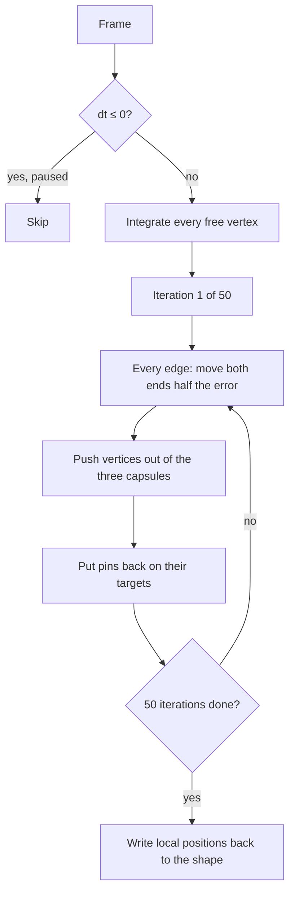

# Cape cloth

The Vampire Lord's cape is the one piece of cloth in the vanilla game. It is not driven by
bones. A simple Verlet solver moves its vertices each frame. Verlet integration keeps the
position of the last frame and moves each point by the difference, so the speed needs no
separate store.

## What starts it

The default object "Verlet Cape" (`DOBJ` code `AIVC`) names the armour. Dawnguard.esm sets it
to `ARMO` `DLC1VampireLordCape` (Dawnguard.esm:015BC1). Skyrim.esm and Update.esm leave it
empty, so without Dawnguard there is no cloth.

The player's vampire change script does not put this armour on. It takes off everything, sets
the race, and equips `DLC1ClothesVampireLordArmor` (Dawnguard.esm:011A84), whose only model is
`VampireLordArmor.nif`, the dark cloth that hangs down the back. Observed in the reference game on
2026-11-16 by running those steps from the console: the body shows that cloth and no red cape.
`player.equipitem` with the cape armour adds a long red cape over the back.

When that armour's model is attached to an actor's third-person body, the cloth starts on
the object named `VampLordCapeMesh`. The name is matched without case. If the object is a
node, the first triangle shape below it is used. In
`meshes\actors\vampirelord\character assets\vampirecape.nif` it is a `BSTriShape` with 70
vertices and 108 triangles.

## Setup

- **Pins.** The 12 vertices with the highest local z are pinned. These are the top edge at
  the shoulders. Each frame a pin is put back at its rest position times the shape's world
  transform, so the pins follow the body.
- **Edges.** Each triangle adds its three edges. An edge shared by two triangles is added
  twice. The rest length of an edge is its world length at setup.
- **Start.** Each vertex starts at its world position, and its last position is the same, so
  it starts at rest.

## Each frame



The step `h` is fixed at 0.033 s, whatever the frame time. One step runs per drawn frame.
The integration is:

```text
x_new = x + (x - x_prev) * (h / h_prev)
x_new.z = x_new.z - 1500 * h * h
```

Gravity is 1500 units per second squared, down world z: 1.6335 units per step. There is no
damping, no wind, no force from the actor's motion, and no speed limit. With a fixed step,
`h / h_prev` is 1.

The edge rule: for an edge of rest length `L` and current length `d`, each end moves by
`(d - L) / 2` toward the other. Edges run in list order, and each move is seen by the next
edge. Example: an edge of rest length 10 stretched to 12 moves each end 1 unit inward.

## Collision

Each iteration pushes a vertex that is inside a capsule out to the capsule's surface, along
the line from the nearest point on the capsule's segment. There are three capsules.

| Capsule | Segment | Radius |
| --- | --- | --- |
| Body | Vertical, from the actor's position plus `r` to the position plus `height - r + 50` | The character controller radius, or `max(0.5 * scale * the larger horizontal bounds extent, 16)` |
| Left calf | The physics capsule of `NPC L Calf [LClf]`, end points times 69.99125 | The shape radius times 69.99125 times 2 |
| Right calf | The same on `NPC R Calf [RClf]` | The same |

69.99125 is the Havok-to-game scale: one Havok metre is about 70 game units.

`height` is the actor's bounds z extent times its scale. The radius is set once, at setup.
The end points follow the actor after each animation update. A calf without a capsule shape
gets no capsule. There is no ground plane.

Worked example for the body capsule: a controller radius of 30 and a height of 200 give a
segment from 30 to 200 - 30 + 50 = 220 units above the actor's position.

A vertex closer than 0.000001 to the segment is put on the segment. Only the current position
moves, not the last one.

## Space and write-back

The solver runs in world space. At the end of the frame it writes each vertex back in the
shape's local space. Normals are not changed.

## Lifetime

The cloth is never reset while it lives: not on load, on a teleport, or after a long move.
Every cloth steps every frame, with no distance or visibility check. It is removed when the
actor's 3D is unloaded, and a new one starts from the rest pose the next time the armour is
attached.
