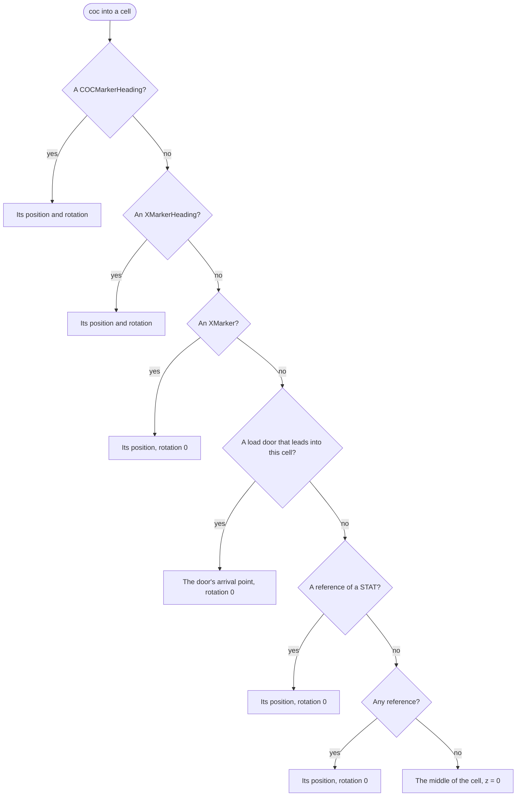

# Centre on cell

The console command `coc <cell>` (CenterOnCell) moves the player into a cell. OpenSky's
`openskycli game debug teleport --cell` and `--x --y` use the same rule.

## Which reference the player lands on

The game looks at every reference the cell has loaded, persistent and temporary alike. It skips
deleted references, and it does not skip disabled ones. In an exterior cell a reference counts
only when its position lies inside the cell's 4096 x 4096 square. In an interior every
reference counts.

The markers are the `STAT` records `COCMarkerHeading` (`0x32`), `XMarkerHeading` (`0x34`), and
`XMarker` (`0x3B`). With no reference at all, an interior puts the player at (2048, 2048, 0),
and an exterior at its south-west corner plus (2048, 2048), with z = 0. In an exterior the
height then rises to the land or the water, whichever is higher, when that is above the chosen
height.

When a cell has several references of one kind, the game takes the first one it meets. It meets
them in the order of a hash table keyed by where each reference sits in memory. That order
changes from one run to the next, so no rule over FormIDs, the plugin's order, or positions
gives the game's choice. The CK wiki's "most recently placed"
([CenterOnCell](https://ck.uesp.net/wiki/CenterOnCell)) does not hold.

OpenSky takes the reference with the highest FormID among those of the winning kind. It is a
fixed choice that does not change between runs.

## Checked in the reference game

On 2026-11-15 the reference game ran `coc` into twelve interiors without a `COCMarkerHeading`
(`.logs/coc-probe/`, local only). Every cell with an `XMarkerHeading` put the player on one, and
the two cells with only `XMarker` references put the player on an `XMarker`:

| Cell | Kind | Game's reference | Highest FormID |
| --- | --- | --- | --- |
| `WhiterunBanneredMare` | `XMarkerHeading` | `0010C076` | `0010C076` |
| `MorthalHighmoonHall` | `XMarkerHeading` | `0300521C` | `0300521C` |
| `FalkreathJarlsLonghouse` | `XMarkerHeading` | `03005217` | `03005217` |
| `WinterholdJarlsLonghouse` | `XMarkerHeading` | `000FCEE4` | `000FCEE4` |
| `IvarsteadFellstarFarm` | `XMarkerHeading` | `0002124B` | `0002124B` |
| `SolitudeFletcher` | `XMarkerHeading` | `0008CA3B` | `0008CA3B` |
| `IvarsteadVilemyrInn` | `XMarkerHeading` | `00021241` | `00064624` |
| `WinterholdCollegeHallofAttainment` | `XMarkerHeading` | `00020032` | `00020310` |
| `WinterholdCollegeArcanaeum` | `XMarkerHeading` | `0002726D` | `0201AA2C` |
| `SolitudeBardsCollege` | `XMarkerHeading` | `0006F1B1` | `0010DEB3` |
| `WindhelmCalixtosHouseofCuriosities` | `XMarker` | `00105A4C` | `00105A59` |
| `MarkarthShrineofTalos` | `XMarker` | `000871D6` | `000871EE` |

The kind matches in all twelve cells, and the reference in seven.
