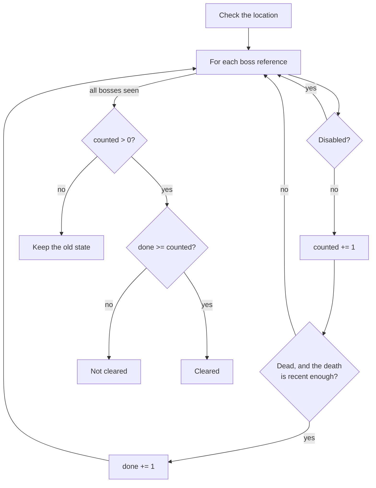
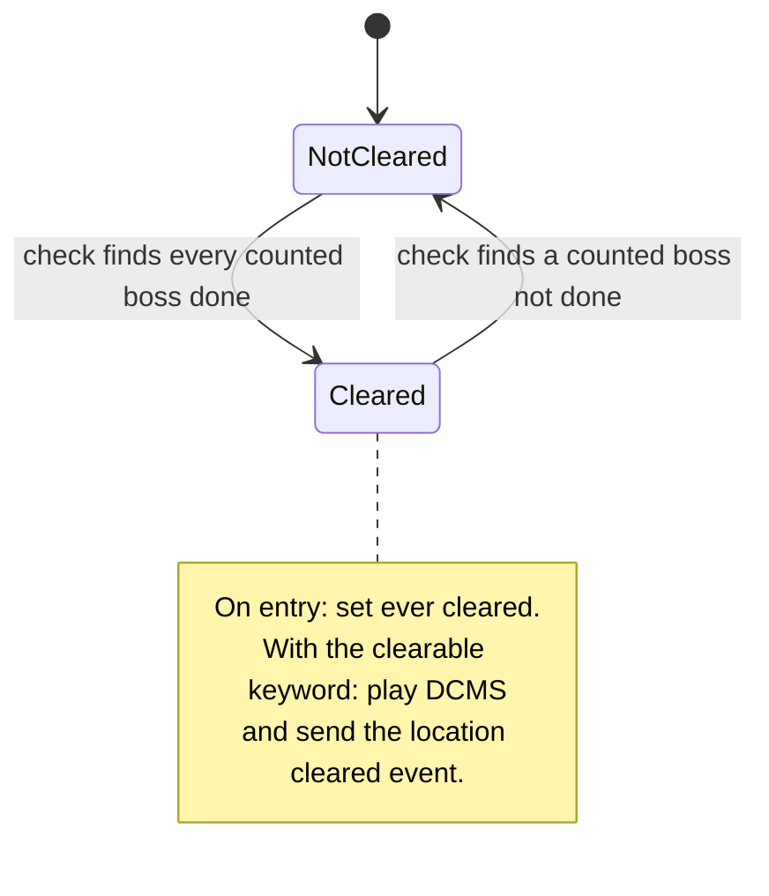

# Cleared locations

A location is cleared when every boss in it is dead. A cleared location plays the dungeon cleared
music once, counts toward the "Dungeons Cleared" statistic, and respawns more slowly
([cell reset](cell-reset.md)).

## The boss record

The game keeps a saved record for each reference: a dead flag, a disabled flag, and a time stamp
in game hours.

- A death sets the dead flag and the stamp. A resurrect or a reset clears the dead flag.
- `Disable` and `Enable` set and clear the disabled flag. A reference with an enable parent uses
  the parent's state instead.

The bosses of a location are its special references with the location ref type Boss (`DOBJ`
`LRTB`).

## Checking a location

A location is checked again when it is asked about with a new hour stamp, or when a check is
forced. A forced check, without a stamp, runs when an actor dies or is resurrected in the player's
current location while that location is not cleared.

For each boss:

1. A disabled boss is left out. It counts neither as done nor as blocking.
2. Any other boss is counted. It is done when its dead flag is set.
3. When the check has a stamp, the death must also be no older than 240 game hours, or 720 when
   the location is already cleared. A death stamp of "never" does not expire.

If at least one boss was counted, the location is cleared when every counted boss is done. With
no counted boss, the state stays as it was. A deleted boss has no special rule: it counts as alive
unless it is also disabled.

Example: a cave has two bosses. One is dead and one was disabled by a quest. The disabled one is
left out, so one of one counted bosses is done, and the cave turns cleared.

## Turning cleared

When the state goes from not cleared to cleared:

- If the location has the clearable keyword (`DOBJ` `KWDO`), the game plays the dungeon cleared
  music (`DCMS`, [music](music.md#special-music)) and sends the location cleared event.
  That event counts toward "Dungeons Cleared".
- In every case, the "ever cleared" flag is set.

## Scripts

Papyrus `Location.SetCleared(true)` sets the cleared flag and the ever cleared flag. `false` clears
the cleared flag. A script clear plays no music, sends no event, and does not check the keyword.

## Where OpenSky differs

- OpenSky counts a boss as done only when it dies. The game leaves a disabled boss out of the
  count.
- A location cleared by a script plays the cleared music in OpenSky. In the game it does not.
