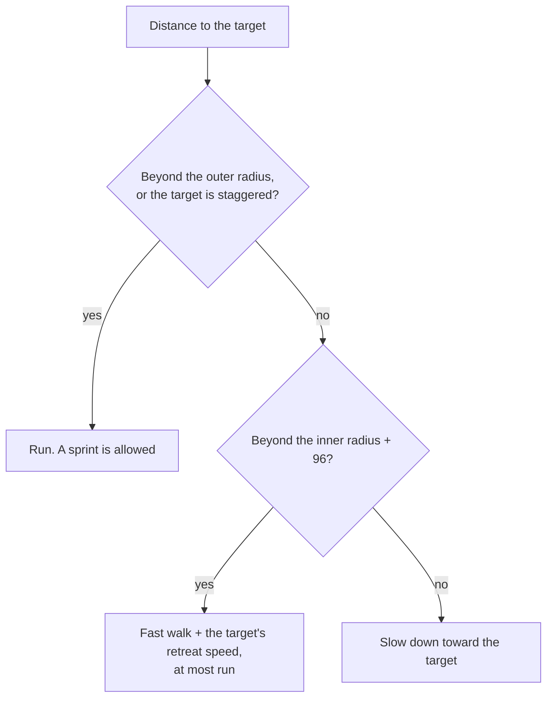

# Combat approach

A fighter that walks toward its target changes its speed with the distance. Far away it runs.
Near the target it slows down, so it does not run past. The game works this out from two advance
radii and three distance bands.

Behaviour described from a clean-room read of the game program (1.6.1170) on 2026-11-22. The
values are the ones that apply in play: `Skyrim.esm` where it overrides the program's default.

## Advance radii

The game works out an inner and an outer advance radius for each fighter.

1. x = D − O.
   - D is the Defensive Mult of the [combat style](/engine/combat-behavior.md#combat-style).
     Against a staggered target D is multiplied by `fCombatAdvanceRadiusStaggerMult`, which is
     0. So every fighter is fully offensive against a staggered target.
   - O is the style's Offensive Mult. When the style's Group Offensive Mult is below 1 and the
     group has n members, n above 1, O is multiplied by the larger of GroupOffensive^(n − 1)
     and `fCombatGroupOffensiveMultMin`, 0.1. Which group is counted was not confirmed; most
     likely the actors that fight the same target.
2. Each radius is a blend over x: x = −1 gives `Min`, x = 0 gives `Mid`, and x = 1 gives `Max`.
   The blend is a straight line on each side of 0.
3. When x is above 0, both radii fall back to `Mid` in two cases: the fighter was last damaged
   more than `fCombatAdvanceLastDamagedThreshold`, 10 seconds, ago; or the fighter's reach and
   the reach of the target's weapon differ by more than the inner radius.
4. The fighter's own reach is added to both radii.

| Setting | Min | Mid | Max |
| --- | --- | --- | --- |
| `fCombatAdvanceInnerRadius...` | 0 | 0 | 256 |
| `fCombatAdvanceOuterRadius...` | 128 | 256 | 512 |

For example, a skeever's style has Offensive Mult 1 and Defensive Mult 0, so x = −1. Its inner
radius is its reach, and its outer radius is 128 units plus its reach.

## Speed

The game uses four speed levels. Walk is 1, fast walk 1.33, jog 1.66, and run 2. On this scale
1 is the actor's walk speed and 2 its run speed, with a straight line between them. The values
are built into the program.

The approach works out its speed again every `fCombatApproachTargetUpdateTime`, 0.25 seconds,
and every `fCombatApproachTargetSlowdownUpdateTime`, 0.05 seconds, while it slows down. The
distance it uses is the larger of the straight distance and the path length that is left.

- The retreat speed is the target's speed straight away from the fighter.
- In the middle band, a sprint is allowed when the sum reaches the run limit.
- The slow band starts at the inner radius plus `fCombatApproachTargetSlowdownDistance`, 96
  units. Inside it the speed is a blend by distance: half the base at distance 0, the base at
  the inner radius, and the middle band's speed at the band's edge.
- The base is the larger of walk and the target's retreat speed, when the fighter moves within
  `fCombatApproachTargetSlowdownVelocityAngle`, 135 degrees, of the direction to the target.
  Otherwise the base is fast walk.
- In the slow band the fighter brakes harder: its deceleration is multiplied by
  `fCombatApproachTargetSlowdownDecelerationMult`, 10, not by `fCombatPathingDecelerationMult`,
  2. Outside it the race's acceleration, deceleration, and angular acceleration are multiplied
  by `fCombatPathingAccelerationMult`, `fCombatPathingDecelerationMult`, and
  `fCombatPathingRotationAccelerationMult`, 2 each, and the turn speed is at least
  `fCombatPathingNormalizedRotationSpeed`, 2.25 ([RACE DATA](/formats/actors.md#race-data-in-the-game)).
  How fighters circle, fall back, flank, and strafe comes from their
  [combat style](/formats/combat-style.md#what-the-values-change).

## Sprint

A fighter sprints when all of these hold:

- the band allows a sprint;
- the INI setting `bCombatPathSprinting` in the `Combat` section is on, which is the default;
- the distance is above the fighter's reach plus a stop range.

The stop range is `fCombatApproachTargetSprintStopRange`, 768 units. For a target that moves
away from the fighter it is `fCombatApproachTargetSprintStopMovingRange`, 0.

No step of the rule tells a creature from an NPC. So a skeever follows it with the walk and
run speeds of its own race. Whether a race without sprint data can sprint was not checked.

## In OpenSky

A fighter that approaches its target takes its pace from the bands above:

- Both radii follow steps 1, 2, and 4, without the stagger and group factors.
- Beyond the outer radius it runs. In the middle band it moves at 1.33 times its walk speed.
  In the slow band it blends down to its walk speed at the inner radius.
- A new pace reaches a walk that already runs to the same place; the walk does not start over.
- For example, a skeever 300 units from a standing player runs until 128 units plus its
  reach, and then moves at 1.33 times its walk speed.

`openskycli game state packages <ref>` shows the mover's gait under `mover`.

- [WARNING] Not built: the target's retreat speed, the stagger and group factors, the fall
  back to `Mid` in step 3, the half speed inside the inner radius, the sprint, and the harder
  braking. The pace is worked out at each combat command, not on the two timers.
