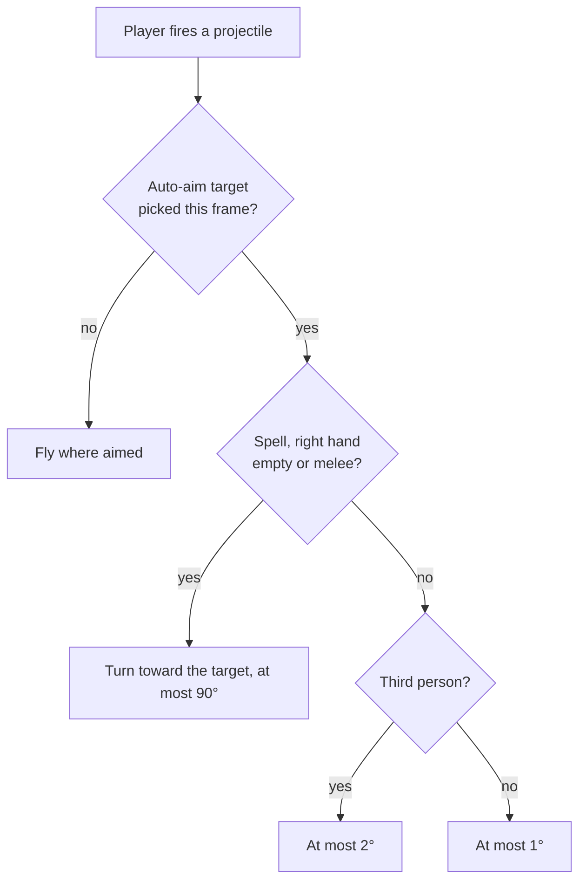

# Combat assist

The game gives the player's aim a small push toward a target, but only for projectiles. Melee
swings get no help. NPCs keep facing their target while they attack.

OpenSky builds the three rules; [in OpenSky](#in-opensky) says how and what it leaves out.

All values below are the ones that apply in play. Where `Skyrim.esm` overrides the program's
built-in default, the page gives the plugin value.

## Melee: no magnetism

The player's swings do not turn or slide the player toward a target. This holds for normal, power,
and sprint attacks, in first and third person. No such rule was found in the program.

## NPC attack tracking

When an NPC's combat logic starts a melee attack, the NPC keeps facing its target until the attack
ends.

- The track band runs from the attack's reach + 128 units to its reach + 512 units. A bash uses the
  bash reach, 141 units.
- The aim is refreshed every 0.25 seconds. It is refreshed every 0.1 seconds while the target is
  inside the band and is the high-priority target, which in practice is the player.
- The tracker runs at priority 3.
- The turn most likely uses the general actor turn speed of 2π radians a second. The attack also
  reads a rate from an animation graph variable. No separate turn speed, and no point in the
  attack where the tracking stops, was found.
- The NPC does not slide toward the target.

## Projectile auto-aim

Every projectile the player fires turns a little toward one chosen target. No check for a gamepad
was found, so this most likely applies to the mouse too.

### Picking the target

The game picks one target each frame. It needs the player to have 3D, a drawn weapon, and no state
that blocks it. A candidate is an actor in the high process level that:

- is not dead, has 3D, and is not the player's mount;
- is within 1800 units;
- has the centre and the top of its bounds both inside a screen window around the crosshair. The
  window's half-width is 6 × 0.005 of the screen;
- most likely is hostile, and is in combat.

From the candidates, the game takes the one closest to the crosshair, by the sum of its screen
offsets. A game option takes the nearest one instead, but it is off. Nothing keeps a target: it is
picked again every frame, so it drops as soon as it leaves the window, the range, or stops being
alive and hostile.

### Turning the projectile

When the projectile is launched, its direction turns toward the target by at most:

| Case | Largest turn |
| --- | --- |
| A spell, with the right hand empty or holding a melee weapon | 90° |
| Third-person camera | 2° |
| First-person camera | 1° |

Example: in first person, an arrow aimed 3° to the left of a deer in the window leaves 2° to the
left of it.

## Flying-mount lock

While the player rides a mount whose race flies, as on a dragon, the Jump button locks a target.
By default each press flips the lock. With the toggle option off, the lock holds while the button
is held. Candidates are gathered within 7500 units on the ground plane.

While locked, each frame the game steers the mount:

- strafe term = the player's speed × the strafe input / 350;
- target term, only for a moving actor: the angle between the target's direction of travel and the
  player's heading, folded into −90° to 90°, × the target's speed / 350 × −2/π;
- f = 1 − distance / 750. While f is above 0, the heading changes by (target term − strafe term)
  × the strafe-heading factor × the frame time × f;
- the look input turns the heading and pitch, each scaled by its own factor.

| Target | Strafe-heading factor | Heading factor | Look factor |
| --- | --- | --- | --- |
| An actor | 0.5 | 1 | 10 |
| An object | 0 | 0.5 | 0.5 |

The steering stops while the target is gone or dead, all inputs are zero, the target is the
player's own mount, or the weapon is sheathed and the target is an actor.

## In OpenSky

- An NPC that starts a melee attack turns to its aim each step until the attack's follow-through
  ends. The aim is the target's place at the last refresh, on the game's two timers. Outside the
  band the 0.25 second timer is used.
- A player shot picks its target when it is fired, from the hostile living actors in combat
  without the player's mount, and turns by the largest angle of the table. The window is
  0.03 of the screen width to each side and 0.03 of its height up and down.
- The lock on a ridden dragon turns the rider's view by the heading change of the rule, with the
  factors of a locked actor.

`openskycli game state assist` shows each attacker's `attackTracks` entry with its `aim` and the
count of `refreshes`, and `autoAim`, the target the last player shot turned toward.
`state mount` shows `lockSteer`, the heading change of the last step in radians.

- [WARNING] The lock has no hold-to-lock option, no look factors, no locked objects, and no stop
  for a sheathed weapon. The lock does not turn the dragon: its flight follows its orders
  ([dragon flight](/engine/dragon-flight.md#riding)).
- [INFO] The NPC turn uses the actor's own turn step, not a rate from the graph.
