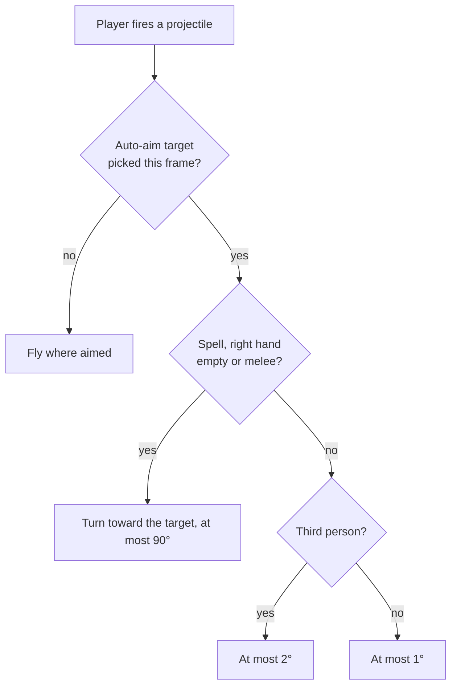

# Combat assist

The game gives the player's aim a small push toward a target: a turn toward the object under the
crosshair on foot, and a soft auto-aim for projectiles. NPCs keep facing their target while they
attack.

OpenSky builds the other three rules; [in OpenSky](#in-opensky) says how and what it leaves out.

All values below are the ones that apply in play. Where `Skyrim.esm` overrides the program's
built-in default, the page gives the plugin value.

## Melee magnetism

Read from the game program. While the player is on foot, a rule turns the player toward the
object under the crosshair. It does not run while the player rides. The target can be an actor
or another object. Each frame:

- strafe term = the player's speed × the strafe input / `fMagnetismStrafeBaseSpeed`;
- target term, only for a moving actor: the angle between the target's direction of travel and the
  player's heading, folded into −90° to 90°, × the target's speed / the same base speed × −2/π;
- f = 1 − distance / `fMagnetismStrafeMaxDistance`. While f is above 0, the heading changes by
  (target term − strafe term) × the strafe-heading factor × the frame time × f;
- the look input is scaled by the turning speed in radians per second / π and by the frame time.
  Its horizontal part turns the heading, times the heading factor. Its vertical part turns the
  pitch, times the look factor.

The values are INI settings of the section `Combat`:

| Setting | Value |
| --- | --- |
| `fMagnetismStrafeMaxDistance` | 750 |
| `fMagnetismStrafeBaseSpeed` | 350 |
| `fMagnetismStrafeHeadingMult`, `fMagnetismObjStrafeHeadingMult` | 0.5 for an actor, 0 for an object |
| `fMagnetismHeadingMult`, `fMagnetismObjHeadingMult` | 1 for an actor, 0.5 for an object |
| `fMagnetismLookingMult`, `fMagnetismObjLookingMult` | 10 for an actor, 0.5 for an object |

The rule stops while the target is gone or dead, all inputs are zero, the target is the
player's own mount, or the weapon is sheathed and the target is an actor.

## NPC attack tracking

When an NPC's combat logic starts a melee attack, the NPC keeps facing its target until the attack
ends.

- The track band runs from the attack's reach + 128 units to its reach + 512 units. A bash uses the
  bash reach, 141 units.
- The aim is refreshed every 0.25 seconds. It is refreshed every 0.1 seconds while the target is
  inside the band and is the high-priority target, which in practice is the player.
- The tracker runs at priority 3.
- The turn most likely uses the general actor turn speed of 2π radians a second. The attack also
  reads a rate from an animation graph variable. No separate turn speed, and no point in the
  attack where the tracking stops, was found.
- The NPC does not slide toward the target.

## Projectile auto-aim

Every projectile the player fires turns a little toward one chosen target. No check for a gamepad
was found, so this most likely applies to the mouse too.

### Picking the target

The game picks one target each frame. It needs the player to have 3D, a drawn weapon, and no state
that blocks it. A candidate is an actor in the high process level that:

- is not dead, has 3D, and is not the player's mount;
- is within 1800 units;
- has the centre and the top of its bounds both inside a screen window around the crosshair. The
  window's half-width is 6 × 0.005 of the screen;
- most likely is hostile, and is in combat.

From the candidates, the game takes the one closest to the crosshair, by the sum of its screen
offsets. A game option takes the nearest one instead, but it is off. Nothing keeps a target: it is
picked again every frame, so it drops as soon as it leaves the window, the range, or stops being
alive and hostile.

### Turning the projectile

When the projectile is launched, its direction turns toward the target by at most:

| Case | Largest turn |
| --- | --- |
| A spell, with the right hand empty or holding a melee weapon | 90° |
| Third-person camera | 2° |
| First-person camera | 1° |

Example: in first person, an arrow aimed 3° to the left of a deer in the window leaves 2° to the
left of it.

## Flying-mount lock

While the player rides a mount whose race flies, as on a dragon, the Jump button locks a target.
By default each press flips the lock. With the INI setting `bTargetLockIsToggle` (section
`Gameplay`, default 1) off, the lock holds while the button is held.

- Candidates are actors only, within `fTargetLockXYRange` (section `Gameplay`, 7500 units) on
  the ground plane. The range is centred on the mount's combat target when it has one, else on
  the player. The mount is left out.
- The first candidate is locked. With no candidate there is no lock, and a notification says so.
- No way to lock an object was found.
- While locked, Sneak orders the mount to attack the target, and spells and shouts aim at it.
- The target is dropped when it is gone, dead, the mount, the player, not in an attached cell,
  or without AI process data. The lock then moves to the next stored candidate, and wraps
  around the list. With none left the lock is off. No range, line-of-sight, or time test ends it.
- The lock does not steer the player or the mount. The magnetism rule above does not run while
  riding.

## In OpenSky

- An NPC that starts a melee attack turns to its aim each step until the attack's follow-through
  ends. The aim is the target's place at the last refresh, on the game's two timers. Outside the
  band the 0.25 second timer is used.
- A player shot picks its target when it is fired, from the hostile living actors in combat
  without the player's mount, and turns by the largest angle of the table. The window is
  0.03 of the screen width to each side and 0.03 of its height up and down.
- The lock on a ridden dragon gathers the living actors in range when Jump is pressed, locks
  the first, and keeps the list. When the target drops, the lock moves to the next actor of the
  list that still lives, and wraps round. A press with no actor in range shows a notification.

`openskycli game state assist` shows each attacker's `attackTracks` entry with its `aim` and the
count of `refreshes`, and `autoAim`, the target the last player shot turned toward.
`state mount` shows `lockedTarget` and `lockCandidates`, the stored list in its order.

- The launcher's "Dragon target lock toggles" switch is the toggle option. With it off, a press
  of Jump locks the first actor in range, and the lock ends when Jump comes up. `state mount`
  shows it as `lockIsToggle`, and `debug setting world.flyingMountLockToggle=off` turns it off
  for a run.
- [WARNING] Melee magnetism is not built.
- [INFO] The order of the lock's candidates is OpenSky's: nearest to the centre of the range
  first. The game's order was not read.
- [INFO] A lock that moves to the next candidate ends the attack order, as Switch Target does.
  What the game does with the order was not read.
- [INFO] The text of the notification, "No target in range.", is OpenSky's. No game setting
  with this message was found in the plugins.
- [INFO] The NPC turn uses the actor's own turn step, not a rate from the graph.
