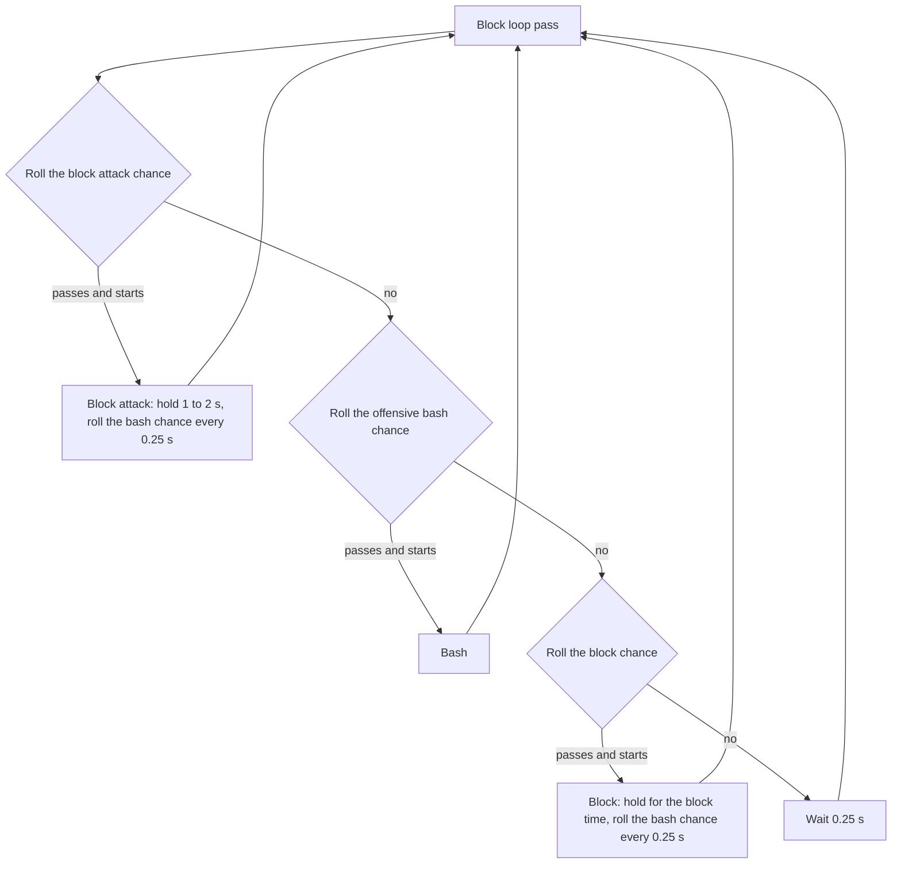

# Combat blocking and bashing

An NPC's combat AI runs several loops at the same time. Blocking and bashing are one of them.

## Loops that run together

The AI runs these at the same time, every frame:

- the movement loop ([close-range movement](/formats/combat-style.md#close-range-movement) and
  [the other movement branches](/engine/combat-movement.md));
- one action loop for each equipment slot.

The item in a slot picks that slot's loop: a weapon runs the attack loop, a shield runs the block
loop, and a spell, staff, scroll, potion, or shout runs its own loop. So an NPC with a sword and a
shield attacks with its right hand and blocks with its left hand at the same time, while it moves.
A blocking NPC keeps circling, backing off, and advancing as its movement loop decides.

Each hand has its own attack loop. A weapon in the left hand picks only attacks with the left-hand
flag `0x8` ([attack data](/engine/attack-data.md#the-ais-pick)). A weapon in any other slot picks
attacks with neither the bash nor the left-hand flag. So the AI does not alternate hands or roll
for a hand: each hand rolls its own attack chance about four times a second, and keeps its own
recovery times and its own time of its last attack.

- A hand's weapon speed divides the strike time of each of its attacks. That time only predicts
  where both actors stand at the strike, for the reach check. It does not change how often the
  loop rolls.
- There is no lock between the hands. Both loops may try to start an attack in the same step, and
  the behaviour graph decides.
- A started attack holds its loop until the actor's attack state is back to none or reaches the
  combo window. The actor has one attack state, so an attack in one hand also holds the other
  hand's loop while that loop waits on its own attack.
- A dual-wield attack has neither flag, so it is in the right hand's pool. The pick sends the
  attack's event to the behaviour graph. A graph that refuses it drops that attack, and the pick
  draws again. So a dual-wield attack starts only while the graph is in its dual-wield state.

An item in the left hand scores 0.01 less in the AI's equipment choice, so a one-handed weapon
goes to the right hand first. A melee weapon that only fits the right hand counts as fitting
either hand when the actor's race has `DATA` flag 0x40000000 and its combat style has `DATA` flag
0x04. Both flags are needed for a melee weapon. A staff, and a weapon picked for its enchantment
or spell, need only the race flag. The style flag changes only where a weapon can go, not which
attack is picked.

## The block loop

Each pass rolls every chance again, so a waiting NPC rolls about four times a second. The chances
are on the [combat style](/formats/combat-style.md#attack-and-bash-chances) page: the block chance
and the block attack chance are `lerp(defensive, 0, 1)`, and the block chance is multiplied by
`fCombatBlockChanceWeaponMult` (0.25) without a shield.

A block starts only when all of these hold:

- the item in the slot can block;
- the target is not blocking;
- the target fights in melee: it holds a melee weapon, or nothing (a bow does not count);
- the NPC stands inside the target's hit cone, at a multiplier of 1;
- the target does not move away from the NPC faster than 128 units a second;
- the distance predicted 0.5 s ahead is at most the block start distance.

The target does not need to be attacking.

| Distance | Value |
| --- | --- |
| Block start | `lerp(Df, 32, 192)` plus both actors' radii plus the target's weapon reach |
| Block stop | `lerp(Df, 128, 384)` plus both actors' radii plus the target's weapon reach |

`Df` is the style's defensive value. For some target states the game uses 0 instead.

A block lasts the block time: a three-point lerp of 4, 8, and 10,000 s at `x = 2 * Df - 1`
([three-point lerp](/formats/combat-style.md#the-general-block)). The block also wants to stop
when the distance is above the block stop distance, which is checked at most once a second. The
NPC lowers its guard only when both hold:

- it is not in the middle of a bash;
- the target is not attacking with the NPC inside 1.25 times the strike angle of the target's
  attack.

So a block never drops during a swing at the blocker. No stamina rule and no "was hit" rule ends
a block.

Example: `Df` 0.24 gives `x = -0.52` and a block time of `4 + (8 - 4) * 0.48 = 5.92` s. `Df` 0.75
gives about 5,004 s, so the block lasts until the distance rule ends it.

### Block attack

The block attack is a block raised against a swing that is winding up. It starts only when all of
these hold:

- the target's attack state is 1, the draw;
- the item in the slot can bash;
- the NPC stands inside 1.25 times the strike angle of the target's attack;
- the distance now, or predicted 0.5 s ahead, is below the per-fighter distance plus 1.5 times the
  target's weapon reach.

It holds the block for a random 1 to 2 s, and wants to stop when that time is over or the target is
staggered. The same rule as above lets it stop.

### Bashing from a block

While a block or a block attack holds, the NPC rolls the bash chance every 0.25 s. A bash that
starts runs to its end, and then the block goes on. So several bashes can come from one block. The
offensive bash starts a bash without a block, at most one for each pass of the loop.

## Bash

A bash starts only when all of these hold:

- the NPC's own attack state is none, and the NPC is able to bash;
- the item in the slot can bash;
- the bash pick finds an attack.

The bash pick is the [attack pick](/engine/attack-data.md#the-ais-pick) over the attacks with the
bash flag `0x2` and without the left-hand flag `0x8`. It uses the bash reach `fCombatBashReach`
(141) and the same weights and multipliers as a swing. So the choice between `bashStart` and
`bashPowerStart` is only this weighted roll. After the pick the target must be inside the attack's
strike angle times 0.67, within reach, and the behaviour graph must take the event. On a start the
NPC says the Bash combat topic. The bash lasts until the attack state is back to none.

Example: vanilla `NordRace` gives `bashStart` a chance of 0.5 and `bashPowerStart` 0.33. A bash
draws `bashStart` `0.5 / 0.83`, about 60 % of the time, before each attack's own roll.

## In OpenSky

An actor with a combat style runs the block loop and bashes as described above. These parts
differ:

- An actor without a combat style rolls its block chance once per gap between attacks, holds its
  guard for a fixed time, and never bashes. In the game such an actor uses the default style.
- A blocking NPC holds still. Its close-range moves wait until the guard drops.
- Bare hands neither block nor bash; they block only with a shield. A bow runs no block loop.
- The per-fighter distance in the block attack rule is taken as both actors' radii.
- A missing `CSME` bash value reads as 1.
- A bash plays the NPC's plain attack clip.
- Each hand does not run its own attack loop.

These values are OpenSky's ([unverified combat values](/engine/unverified-combat-values.md)).
`openskycli game state assist` lists each styled fighter's guard and bashes under `guards`.
