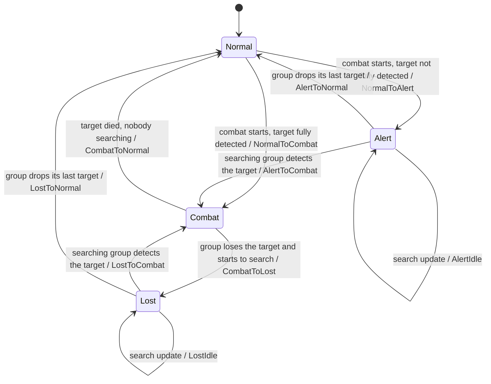
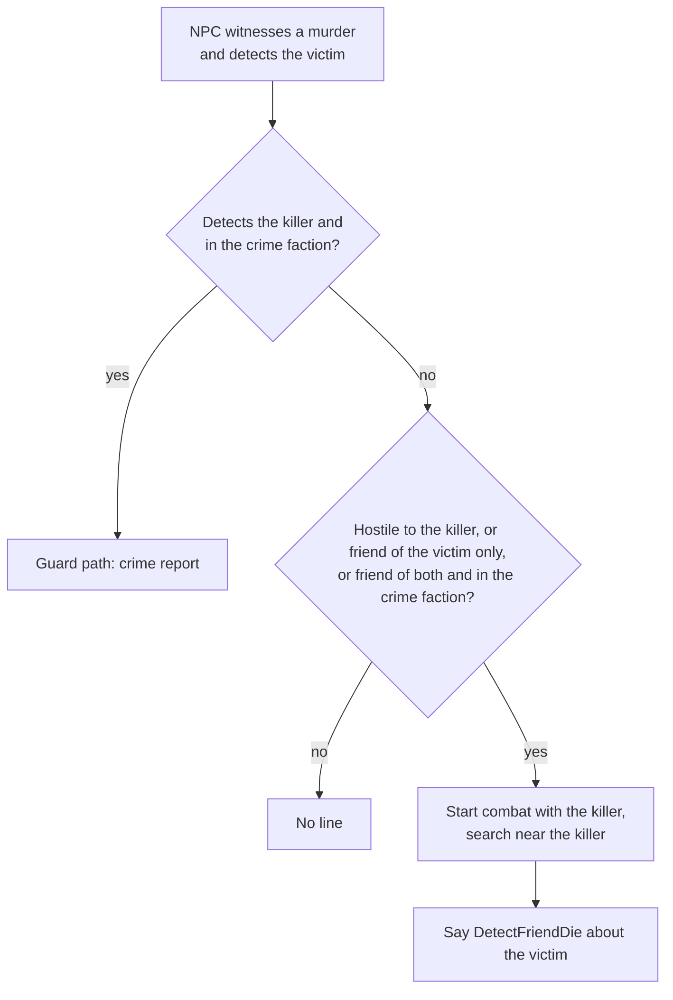

# Combat detection dialogue

During a fight, NPCs bark short lines about what they detect, for example when they lose a
target or find it again. Each line is a dialogue topic of the
detection category. The subtype says when it fits.

OpenSky does not build this yet.

| Subtype | Number |
| --- | --- |
| AlertIdle | 55 |
| LostIdle | 56 |
| NormalToAlert | 57 |
| AlertToCombat | 58 |
| NormalToCombat | 59 |
| AlertToNormal | 60 |
| CombatToNormal | 61 |
| CombatToLost | 62 |
| LostToNormal | 63 |
| LostToCombat | 64 |
| DetectFriendDie | 65 |

All values below are the ones that apply in play. Where `Skyrim.esm` overrides the program's
built-in default, the page gives the plugin value.

## When a line may be spoken

Every subtype except DetectFriendDie passes the same gate:

- Dialogue is allowed at all.
- The speaker can speak combat lines and is not already in a speech state that blocks it.
- The speaker is within hearing range of the camera.
- The wait for this subtype has run out. The waits are kept per combat group and per subtype:
  - AlertIdle and LostIdle: a random time from 10 to 25 seconds.
  - Every other subtype: a random time from 1 to 3 seconds.
- The wait starts only when a line was found and spoken.

## A group's record of a target

Each combat group keeps a record of each target. The record is in one of four states:

| State | When |
| --- | --- |
| Normal | No combat |
| Alert | In combat, but the target is not fully detected, or it is unseen and has no lost time |
| Combat | The target is seen: its stealth points are 0, its detection level is above 0, and it is not marked unseen |
| Lost | A lost time is set |

## Which line each change speaks

Who speaks each line:

- NormalToCombat and NormalToAlert: the actor whose combat starts for the first time, about its
  combat target.
- CombatToLost: a member near the target's last known position. The idle waits are rolled at
  this moment.
- AlertToCombat and LostToCombat: a member that detects the target again. The player never says
  it.
- AlertIdle and LostIdle: on each search update, every second, one member, never the player, about
  its own combat target. The pick is most likely random. LostIdle when the group's record of that
  target is Lost, else AlertIdle, also when there is no record.
- AlertToNormal and LostToNormal: the member nearest the target's position, or else the member
  nearest the player. LostToNormal when the record was Lost, else AlertToNormal.
- CombatToNormal: an actor whose combat target becomes nothing, while its old target is dead or
  dying and the group is not searching. The topic is about the dead target.

## When a group drops a target

The check runs every second. A group drops a target when any of these holds:

- The target is gone, dead, disabled, or deleted.
- It has been unseen for more than 30 seconds, also while the group flees, and either no member
  tracks it, or it has been unseen for more than 60 seconds and no live member is within 4096
  units of it.
- The group is searching and the target's stealth points have reached their maximum of 100.

When the group drops its last target, the AlertToNormal or LostToNormal line plays.

## DetectFriendDie

This line has its own path, and no group wait applies.

1. An NPC handles a murder it witnessed, and it can detect the victim.
2. The guard path did not take over. That path applies when the witness detects the killer and
   belongs to the crime faction.
3. The witness turns on the killer when any of these holds:
   - it is hostile to the killer;
   - it is friendly to the victim and not to the killer;
   - it is friendly to both and belongs to the crime faction.
4. It starts combat with the killer, adds a search point near the killer, and says
   DetectFriendDie about the victim.

