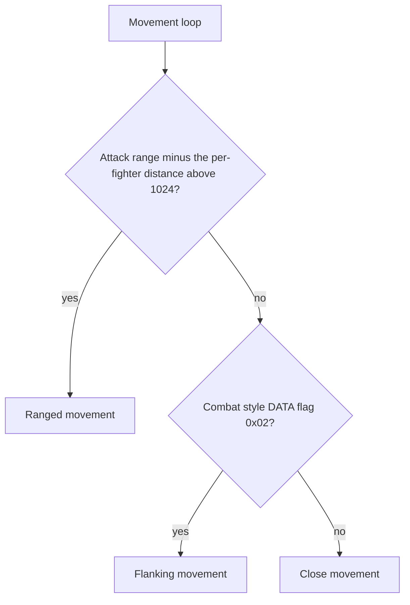

# Combat movement

An NPC in combat runs one movement loop beside its attack and block loops
([combat blocking](/engine/combat-blocking.md#loops-that-run-together)). The loop picks one branch.

The flanking branch needs no roll: an NPC whose style has the flanking flag always flanks while it
is not in ranged movement. Fleeing and searching take over from every branch.

## Close movement

The close loop checks three cases in order and runs the first that applies.

| Case | Choices, in order |
| --- | --- |
| Out of range | Fall back to a ranged weapon, advance, surround, distant circle, wait 0.25 s |
| Out of position | Reposition, surround, wait 0.25 s |
| In range | Circle or fall back, back off, wait 0.25 s ([close-range movement](/formats/combat-style.md#close-range-movement)) |

Each move ends when its path ends or fails, and the loop starts again from the top.

### Out of range

`R` is the NPC's reach plus the inner advance radius
([advance radii](/engine/combat-approach.md#advance-radii)). The NPC is out of range when the
distance predicted 0.5 s ahead is above `R`. One case stays in range: the NPC holds a place around
its target (below), its distance now is below `R`, and its bearing lies inside that place.

- Fall back to a ranged weapon runs only when the NPC's ranged range is above 1024 units.
- Distant circle rolls `lerp(circle, 0.25, 0.75)`, with the style's `CSCR` circle value. It moves as
  the in-range circle does, with the same angle and side rules, and needs a navmesh point within
  `max(radius, 64)` units.

### Places around the target

Each fighter books an arc around its target, so two fighters do not stand in one place. The arc
is centred on the fighter's bearing from the target. Its width, in radians, is
`max(2 * radius * 1.25, width * 2) / distance`, held between 10 and 180 degrees. The search for a
free arc tries 24 places.

The NPC is out of position when it holds no arc, or when its bearing from the target is more than
0.67 times half the arc's width from the arc's centre.

Example: an NPC of radius 30, 250 units away, books `2 * 30 * 1.25 / 250 = 0.3` radians, about
17 degrees. It is out of position once its bearing is more than `0.67 * 8.6`, about 5.8 degrees,
off the centre.

- Reposition books an arc at the NPC's current bearing. When that place is taken, it finds another
  free arc and walks there.
- Surround uses a ring from `reach + inner radius + 128` to `reach + inner radius + 384` from the
  target. An NPC inside the ring does not surround, and the next choice runs. An NPC closer than
  the ring walks out to its middle, `+ 256`.

## Ranged movement

An NPC whose attack range is above 1024 units, such as an archer or a mage, uses the ranged loop.
In range it tries, in order: use cover, find an attack location, the strafe choice, and a 0.25 s
wait. Out of range means the distance predicted 0.5 s ahead is outside the NPC's best range band.

The strafe choice rolls the strafe chance `lerp(strafe, 0, 0.75)`, with the style's `CSLR` value,
and then tries a strafe, then a circle. A strafe:

- starts only on the navmesh, while the NPC faces its target within 30 degrees;
- goes sideways, at right angles to the line from the target to the NPC, to a side drawn at even
  odds; the other side is tried once when the first fails;
- goes a random distance from 96 to 256 units, and at least 3 times the NPC's radius;
- needs a navmesh point within `max(2 * radius, 96)` units, inside the combat area when there is
  one.

A melee NPC never strafes.

## Flanking

The flanking loop repeats two steps: a stalk, then a flank choice.

The stalk runs only when the distance is below `reach + 256`. It lasts
`lerp(stalk time, 0.01, 10)` s, with the style's `CSCR` stalk time. Meanwhile the NPC keeps
between its reach and `reach + 256` from the target, and walks back into that band when it leaves
it. The stalk ends after 10 s at most, or once its time is over while the NPC is not attacking.

The flank choice tries, in order:

1. Flank: a flanking path to a point on the ring between the reach and `reach + 256`. The path may
   swing out to `reach + flank distance`, where the flank distance is `lerp(flank, 0, 1024)` from
   the style's `CSCR` value. The goal may lie at any angle within `reach + 384`. Further out the
   allowed angle narrows from 30 degrees at 384 units to 10 degrees at 1024 units.
2. Chase: inside its reach the NPC books a place around the target and is done. Otherwise it walks
   back into the band.
3. Flank distant: a flanking path at the flank distance.
4. Watch the target for 1 s.

Flanking ends only when the NPC leaves this branch, for example when it switches to ranged
movement or starts to flee or search.

## In OpenSky

OpenSky builds only the in-range moves of the close loop
([combat style](/formats/combat-style.md#where-opensky-differs)). An NPC out of reach advances
straight at its target ([combat approach](/engine/combat-approach.md)), and no NPC books a place,
surrounds, strafes, or flanks.
