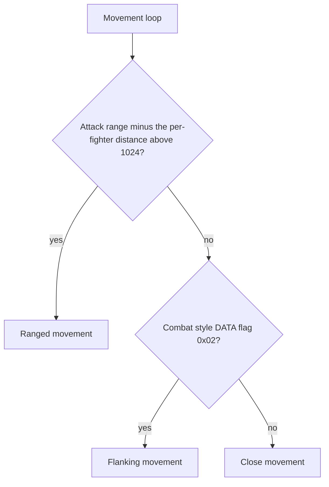
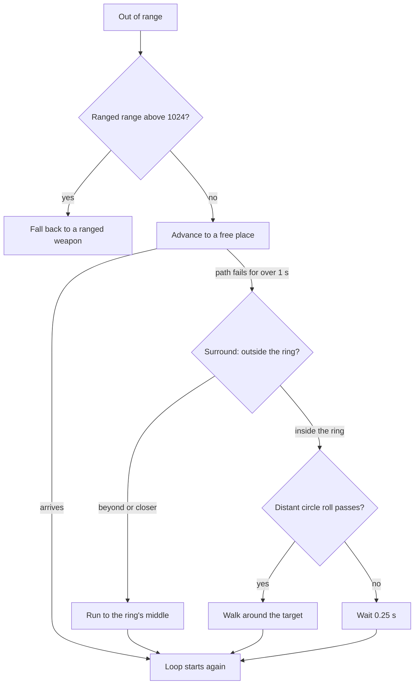

# Combat movement

An NPC in combat runs one movement loop beside its attack and block loops
([combat blocking](/engine/combat-blocking.md#loops-that-run-together)). The loop picks one branch.

The flanking branch needs no roll: an NPC whose style has the flanking flag always flanks while it
is not in ranged movement. Fleeing and searching take over from every branch.

## Close movement

The close loop checks three cases in order and runs the first that applies. It checks the case
only when it starts again. While a move runs, it does not test the case again.

| Case | Choices, in order |
| --- | --- |
| Out of range | Fall back to a ranged weapon, advance, surround, distant circle, wait 0.25 s |
| Out of position | Reposition, surround, wait 0.25 s |
| In range | Circle or fall back, back off, wait 0.25 s ([close-range movement](/formats/combat-style.md#close-range-movement)) |

Each move ends when its path ends or fails, or when the NPC's combat target changes. Then the loop
starts again from the top.

In this page, `reach` is the low edge of the NPC's optimal range, and the maximum range is the
largest attack range of its equipment. `inner` is the inner advance radius
([advance radii](/engine/combat-approach.md#advance-radii)).

### Out of range

The NPC is out of range when the distance predicted 0.5 s ahead is above the maximum range plus
`inner`. One case stays in range: the NPC holds a place around its target (below), its distance
now is inside that range, and its bearing lies inside the place's full width.

- Fall back to a ranged weapon runs only when the NPC's ranged range is above 1024 units.
- The advance always starts. Its goal is a free place around the target at `reach + inner`. The
  NPC books that place when its path is planned. It walks at the
  [approach speeds](/engine/combat-approach.md#speed), with the bands at `reach + inner` and
  `reach + outer`, and turns to face the target within 768 units.
- The advance ends when its path ends. It also ends early while the path runs, when the target
  moves slower than 5 units a second, the NPC is inside the goal distance, and its bearing lies in
  its own place or a free place can be booked there.
- A failed path is asked for again every 0.25 s. The advance fails only when its path has failed
  for more than 1 s. So surround and distant circle run only when no path reaches a place, for
  example when the target stands on a ledge.

Surround uses a ring from `reach + inner + 128` to `reach + inner + 384` from the target.

- When the target has a combat area, the area must allow the ring's middle, `+ 256`. Otherwise the
  surround fails at once.
- Beyond the ring, the NPC runs toward the target and stops at the middle. It picks no bearing and
  books no place.
- Closer than the ring, the NPC runs away from the target to the middle.
- Inside the ring the surround fails at once, and the next choice runs.

Distant circle starts only when all of these hold:

- a roll passes `lerp(circle, 0.25, 0.75)`, with the style's `CSCR` circle value;
- the NPC's movement is not driven by an animation, such as a lunge or a stagger;
- the NPC faces the target within 30 degrees.

Its angle is drawn from 30 degrees to `lerp(circle, 30, 90)` degrees, times 0.75 against the
player, and at least `3 * radius / distance` radians. The NPC's position is turned about the
target by that angle, at the same distance and height. The side is drawn at even odds, and the
other side is tried once. The point must lie in the combat area and on the navmesh within
`max(radius, 64)` units. The NPC walks there at fast walk.

### Places around the target

Each target has its own circle of booked arcs. A fighter books an arc centred on its bearing from
the target, so two fighters do not stand in one place. A new arc fits only inside a free gap, and
a fighter that books again gives up its old arc first. No limit counts the fighters; the arcs
only have to fit around the circle. A booked place is freed when the close loop ends.

The arc's width, in radians, is `max(2 * radius * 1.25, width * 2) / distance`, held between 10
and 180 degrees. `radius` is half the actor's larger side-to-side size, times its scale, at least
16. `width` is its full side-to-side size, times its scale, at least 32.

The NPC is out of position when it holds no arc, or when its bearing from the target is more than
0.67 times half the arc's width from the arc's centre.

Example: an NPC of radius 30 and width 60, 250 units away, books `max(75, 120) / 250 = 0.48`
radians, about 27.5 degrees. It is out of position once its bearing is more than `0.67 * 13.75`,
about 9.2 degrees, off the centre.

- Reposition first tries to book an arc at the NPC's bearing. When that works, it is done without
  moving. Otherwise it runs the advance move above.
- Surround runs as in the out-of-range case.

## Ranged movement

An NPC whose attack range is above 1024 units, such as an archer or a mage, uses the ranged loop.
In range it tries, in order: use cover, find an attack location, the strafe choice, and a 0.25 s
wait.

Out of range means the distance predicted 0.5 s ahead lies outside the best range band. The band
runs from the optimal range's low edge minus 256, at least 0, to its high edge plus 512, at most
the maximum range. The optimal range's high edge follows the style's offensive and defensive
balance, with the blend of the advance radii: 1024 for a fully offensive style, 1280 in the
middle, and 1536 for a fully defensive one.

The strafe choice rolls the strafe chance `lerp(strafe, 0, 0.75)`, with the style's `CSLR` value,
each time the loop reaches it. So an idle archer rolls about four times a second. It then tries a
strafe, then a circle. The movement loop runs beside the attack loop, so an archer strafes while it
draws and aims. A strafe:

- starts only on the navmesh, while the NPC faces its target within 30 degrees, and while its
  movement is not driven by an animation;
- goes sideways, at right angles to the line from the target to the NPC, to a side drawn at even
  odds; the other side is tried once when the first fails;
- goes a random distance from 96 to 256 units, and at least 3 times the NPC's radius;
- needs a navmesh point within `max(2 * radius, 96)` units, inside the combat area when there is
  one;
- walks at fast walk.

A melee NPC never strafes.

## Flanking

The flanking loop repeats two steps: a stalk, then a flank choice.

The stalk runs only when the distance is below the maximum range plus 256. It lasts
`lerp(stalk time, 0.01, 10)` s, with the style's `CSCR` stalk time. Meanwhile the NPC keeps
between its reach and `reach + 256` from the target, and jogs back into that band when it leaves
it. The stalk ends after 10 s at most, or once its time is over while the NPC is not attacking.

The flank choice tries, in order:

1. Flank: a path to a free place around the target at its reach, booked like an advance place.
   The path keeps between the reach and `reach + flank distance`, where the flank distance is
   `lerp(flank, 0, 1024)` from the style's `CSCR` value. Ground within the target's radius plus 11
   costs more to cross, so the path swings around the target, not past it. Within `reach + 384`
   the goal may lie at any angle. Further out the allowed angle widens from 10 degrees at 384
   units to 30 degrees at 1024 units. The NPC walks at the approach speeds, with the bands at its
   reach and `reach + 256`.
2. Chase: the advance move.
3. Flank distant: a path held at the flank distance from the target, at a run, only while the
   NPC's movement is not driven by an animation.
4. Watch the target for 1 s.

Flanking ends only when the NPC leaves this branch, for example when it switches to ranged
movement or starts to flee or search.

## In OpenSky

OpenSky builds only the in-range moves of the close loop
([combat style](/formats/combat-style.md#where-opensky-differs)). An NPC out of reach advances
straight at its target ([combat approach](/engine/combat-approach.md)), and no NPC books a place,
surrounds, strafes, or flanks.
