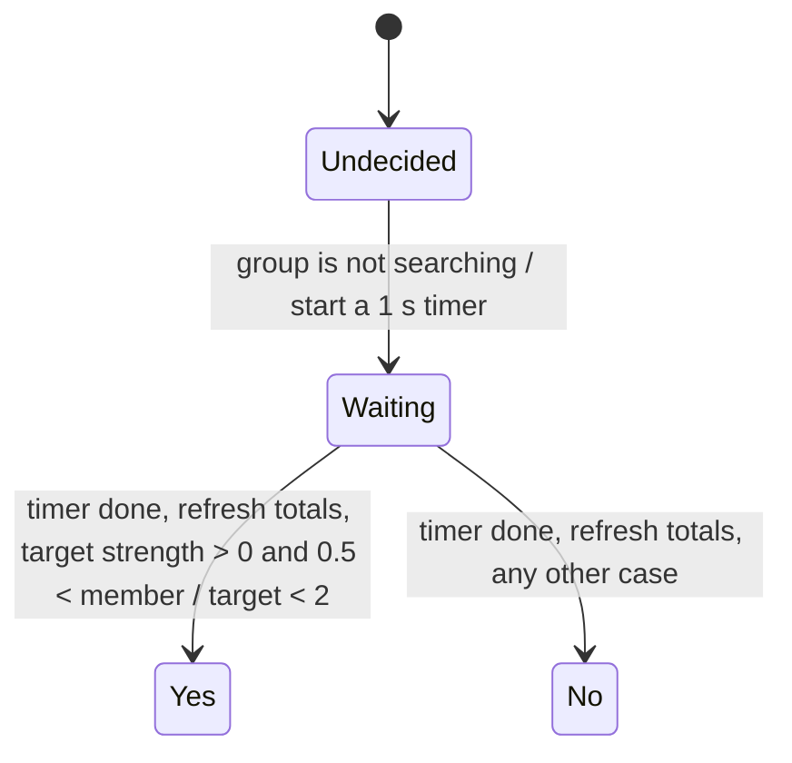
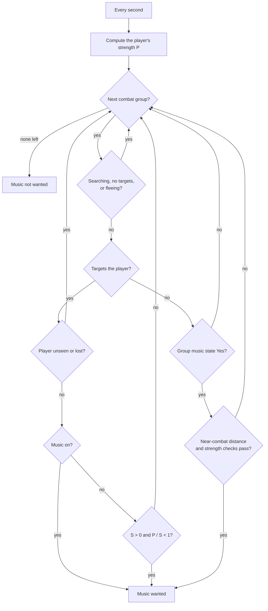
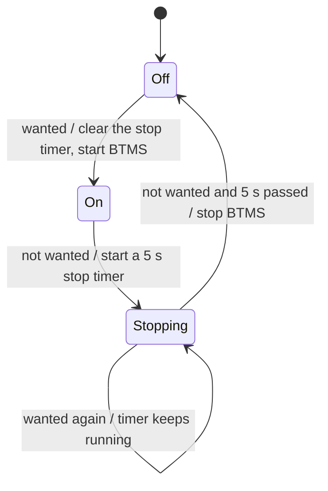

# Combat strength and combat music

The game gives every combatant a combat strength, one number for how dangerous it is. Each combat
group adds up the strength of its members and of its targets. These totals decide each actor's
threat ratio and whether battle music plays.

OpenSky does not build this yet. Its combat music does not depend on how dangerous the fight is.

All values below are the ones that apply in play. Where `Skyrim.esm` overrides the program's
built-in default, the page gives the plugin value.

## One actor's strength

strength = offense / (1 − min(0.99, `DamageResist` × armour scaling / 100 + X)) × current `Health`

- Armour scaling is the game's armour scaling factor, 0.12.
- X is the number of armour pieces the actor wears × the game's armour base factor, 0.03. Only
  worn `ARMO` items count, an item of the clothing armour type does not, and each item counts
  once. This is the same per-piece bonus as in the player's damage reduction. X is 0 for an actor
  that is not a full character.
- The cap is 0.99, not the 80% maximum armour reduction of a hit.
- Level is not used.

Offense is the damage per second of the actor's attacks:

- The sum of a damage figure for each attack item equipped:
  - a weapon: its full damage, with the game's weapon damage and skill scaling, × its speed × a
    speed multiplier, which is lower for bows and crossbows;
  - a spell: the sum of its effect magnitudes, divided by (cast time + 1) for one casting type;
  - a staff: its enchantment's effects.
- If the sum is 0, the actor's unarmed damage is used.
- An actor with a combat controller uses at least the best weapon figure of its combat inventory.

Example: offense 20, `DamageResist` 100, and 5 armour pieces give 1 − min(0.99, 0.12 + 0.15) =
0.73. With 200 `Health`, strength = 20 / 0.73 × 200 ≈ 5479.

## Refresh intervals

| What | Interval |
| --- | --- |
| Each combatant's cached offense and strength | 1 second |
| Each combatant's threat ratio | 5 seconds |
| Each group's totals | 2 seconds, and at the moment the group's music state is decided |

## Group totals

Members:

- The player is computed live. Other members use their cached value.
- A member whose controller is marked inactive is skipped.
- A member is added only when its strength and its offense are 0 or more.
- The group keeps the sum of its members' strength and the average of their offense.

Targets:

- Dead and ignored targets are skipped.
- A target with a combat controller uses its cached strength. Any other, the player too, is
  computed live.
- Strengths of 0 or more are added. The group keeps the sum and the average.

## Threat ratio

Each combatant's threat ratio = its group's member strength / its group's target strength. It is
measured again every 5 seconds. It stays at 100 until both totals are valid and the group had a
combat event in the last 120 seconds. A frenzied actor (`Aggression` 3) keeps 100.

## Music state of a group

Each group decides once whether it is a fair fight. The state starts undecided when the group is
made, and a merged group keeps a state already decided.

After that moment the state never changes.

## When battle music plays

Every second, unless music decisions are suspended, the game works out whether battle music is
wanted. It first computes the player's strength P, then looks at the combat groups in turn and
stops at the first one that wants music.

A group is skipped when it is searching, has no targets, or flees: it has fled from at least one
target and has no other target left.

A group that targets the player:

- It is skipped when its record of the player says unseen or lost.
- If music already plays, music is wanted.
- Otherwise S = the sum of the cached strength of the members that the player detects and that
  have a combat controller. Music is wanted when S > 0 and P / S < 1. So music starts once the
  enemies the player sees are stronger than the player.

A group that does not target the player, the near-combat check:

- Its music state must be Yes.
- If music already plays, music is wanted while a live member other than the player is within
  3500 units of the player.
- If music does not play, the group needs a live member within 2500 units. For the first such
  group, the game checks whether the player detects any member, and that answer holds for the
  later groups of the same pass. The member strengths of every such group add to a sum N. Music
  is wanted once the player detects a member and N > P.

## Start and stop

The battle music is the `DOBJ` `BTMS` music type.

The stop timer is cleared only on a start. So when music is wanted again while it still plays, the
old timer keeps running, and a later loss can stop the music almost at once.

The game also has a cap on the player's combat strength, 35000 by default. No rule was found that
reads it.

## Source

Behaviour described from a clean-room read of `SkyrimSE.exe` 1.7.104.0. It is not yet confirmed
in the reference game. UESP "Skyrim:Music" (<https://en.uesp.net/wiki/Skyrim:Music>) describes the
music types.
