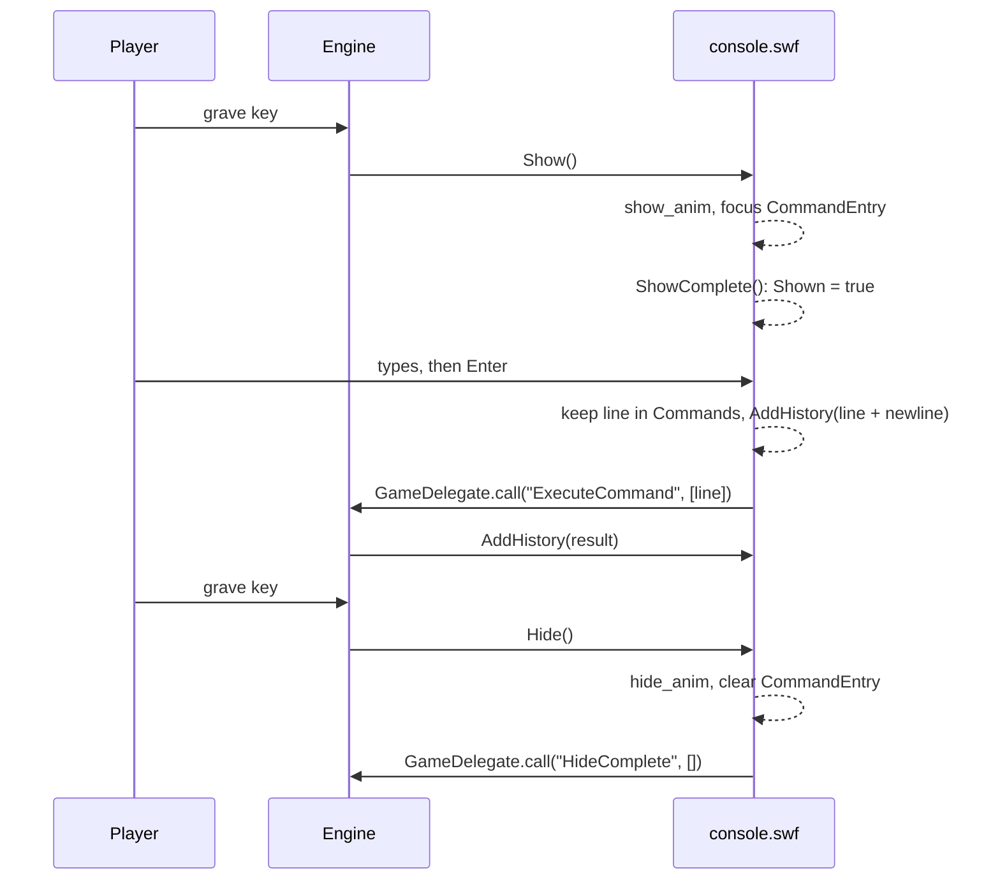

# Console

The console is a text prompt over the game. The player types a command, presses Enter, and the
game runs it. The commands are the ones the reference bridge already sends
([reference game](/tools/reference-game.md)).

## What the player sees

Source: the UESP page <https://en.uesp.net/wiki/Skyrim:Console> (revision 3628513).

- The grave key (`` ` ``, scan code 0x29, the key under Esc) opens and closes the console. The
  control map can bind it to another key.
- The game pauses while the console is open. The world stays drawn behind it.
- The prompt sits at the lower left. The output of earlier commands is above it.
- Enter runs the line. The line is echoed into the output, then the command's result.
- Page Up and Page Down scroll the output by one page.
- Commands are not case-sensitive.
- A click in the world selects the reference under the mouse. Its form ID shows at the top of
  the console, and commands without a target act on it. The mouse wheel steps through overlapping
  references.

## The movie

The vanilla movie is `interface/console.swf`. Its class `Console` keeps one instance in
`Console.ConsoleInstance`. The movie has three text fields: `CommandEntry` (the line being typed),
`CommandHistory` (the output), and `CurrentSelection` (the selected reference). The stage is set
to `align = "BL"` and `scaleMode = "noScale"`, so the console is anchored at the bottom left and
does not scale with the window.

### Calls the engine makes

| Method | What it does |
| --- | --- |
| `Show()` | Plays `show_anim` on the parent clip, focuses `CommandEntry`, puts the caret at the end. Does nothing while an animation runs |
| `Hide()` | Plays `hide_anim`, removes focus, clears the entry. Does nothing while an animation runs |
| `Minimize()` | Moves the parent clip so only the output shows above the entry |
| `AddHistory(text)` | Appends text to the output and scrolls to the bottom |
| `ClearHistory()` | Empties the output |
| `SetHistoryCharBufferSize(n)` | Sets the output limit; the default is 8192 characters |
| `PreviousCommand()`, `NextCommand()` | Step back and forward through the kept commands into the entry |
| `SetCurrentSelection(text)` | Sets the selected-reference text |
| `SetTextColor(colour)` | Colour of the entry and the selection |
| `SetHistoryTextColor(colour)` | Colour of the output |
| `SetTextSize(points)` | Entry and selection at `points`, output at `points - 2`; each at least 1 |
| `SetSize(percent)` | Background height as a percentage of the stage height, then lays out the fields |
| `QShown()` | True when shown and not animating |
| `QHiding()` | True while the hide animation runs |

### Calls the movie makes

| Call | When |
| --- | --- |
| `ExecuteCommand` with the typed line | Enter on a line that is not empty |
| `HideComplete` with no arguments | The hide animation ends |

### Keys the movie handles itself

| Key code | Key | Action |
| --- | --- | --- |
| 13, 108 | Enter, keypad Enter | Runs the line, as in the diagram, then clears the entry |
| 33 | Page Up | Scrolls the output up one page, to line 0 at most |
| 34 | Page Down | Scrolls the output down one page, to the last line at most |

The movie keeps the last 32 commands (`PREVIOUS_COMMANDS`); a new one drops the oldest. The movie does
not handle Up and Down itself; `PreviousCommand` and `NextCommand` are there for the engine to call.

The output keeps only its last `HistoryCharBufferSize` characters. When text passes the limit,
the oldest characters are cut. Example: with the default 8192 and an output of 8000 characters,
adding 300 characters leaves the last 8192 of the 8300.
