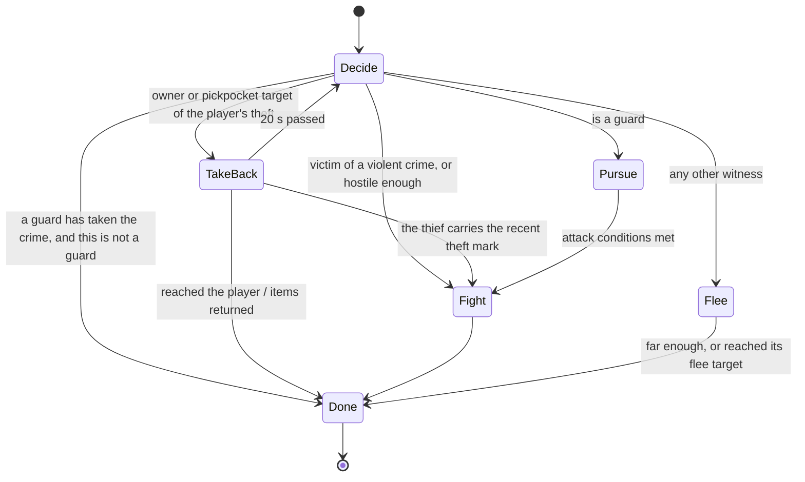
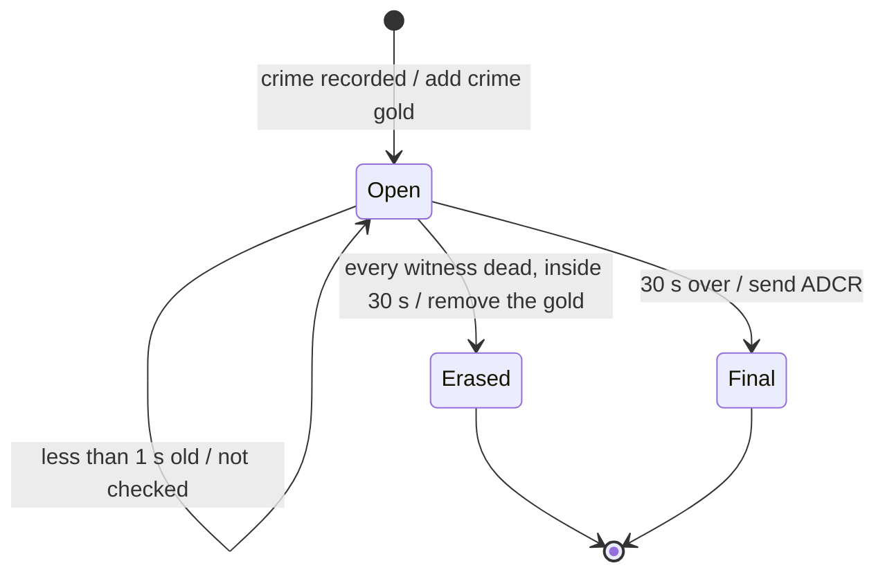
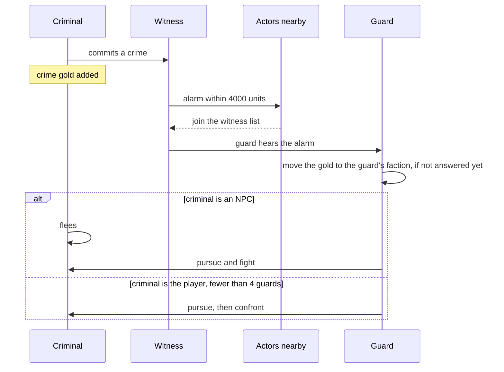

# Crime reports in the game

This page gives the game's rules for what happens after a crime is seen. OpenSky's own rules are
in [crime](/engine/crime.md) and [guard response](/engine/guard-response.md). The differences are
listed at the end.

## Who commits a crime

- Only the player commits a theft. When an NPC takes an owned item, no crime is recorded.
- A theft or a trespass by one of the player's followers is charged to the player. The game
  follows the chain of teammates up to the player. Whether a follower's assault is charged to the
  player was not found.
- An assault by a guard is no crime.
- A theft is charged to the victim's crime faction. A pickpocket or an assault is charged to the
  crime faction of the first guard among the witnesses, else of the first other witness. That
  faction must have a non-zero price for the crime.

## Witnesses

An actor joins the crime's witness list when it has full AI processing and sees or detects the
criminal. These never join: the player's teammates, dead or disabled actors, the criminal, and
summoned or commanded actors.

- An animal can be a witness. To erase the crime, the player must kill it too. An animal has no
  crime faction, so it never hears or raises an alarm, and no bounty comes from it.
- A child is a normal witness, and a child with a crime faction is a normal alarm hearer. No rule
  makes a child tell an adult or a guard. The only child rule found is that followers never pick a
  child as a combat target.

## The alarm

A witness does not walk to a guard. It raises an alarm, and every actor near enough hears it at
once.

- An actor hears the alarm when it is within 4000 units of the criminal.
- An actor in a cell with less AI processing than the criminal's can still hear it. It must be
  within 2000 units of a load door that leads into its own cell, and that door must be within 4000
  units of the crime.

These actors are skipped:

- dead, disabled, bleeding out, or unconscious actors;
- actors without AI processing;
- actors whose alarm already holds this crime, or who already run an alarm;
- actors already in combat, except in some states of the player's own crime handling;
- the player's teammates.

A guard hears the alarm with no other test, but only while no guard has taken the crime yet. Any
other actor must pass two tests:

1. It cares about the crime's faction: its own crime faction is the crime's faction, or the crime's
   faction is in its faction's shared crime list.
2. It is willing to be hostile to the criminal. This depends on its Aggression actor value: 0 only
   for an enemy, 1 for a hostile relationship, 2 for some more cases, and 3 always. A criminal
   already marked by crime counts as an enemy: an active faction enemy timer, the "alerted" mark,
   or a recent theft.

So a bystander that does not care about the faction, or that would not be hostile, does nothing.
The victim and the direct witness of a pickpocket or an assault get the alarm directly, without
these tests.

Each actor that hears the alarm joins the witness list. When the crime is the player's ongoing
assault, it goes straight into combat. Otherwise it gets an Alarm package aimed at the criminal. If
it already runs an Alarm package against the same criminal, the new crime joins that package.

Example: a guard 3500 units from a thief hears the alarm. A guard 4200 units away does not.

The crime gold is added when the crime is recorded, not when it is reported later.

## The Alarm package

Each time the package decides, it sends the alarm again while no guard has taken the crime.

- **Fight.** The witness was the victim of an assault, a murder, or worse, or it passes the
  hostility test for a lesser crime. It starts combat with the criminal.
- **Pursue.** Only a guard. It goes after the criminal and says its Pursue idle line (`DIAL`
  subtype `PURS`) every 3 seconds.
- **Take back.** The witness is the victim of the player's theft or pickpocket: the owner, a member
  of the owning faction, or the pickpocket target. It walks to the player and says its Steal line
  (`STEA`). When it reaches the player, the stolen items go back to it, those crimes are deleted,
  and the theft mark goes. If the thief carries a recent theft mark, the victim attacks instead.
  After 20 seconds without reaching the player it falls back to a normal alarm.
- **Done.** A non-guard ends its package once a guard has taken the crime. The exception is a
  trespass by the player: the witness then turns to the player.
- **Flee.** It runs from the criminal. Outside it flees to 5000 units and is done at 2500; inside
  to 3000 and done at 600. It counts as safe after 30 seconds.

The package also ends when the witness enters combat.

## Killing the witnesses

Each crime keeps the time it was made. For 30 seconds after the crime, the criminal can still
erase it by killing every witness. The clock is real time, and it stops while the game is paused.

- A crime is not checked until it is more than 1 second old.
- When every witness on its list is dead inside the window, or the crime has no witness, the crime
  is removed, and the criminal's crime gold with that faction drops by the crime's value. If the
  crime had witnesses, or was an assault, the HUD shows the last-witness-killed notice, the gold
  removed, and the faction's name.
- When the window is over, the crime is final. Killing the witnesses no longer erases it, and the
  `ADCR` story event is sent once ([story manager](/engine/story-manager.md)). It carries the
  criminal, the victim, the crime type, the gold, and the faction.

Example: a dog and a farmer see the player pick a pocket. The player kills both within 25 seconds.
The 25 gold comes off and the notice shows. If the player kills only the farmer, the crime is
final at 30 seconds.

## Guards

A guard is an actor that has a crime faction and belongs to the guard faction.

When a guard answers an alarm:

1. If the guard's crime faction is not the crime's faction, and no guard has answered this crime
   yet, the crime gold moves from the old faction to the guard's faction. A later guard of a third
   faction ignores the crime.
2. The crime is marked as answered by a guard.
3. At most 4 guards answer one criminal. A fifth guard in range does nothing.
4. Below the cap, the guard runs the Alarm package and pursues the criminal.
5. The guard attacks at once when the criminal is the player and an enemy of the faction, which
   follows resisting arrest. That enemy state lasts 300 seconds of real time, and a faction cools
   down after 24 game hours.

An NPC criminal that is not in combat flees from the guard. Guards never arrest an NPC: they
pursue it and fight it.

## Statistics

The game itself changes only the bounty statistics. It does this on the "bounty changed" event,
which carries the faction, the new bounty, and the old bounty.

1. The faction counts only when its `FACT` `DATA` flag `0x40` (Track Crime) is set and its flag
   `0x01` is not.
2. When the faction is one of the ten hold factions below, its hold statistic is set to the new
   bounty. It follows the bounty down too, so it is the current bounty, not the highest. These ten
   statistics do not show in the Stats menu.
3. Only when the bounty goes up: "Largest Bounty" becomes the larger of itself and the new bounty,
   and "Total Lifetime Bounty" goes up by new − old.

| Faction | Statistic |
| --- | --- |
| `CrimeFactionEastmarch` | Eastmarch Bounty |
| `CrimeFactionFalkreath` | Falkreath Bounty |
| `CrimeFactionHaafingar` | Haafingar Bounty |
| `CrimeFactionHjaalmarch` | Hjaalmarch Bounty |
| `CrimeFactionPale` | The Pale Bounty |
| `CrimeFactionReach` | The Reach Bounty |
| `CrimeFactionRift` | The Rift Bounty |
| `CrimeFactionOrcs` | Tribal Orcs Bounty |
| `CrimeFactionWhiterun` | Whiterun Bounty |
| `CrimeFactionWinterhold` | Winterhold Bounty |

Example: the player's Whiterun bounty goes from 40 to 1040 for a murder. Whiterun Bounty becomes
1040, Largest Bounty becomes at least 1040, and Total Lifetime Bounty goes up by 1000. Paying the
fine sets Whiterun Bounty to 0 and leaves the other two.

"Horses Stolen", "Assaults", "Murders", "Times Jailed", "Jail Escapes", and "Locks Picked" count
up in play, but no vanilla script calls `Game.IncrementStat` for them
(`openskycli pex-calls IncrementStat`). So the game counts them itself, by a path that was not
found. "Trespasses", "Items Stolen", "Items Pickpocketed", "Pockets Picked", "Days Jailed", and
"Fines Paid" each change on their own game event, which was not read.

The vanilla scripts count only these statistics:

| Statistic | Counted by |
| --- | --- |
| Persuasions, Bribes, Intimidations | The favour dialogue script |
| Horses Owned, Houses Owned, Stores Invested In | Stable dialogue, house, and Investor perk scripts |
| Side Quests Completed, Questlines Completed | The achievements script and the last quest of each questline |
| NumVampirePerks, NumWerewolfPerks, Necks Bitten, Werewolf Transformations, Vampirism Cures | Vampire and werewolf scripts |
| Diseases Contracted | Only the Survival Mode disease script |
| Standing Stones Found, Nirnroots Found, Wings Plucked, Brawls Won | Object and quest scripts |

## Where OpenSky differs

- OpenSky raises no alarm. In the game the alarm reaches every actor in range at once, and a
  non-guard witness fights, takes back, or flees.
- OpenSky does not move the crime gold to the faction of the guard that answers, and has no cap on
  the guards that answer.
- OpenSky's guards do not fight NPC criminals, and an NPC criminal does not flee from them.
- Followers' thefts and trespasses are not charged to the player. Animals are not witnesses.
- OpenSky has no "bounty changed" event. Once per frame it compares the player's bounties with
  the last frame's and applies the statistics rule above to each change. It counts "Horses
  Stolen", "Assaults", "Murders", and "Locks Picked" itself, as the game does.
