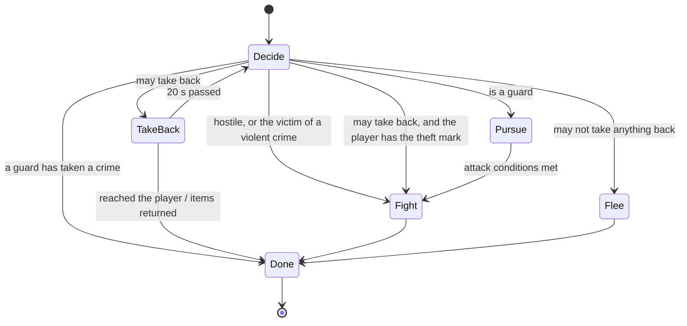
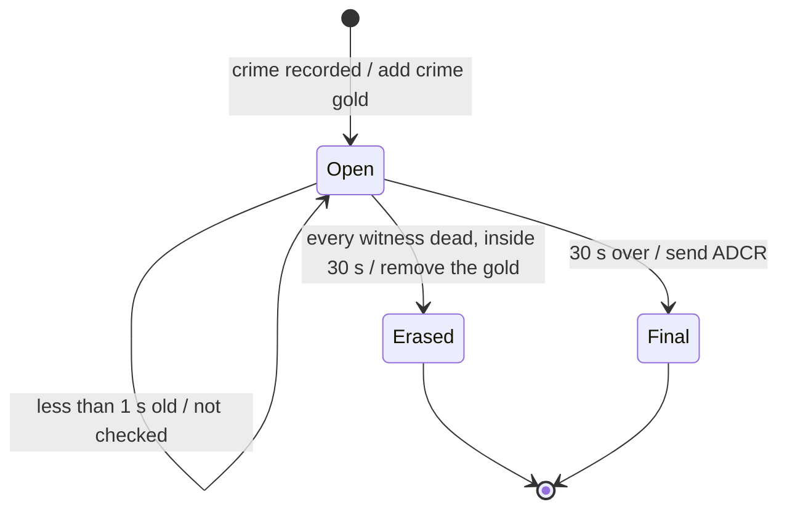
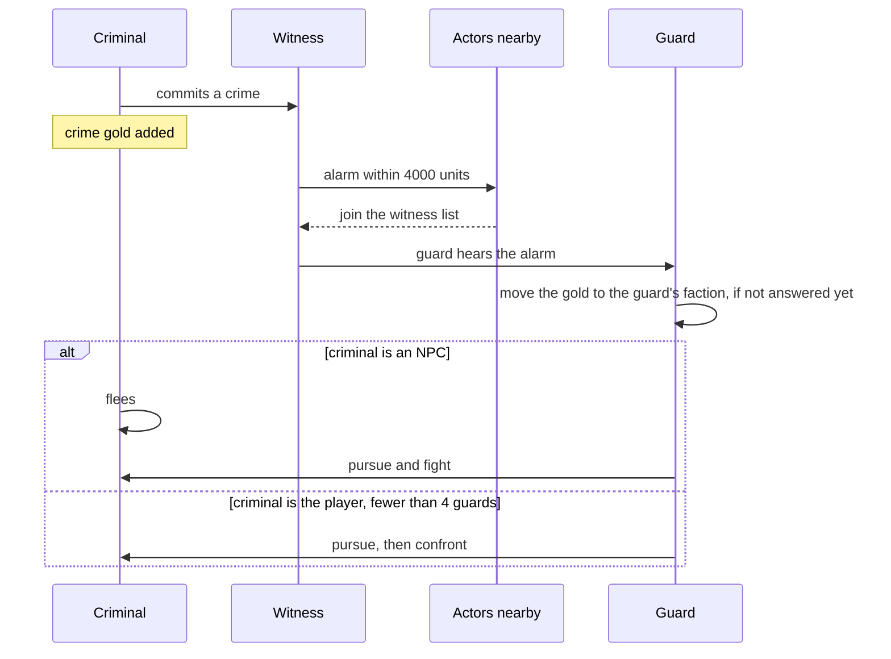

# Crime reports in the game

This page gives the game's rules for what happens after a crime is seen. OpenSky's own rules are
in [crime](crime.md) and [guard response](guard-response.md). The differences are
listed at the end.

## Who commits a crime

- Only the player commits a theft. When an NPC takes an owned item, no crime is recorded.
- A theft or a trespass by one of the player's followers is charged to the player. The game
  follows the chain of teammates up to the player. Whether a follower's assault is charged to the
  player was not found.
- An assault by a guard is no crime.
- A theft is charged to the victim's crime faction. A pickpocket or an assault is charged to the
  crime faction of the first guard among the witnesses, else of the first other witness. That
  faction must have a non-zero price for the crime.

## Witnesses

An actor joins the crime's witness list when it has full AI processing and sees or detects the
criminal. These never join: the player's teammates, dead or disabled actors, the criminal, and
summoned or commanded actors.

- An animal can be a witness. To erase the crime, the player must kill it too. An animal has no
  crime faction, so it never hears or raises an alarm, and no bounty comes from it.
- A child is a normal witness, and a child with a crime faction is a normal alarm hearer. No rule
  makes a child tell an adult or a guard. The only child rule found is that followers never pick a
  child as a combat target.

## The alarm

A witness does not walk to a guard. It raises an alarm, and every actor near enough hears it at
once.

- An actor hears the alarm when it is within 4000 units of the criminal.
- An actor in a cell with less AI processing than the criminal's can still hear it. It must be
  within 2000 units of one of the references the alarm carries, which look like the load doors near
  the crime.

These actors are skipped:

- dead, disabled, bleeding out, or unconscious actors;
- actors without AI processing;
- actors whose alarm already holds this crime, or who already run an alarm;
- actors already in combat, except in some states of the player's own crime handling;
- the player's teammates.

A guard hears the alarm with no other test, but only while no guard has taken the crime yet. Any
other actor must pass two tests:

1. It cares about the crime's faction. Its crime faction is the one set on the reference, else the
   `CRIF` of its base. It cares when that faction is the crime's faction, or when the crime's
   faction is in that faction's shared crime list: the form list (`FLST`) its `CRGR` field names.
   Only the hearer's list is read. A summoned or commanded actor has no crime faction.
2. It is hostile to the criminal by the hostility test below.

So a bystander that does not care about the faction, or that would not be hostile, does nothing.
The victim and the direct witnesses of the crime get the alarm directly, without these tests.

Each actor that hears the alarm joins the witness list. When the crime is the player's ongoing
assault, it goes straight into combat. Otherwise it gets an Alarm package aimed at the criminal. If
it already runs an Alarm package against the same criminal, the new crime joins that package.

Example: a guard 3500 units from a thief hears the alarm. A guard 4200 units away does not.

The crime gold is added when the crime is recorded, not when it is reported later.

## The hostility test

The test asks whether witness W is hostile to criminal C. It reads W's Aggression, from 0 to 3, and
a reaction R: Neutral, Enemy, Ally, or Friend.

1. Aggression 3 is always hostile.
2. When C is an NPC that is in combat with W as its target and is not fleeing, W is hostile,
   unless R is Ally or Friend.
3. When C is the player, W is hostile if W is angry with the player (see the Alarm package below).
4. Otherwise the table decides:

| Aggression | Hostile when |
| --- | --- |
| 0 | R is Enemy and the player is marked to be attacked on sight |
| 1 | R is Enemy |
| 2 | R is Enemy or Neutral |
| 3 | always |

R comes from these steps:

- For the player, R is Enemy at once when W, or one of W's factions, has the player as a faction
  enemy, or when W is alerted. A faction keeps the player as an enemy for 24 game hours after the
  last crime. W is alerted when it is angry with the player, when its crime faction has the player
  as an enemy, or when the crimes W saw itself add up to a value of 100 or more. A theft counts the
  item value times the count, and a stolen horse counts 100.
- Otherwise R starts from the relationship rank: Lover, Ally, or Confidant give Ally, and the
  factions are not read. Friend gives Friend. Acquaintance, Rival, and Foe give Neutral. Enemy and
  Archnemesis give Enemy.
- Then each faction of W is compared with each faction of C. A Neutral R takes the faction
  reaction. An Enemy R takes any faction reaction that is not Neutral, so an allied faction beats a
  personal enemy. A Friend R becomes Ally when a faction says Ally. The steps stop at Ally.

Example: a shopkeeper with Aggression 1 and a Neutral reaction sees a theft. The shopkeeper is not
hostile, so it does not fight.

## The Alarm package

A guard always pursues. A non-guard goes through each crime in its package once:

1. When no guard has taken the crime, it sends the alarm again, with the same hearing rules. A guard
   can take the crime during this. When the crime is still not taken, the witness may take back
   when the crime is a theft or a pickpocket by the player, and the witness is the pickpocket
   target, the item's owner, or a member of the owning faction (rank 0 or higher).
2. A theft, a pickpocket, or a trespass makes it fight when it passes the hostility test. An
   assault, a murder, or worse makes it fight only when it is the victim.

Then the first match wins:

1. **Fight.** A crime passed the fight test. This comes before taking back, so a hostile owner
   attacks.
2. **Done.** A guard has taken one of the crimes. When the player is still trespassing, the witness
   turns to its trespass warning instead.
3. **Flee.** The witness may not take anything back. When the player is trespassing, it turns to
   its trespass warning instead. The Alarm package gives the flee no radius, so the witness does not
   run: it says a reaction line and stays where it is. Confidence is not read.
4. **Fight.** The player has the recent theft mark. The witness also becomes angry with the
   player, which makes later hostility tests pass.
5. **Take back.** It walks to the player and says its Steal line (`STEA`). When it reaches the
   player, the stolen items go back to it and those crimes are deleted. After 20 seconds without
   reaching the player it decides again.

- **Pursue.** Only a guard. It goes after the criminal and says its Pursue idle line (`DIAL`
  subtype `PURS`) every 3 seconds.

The package also ends when the witness enters combat.

Example: a shopkeeper with Aggression 1 sees the player steal from its counter. It is not hostile,
so it walks over to take the item back. If the player already has the theft mark, it attacks.

## The recent theft mark

The player gets the mark from a theft of an item whose owner leads to an actor, seen or not, a
theft by a follower included. A caught pickpocket gives it too, and so does a witness that becomes
alerted through the value of 100.

The mark has no timer. It keeps the game day it was set. At the next theft or caught pickpocket, if
the day has changed, that event only clears the mark, and the event after it sets the mark again. A
guard that sees the player in combat with the mark clears it and raises an alarm against the player
at once.

Example: the player steals at 23:00 on day 5 and again at 01:00 on day 6. The second theft clears
the mark, and a third theft sets it again.

## Killing the witnesses

Each crime keeps the time it was made. For 30 seconds after the crime, the criminal can still
erase it by killing every witness. The clock is real time, and it stops while the game is paused.

- A crime is not checked until it is more than 1 second old.
- When every witness on its list is dead inside the window, or the crime has no witness, the crime
  is removed, and the criminal's crime gold with that faction drops by the crime's value. If the
  crime had witnesses, or was an assault, the HUD shows the last-witness-killed notice, the gold
  removed, and the faction's name.
- When the window is over, the crime is final. Killing the witnesses no longer erases it, and the
  `ADCR` story event is sent once ([story manager](story-manager.md)). It carries the
  criminal, the victim, the crime type, the gold, and the faction.

Example: a dog and a farmer see the player pick a pocket. The player kills both within 25 seconds.
The 25 gold comes off and the notice shows. If the player kills only the farmer, the crime is
final at 30 seconds.

## Guards

A guard is an actor that has a crime faction and belongs to the guard faction.

When a guard answers an alarm:

1. If the guard's crime faction is not the crime's faction, and no guard has answered this crime
   yet, the crime gold moves from the old faction to the guard's faction. A later guard of a third
   faction ignores the crime.
2. The crime is marked as answered by a guard.
3. At most 4 guards answer one criminal. A fifth guard in range does nothing.
4. Below the cap, the guard runs the Alarm package and pursues the criminal.
5. The guard attacks at once when the criminal is the player and an enemy of the faction, which
   follows resisting arrest. That enemy state lasts 300 seconds of real time, and a faction cools
   down after 24 game hours.

An NPC criminal that is not in combat flees from the guard. Guards never arrest an NPC: they
pursue it and fight it.

## Statistics

The game itself changes only the bounty statistics. It does this on the "bounty changed" event,
which carries the faction, the new bounty, and the old bounty.

1. The faction counts only when its `FACT` `DATA` flag `0x40` (Track Crime) is set and its flag
   `0x01` is not.
2. When the faction is one of the ten hold factions below, its hold statistic is set to the new
   bounty. It follows the bounty down too, so it is the current bounty, not the highest. These ten
   statistics do not show in the Stats menu.
3. Only when the bounty goes up: "Largest Bounty" becomes the larger of itself and the new bounty,
   and "Total Lifetime Bounty" goes up by new − old.

| Faction | Statistic |
| --- | --- |
| `CrimeFactionEastmarch` | Eastmarch Bounty |
| `CrimeFactionFalkreath` | Falkreath Bounty |
| `CrimeFactionHaafingar` | Haafingar Bounty |
| `CrimeFactionHjaalmarch` | Hjaalmarch Bounty |
| `CrimeFactionPale` | The Pale Bounty |
| `CrimeFactionReach` | The Reach Bounty |
| `CrimeFactionRift` | The Rift Bounty |
| `CrimeFactionOrcs` | Tribal Orcs Bounty |
| `CrimeFactionWhiterun` | Whiterun Bounty |
| `CrimeFactionWinterhold` | Winterhold Bounty |

Example: the player's Whiterun bounty goes from 40 to 1040 for a murder. Whiterun Bounty becomes
1040, Largest Bounty becomes at least 1040, and Total Lifetime Bounty goes up by 1000. Paying the
fine sets Whiterun Bounty to 0 and leaves the other two.

"Horses Stolen", "Assaults", "Murders", "Times Jailed", "Jail Escapes", and "Locks Picked" count
up in play, but no vanilla script calls `Game.IncrementStat` for them
(`openskycli pex-calls IncrementStat`). So the game counts them itself, by a path that was not
found. "Trespasses", "Items Stolen", "Items Pickpocketed", "Pockets Picked", "Days Jailed", and
"Fines Paid" each change on their own game event, which was not read.

The vanilla scripts count only these statistics:

| Statistic | Counted by |
| --- | --- |
| Persuasions, Bribes, Intimidations | The favour dialogue script |
| Horses Owned, Houses Owned, Stores Invested In | Stable dialogue, house, and Investor perk scripts |
| Side Quests Completed, Questlines Completed | The achievements script and the last quest of each questline |
| NumVampirePerks, NumWerewolfPerks, Necks Bitten, Werewolf Transformations, Vampirism Cures | Vampire and werewolf scripts |
| Diseases Contracted | Only the Survival Mode disease script |
| Standing Stones Found, Nirnroots Found, Wings Plucked, Brawls Won | Object and quest scripts |

## Where OpenSky differs

- The alarm does not pass through a door to an actor in another cell, as the 2000-unit door
  rule above allows.
- The "attack on sight" mark that Aggression 0 also needs is not kept, so an unaggressive witness
  is never hostile through it.
- An NPC criminal that a guard answers runs a fixed 2000 units straight away from the guard.
- A theft is charged to the place's crime faction, not the victim's. A follower's take is charged
  to the player, but a follower's trespass is not.
- OpenSky reads "has no crime faction" in place of "is an animal": such a witness must be killed
  to erase a crime, but adds no bounty.
- OpenSky has no "bounty changed" event. Once per frame it compares the player's bounties with
  the last frame's and applies the statistics rule above to each change. It counts "Horses
  Stolen", "Assaults", "Murders", and "Locks Picked" itself, as the game does.
