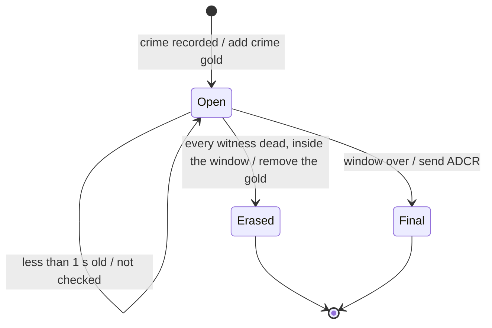
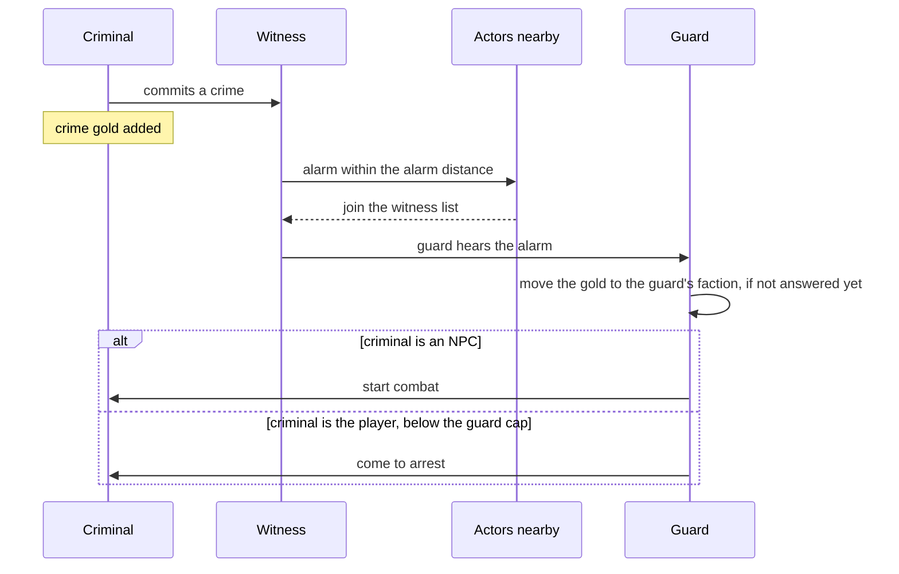

# Crime reports in the game

This page gives the game's rules for what happens after a crime is seen. OpenSky's own rules are
in [crime](/engine/crime.md) and [guard response](/engine/guard-response.md). The differences are
listed at the end.

## The alarm

A witness does not walk to a guard. It raises an alarm, and every actor near enough hears it at
once.

1. The game looks at every actor that has AI processing.
2. It skips actors that are dead, disabled, or deleted, and actors that are not allied with the
   crime's faction. The player's followers take part only in one state of the player's crime
   handling.
3. An actor in the same area as the criminal must be within the alarm distance of the criminal.
   Any other actor must be within a smaller alarm distance of the references around the witness.
4. Each actor alerted joins the crime's list of witnesses.

A witness that is not a guard gets an Alarm package aimed at the criminal. If it already runs an
Alarm package against the same criminal, the new crime joins that package.

The crime gold is added when the crime is recorded, not when it is reported later.

## Killing the witnesses

Each crime keeps the time it was made. For a short window after the crime, the criminal can still
erase it by killing every witness.

- A crime is not checked until it is more than 1 second old.
- When every witness on its list is dead inside the window, the crime is removed, and the
  criminal's crime gold with that faction drops by the crime's value. If the crime had witnesses,
  or was an assault, the HUD shows the last-witness-killed notice, the gold removed, and the
  faction's name.
- When the window is over, the crime is final. Killing the witnesses no longer erases it, and the
  `ADCR` story event is sent once ([story manager](/engine/story-manager.md)).

The length of the window was not found.

## Guards

A guard is an actor that has a crime faction and belongs to the guard faction.

When a guard answers an alarm:

1. If the guard's crime faction is not the crime's faction, and no guard has answered this crime
   yet, the crime gold moves from the old faction to the guard's faction.
2. The crime is marked as answered by a guard.
3. If the criminal is not the player or one of the player's followers, the guard starts combat
   with the criminal. Guards fight NPC criminals. They do not arrest them.
4. A setting caps how many guards answer one criminal. Below the cap, a guard may come to the
   player to arrest them. Otherwise it runs the alarm response.

## Statistics

The game itself changes only the bounty statistics. It does this on the "bounty changed" event,
which carries the faction, the new bounty, and the old bounty.

1. The faction counts only when its `FACT` `DATA` flag `0x40` (Track Crime) is set and its flag
   `0x01` is not.
2. When the faction is one of the ten hold factions below, its hold statistic is set to the new
   bounty. It follows the bounty down too, so it is the current bounty, not the highest. These ten
   statistics do not show in the Stats menu.
3. Only when the bounty goes up: "Largest Bounty" becomes the larger of itself and the new bounty,
   and "Total Lifetime Bounty" goes up by new − old.

| Faction | Statistic |
| --- | --- |
| `CrimeFactionEastmarch` | Eastmarch Bounty |
| `CrimeFactionFalkreath` | Falkreath Bounty |
| `CrimeFactionHaafingar` | Haafingar Bounty |
| `CrimeFactionHjaalmarch` | Hjaalmarch Bounty |
| `CrimeFactionPale` | The Pale Bounty |
| `CrimeFactionReach` | The Reach Bounty |
| `CrimeFactionRift` | The Rift Bounty |
| `CrimeFactionOrcs` | Tribal Orcs Bounty |
| `CrimeFactionWhiterun` | Whiterun Bounty |
| `CrimeFactionWinterhold` | Winterhold Bounty |

Example: the player's Whiterun bounty goes from 40 to 1040 for a murder. Whiterun Bounty becomes
1040, Largest Bounty becomes at least 1040, and Total Lifetime Bounty goes up by 1000. Paying the
fine sets Whiterun Bounty to 0 and leaves the other two.

"Horses Stolen", "Assaults", "Murders", "Times Jailed", "Jail Escapes", and "Locks Picked" count
up in play, but no vanilla script calls `Game.IncrementStat` for them
(`openskycli pex-calls IncrementStat`). So the game counts them itself, by a path that was not
found. "Trespasses", "Items Stolen", "Items Pickpocketed", "Pockets Picked", "Days Jailed", and
"Fines Paid" each change on their own game event, which was not read.

The vanilla scripts count only these statistics:

| Statistic | Counted by |
| --- | --- |
| Persuasions, Bribes, Intimidations | The favour dialogue script |
| Horses Owned, Houses Owned, Stores Invested In | Stable dialogue, house, and Investor perk scripts |
| Side Quests Completed, Questlines Completed | The achievements script and the last quest of each questline |
| NumVampirePerks, NumWerewolfPerks, Necks Bitten, Werewolf Transformations, Vampirism Cures | Vampire and werewolf scripts |
| Diseases Contracted | Only the Survival Mode disease script |
| Standing Stones Found, Nirnroots Found, Wings Plucked, Brawls Won | Object and quest scripts |

## Where OpenSky differs

- OpenSky's witness reports only when a guard is within 4000 units of it. In the game the alarm
  reaches every allied actor in range at once, and a non-guard witness runs an Alarm package.
- OpenSky's report stays open until a guard is reached. In the game a crime becomes final when its
  window ends, and only then sends `ADCR`.
- OpenSky does not move the crime gold to the faction of the guard that answers.
- OpenSky's guards do not fight NPC criminals.
- OpenSky has no "bounty changed" event. Once per frame it compares the player's bounties with
  the last frame's and applies the statistics rule above to each change. It counts "Horses
  Stolen", "Assaults", "Murders", and "Locks Picked" itself, as the game does.
