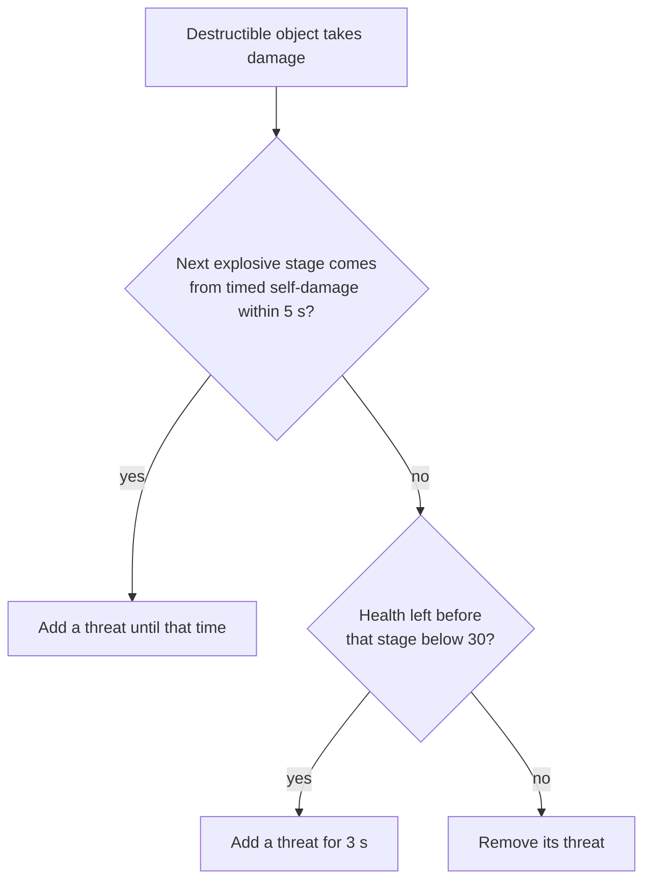
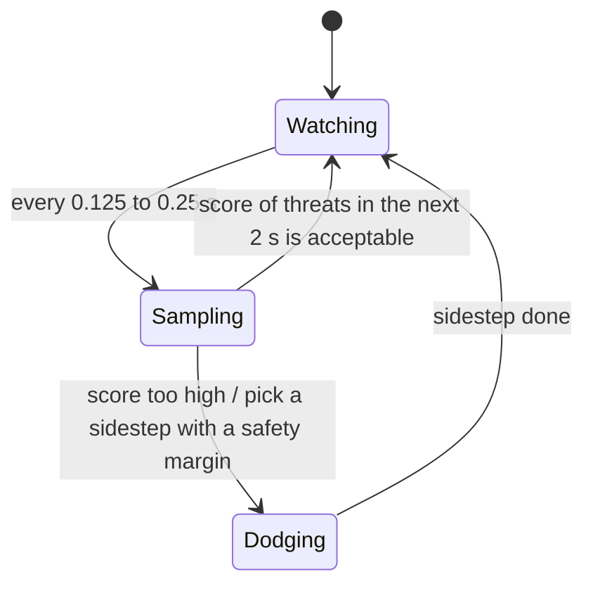

# Danger avoidance

The game keeps one list of threats. A threat is something that will explode near an actor soon. A
fighter checks the list and sidesteps when the danger is large. A civilian who watches a fight
keeps a distance from it.

OpenSky does not build this yet. Its AI does not move away from explosions or projectiles.

All values below are the ones that apply in play. Where `Skyrim.esm` overrides the program's
built-in default, the page gives the plugin value.

## What counts as a threat

The game assumes an explosion deals D × (1 − (d / R)²) at distance d, where D is its damage and R
its radius. So the distance inside which it deals at least T is its effective radius,
R × √(1 − T / D), or 0 when T is larger than D.

| Source | It is a threat when |
| --- | --- |
| A projectile or explosion on its way | Its explosion deals at least 5, and its effective radius at 5 damage is at least 30 units |
| A destructible object, such as a barrel or a trap | One of its destruction stages explodes with a radius of at least 100 and damage of at least 25 |

Example: an explosion with damage 20 and radius 100 has an effective radius at 5 damage of
100 × √(1 − 5/20) ≈ 87 units, so it is a threat.

When a dangerous destructible object takes damage:

## How a fighter scores threats

For one actor and a look-ahead time, a threat counts when:

- the actor is ahead of it: the vector from the threat to the actor points along the threat's
  direction of travel;
- the space the threat sweeps through in that time overlaps the actor's bounds;
- most likely, the threat does not come from the actor's own side.

The score = the sum of the counted threats' damage / the actor's current `Health`.

## Dodging

The combat behaviour tree has a "Dodge Threat" step with a "Check Should Dodge" condition.

The check compares the score with half of a reference score, and uses a reaction time that differs
for a moving and a standing actor. The sidestep uses the dodge speed-up and slow-down factors. The
exact way the escape point is chosen was not found.

The combat style's Avoid Threat Chance (`CSTY`) exists in the data, but its reader was not found.
Several threat settings, such as the time to avoid a rune, are never read.

## Onlookers

A civilian who sees a fight remembers the threat source for 5 seconds, and keeps away from it by a
radius set by the source's weapon. A higher level replaces a lower one, never the reverse.

| Source weapon | Radius | Level |
| --- | --- | --- |
| Melee | 512 | 1 |
| Ranged | 256 | 2 |
| Explosive | 512 | 3 |
| Mine | 256 | 3 |
| None | unchanged | unchanged |

What the onlooker then does, such as fleeing or a comment, was not found.
