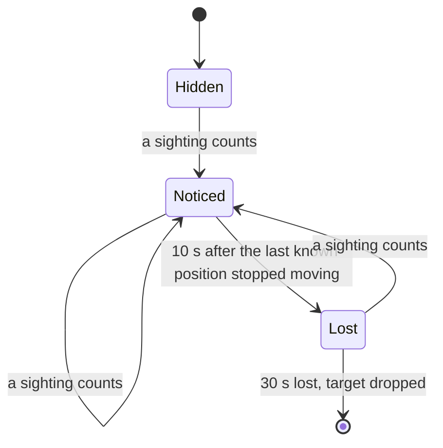

# Perception and detection

This page covers what one observer makes of one target: how the detection value is computed,
how it builds up into a state, and which inputs are still missing. What an alerted actor then
does is on the [combat](/engine/combat.md) page.

Sources:

- UESP, "Skyrim:Sneak", section "Remaining Undetected"
  (<https://en.uesp.net/wiki/Skyrim:Sneak>): the detection value, the attenuation, and the sound
  factor with its settings.
- UESP, "Skyrim:Skills" (<https://en.uesp.net/wiki/Skyrim:Skills>): the starting skill level.
- CK wiki, "Category:Detection" (<https://ck.uesp.net/wiki/Category:Detection>): the visual factor,
  the modified noticer skill, and detection events.
- CK wiki, "GetLightLevel" (<https://ck.uesp.net/wiki/GetLightLevel>) and "Perk Entry Point",
  Mod Detection Light (<https://ck.uesp.net/wiki/Perk_Entry_Point>): the light level scale.
- xEdit `Core/wbDefinitionsTES5.pas`: the condition function indices.
- Creation Kit wiki: what `GetDistance`, `GetLineOfSight`, and `GetDetected` return.

## One evaluation

Perception runs on the same 1/60 s fixed step as combat and actor values, and stops when the
world is paused. One evaluation of an observer and a target:

1. Distance, feet to feet. A seated player's feet are where the vehicle seat holds them.
2. View cone: a wedge of `viewConeHalfAngleDegrees` on each side of the observer's facing. It is
   flat in XY, because no actor tilts its head here.
3. Line of sight: one ray from the observer's eye to the target's eye, against fixed collision.
   Actors do not block it. A guard behind another guard can still see the player. Interaction
   targeting makes the same choice.
4. The detection value, from the three above plus the target's gait and crouch.
5. The pair's level goes up or down, and the level gives a state.

The ray uses the exact ray test, not the swept shape a projectile uses, because a sight line has
no thickness. A pair beyond the range of both senses is skipped before the ray, because the
attenuation would make everything zero anyway.

Observers are actors something already simulates: hostile to the player, engaged by the combat
behavior, or running a package. The only target is the player. The target list is a list so it
can grow later without changing the evaluation.

## The formula

The game computes one value for an observer and a target. The formula is the same for every
target:

```text
Detection Value = fSneakBaseValue + Sound + Visual + Skill

attenuation = ((range - distance) / range) ^ 2, never below 0
range       = fSneakMaxDistance, times fSneakExteriorDistanceMult for an observer outdoors,
              times fSneakFlyingDistanceMult when the observer or the target flies

Skill  = fSneakSkillMult * (attenuation * Weight * Noticer - Sneaking * Sneaker)
Sound  = fSneakSoundsMult * (Action + Movement) * attenuation
         * (1 with line of sight, fSneakSoundLosMult without)
         * (1 + Sleeping * fSneakSleepBonus)
Visual = InViewCone * attenuation * Moving * Light * Blindness * Size
```

Sound and Visual are never below 0.

Skill:

- Noticer is the observer's Sneak skill, mapped onto `fSneakPerceptionSkillMin` to
  `fSneakPerceptionSkillMax`: `min + (max - min) * skill / 100`. This is a line, not a clamp.
  The install sets 0 and 100, so Noticer is the skill itself.
- Weight is `1 + InCombat * fSneakAlertMod + Sleeping * fSneakSleepMod + FightingAnother *
  fSneakCombatMod`. InCombat is an observer in combat. FightingAnother is an observer whose
  combat target is another actor. On the install the first two settings are 0 and
  `fSneakCombatMod` is -0.4, so only a busy fighter notices less.
- An observer that runs an Ambush package adds 2.5 to Weight for its ambush target, and 0 for
  any other target.
- Sneaking is 1 for a target in sneak mode, and 0 for any other target. So **a target that
  does not sneak loses nothing for its Sneak skill**. A standing player in plain view is seen
  even in a dark room.
- Sneaker is the target's Sneak skill. For the player it is first `fPlayerDetectionSneakBase +
  fPlayerDetectionSneakMult * skill` (10 and 0.4). Then the perk entry point Modify Detection
  Sneak Skill runs. The same player rule applies to Noticer when the observer is the player.
- Only the observer's part is attenuated.

Sound:

- Movement is `(12 + 0.5 * equipped weight) * Movement Noise Mult`, times `fSneakRunningMult`
  when running, and 0 when the target does not move.
- Action is the sound level of the attack or cast the target makes now, times the whole part
  of `fSneakActionMult`.
- An ambush target is heard as if in line of sight.

Visual:

- InViewCone is tested only with a line of sight. It is 0 when the target's Invisibility is
  above 0, so an invisible target can only be heard.
- Moving is `1 + running * fSneakLightRunMult + moving * fSneakLightMoveMult`. Then the perk
  entry point Mod Detection Movement runs.
- Light is `light level * multiplier + fDetectionSneakLightMod`. The multiplier is
  `fSneakLightMult` indoors and `fSneakLightExteriorMult` outdoors. So a fully dark interior
  still gives 15.
- Blindness is `(100 - observer Blindness) / 100`, and 0 for a sleeping observer.
- Size is 0.5, 1, 1.5, or 2 for a small, normal, large, or very large target.
- Crouching does not change Visual. It works only through the Sneaker term.

Rounding: a total between 0 and 1 becomes 1. Any other total loses its fraction. A result of
exactly 0 becomes -1. So sight never gives 0; the value 0 means "noticed an event" (below).

### Range and view cone

- Inside the range the formula always runs. Beyond it, it does not run at all.
- The range is multiplied by 0.75 for an observer in combat when the target is not the player
  and not its combat target.
- More than 60 degrees off the observer's facing, the range for a line of sight shrinks in a
  straight line, down to 0.75 times (indoors) or 0.5 times (outdoors) directly behind.
- The view cone is 190 degrees wide: 95 degrees on each side of the facing.
- No rule detects a target only because it is in line of sight.

### Detection events

When the sight value is not positive, or the target is out of range, the observer checks the
target's last sound event:

- The event counts within 1,536 units for the player's sound and 512 units for another
  actor's. A very loud sound (level 200 or more) doubles the distance.
- A sound-only form of the formula runs. Its light level is fixed at 225 indoors and 75
  outdoors, and is used only when the event position is in view. Its range for a very loud
  event is 3,072 units.
- The observer then checks the target's projectiles within 1,024 units (player) or 512 units
  (another actor), at sound level 50.
- A positive result gives the detection value 0, at the event position.

### Light level

In the game:

- The level starts as a light value stored for the actor, as a whole number. Asking for a
  detection marks the target, so its light is sampled.
- An observer with a Night Eye value above 0 multiplies it by 3.
- An offset is then **taken off**, not added. Indoors it is the smaller of
  `iLightLevelInteriorMod` (25) and 100 times the largest channel of the cell's ambient
  colour. Outdoors it is 0. That it is the ambient colour is inferred.
- The level is held in 0 to `iLightLevelMax` (300). Then the perk entry point Mod Detection
  Light runs, and the level is rounded to a whole number.
- `GetLightLevel` returns the level times the indoor or outdoor multiplier.

OpenSky samples the stored light value itself. It is sampled at the middle of the target's
body from the light the scene pass shades it with: the ambient colour, the sun (or the cell's
directional light indoors), and the 8 nearest point lights with the shader's
`(1 - d / r) ^ falloff`. The Rec. 709 luminance of that sum, divided by `fullLightLuminance`,
times 100, is the value. Mapping one luminance unit to 100 is OpenSky's own choice. There is no
shadow test and no facing term. So a target in the shade of a wall at noon still counts as
lit.

### What OpenSky leaves out

- The Ambush package weight, the target's size, and the Night Eye multiplier.
- The three perk entry points named above.
- The indoor offset is always 25; it is not capped by the cell's ambient colour.
- The smaller range behind the observer and for a fighter's other targets.
- The sound-event fallback. A landed projectile makes OpenSky's only detection event
  ([stealth points](#stealth-points)).
- Weight uses a suspicious pair for InCombat.

### Gait multipliers

| Gait | Multiplier | Source |
| --- | --- | --- |
| Standing still | 0 | Vanilla rule |
| Sneak | `sneakMovementMult` = 0.75 | OpenSky |
| Walk, swim | 1 | Vanilla base |
| Run | `fSneakRunningMult` = 2 | `Skyrim.esm` |
| Sprint | `sprintMovementMult` = 3 | OpenSky |

The game's movement term has no crouch or sprint factor. The two OpenSky multipliers stay,
because the sneak walk is slower than a walk and a sprint is faster than a run. Swimming uses the walking value instead of a new unmeasured constant.

### Noise radius

The noise radius is how far a target at one gait can be heard, in world units. It is the
distance where the sound and the observer's skill exactly cancel `fSneakBaseValue` and the
sneaker's skill. The evaluation does
not use it. Zero is a
real answer: a target too quiet to notice even up close has no radius.

Where each constant and each input comes from is on the
[detection constants](/engine/detection-constants.md) page.

## Level and state

UESP describes detection as "an entire system of Stealth Points, like hit points but for
stealth". The visible behavior depends on that: the eye opens slowly, and a guard looks over and
goes back to work. A yes or no answer per frame would flicker at every doorway. So each pair has
a level from 0 to 100:

- A positive detection value adds `min(1, value / fullDetectionValue) * gainPerSecond` per
  second, and stores the target's position as the place to investigate.
- A value of zero or less removes `decayPerSecond` per second. At zero the stored position is
  forgotten, so an old position is never visited.

| Level | State |
| --- | --- |
| Below `suspiciousLevel` | Unaware |
| From `suspiciousLevel` | Suspicious |
| At `detectedLevel` | Detected |

`GetDetected` is true only in the detected state. A suspicious observer has detected nothing. It
has a place to look.

With these values, a target at full signal is detected in 1 second. A target that disappears
from a full level drops below suspicious at 3.75 seconds and is forgotten at 5 seconds.

## Stealth points

The level above decides what an observer has noticed. Whether it attacks is a second test, the
stealth point pool. CK wiki "Stealth Points": each target has a pool, like hit points for staying
hidden, and the highest detection value of any aggressive observer works on it. An observer is
aggressive when it is hostile to the target or already fighting. Other observers use the level
alone.

- A positive value drains `value x fCombatStealthPointDrainMult` points per second (3).
- After `fCombatStealthPointRegenAlertWaitTime` seconds (10) with no positive value, the pool
  refills at `fCombatStealthPointRegenMin` (5) plus `fCombatStealthPointRegenMult` (0.2) per point
  below zero, up to `fCombatStealthPointMax` (100).
- A value at or over `iCombatStealthPointDetectionThreshold` (25), or
  `iCombatStealthPointSneakDetectionThreshold` (70) while sneaking, detects at once and empties
  the pool.
- At 0 points the target is detected. An observer that detected it keeps it through the alert
  wait. When the pool starts to refill, the observer loses the target and searches. Until the
  pool is full again, any positive value detects the target at once.
- When the target lands a blow, its pool waits `fCombatStealthPointRegenAttackedWaitTime` (15)
  before it refills.
- A detection event holds the refill for `fCombatStealthPointRegenDetectedEventWaitTime` (10). The
  CK wiki says a projectile that hits something makes a detection event. OpenSky makes one when
  the target's projectile lands and an aggressive observer is in detection range of the impact.
  The event also puts each such observer in its Alert state: an unaware observer becomes
  suspicious of the target, and the impact is the place it searches.

The pool sets the pair's state, which combat reads. Crime witnesses read the level's own state,
because the wiki says the pool is for aggression, not for seeing a theft.

## Keeping a combat target

In the game, each combat group keeps one record per target. It holds the best detection value
any member has now, the target's stealth points, which start at 99, and two states: noticed
and lost.



- A sighting counts when the value is above 0 and either the points are 0 or the value is over
  the threshold: 25 for a standing target and 70 for a sneaking one. It sets the points to 0
  and stores the time and the target's true position.
- Every 0.1 s, a value above 0 takes `value * 3 * seconds` off the points.
- For 10 s after a counting sighting, while the target stays within 768 units of where it was
  seen, the group's last known position follows the target's true position. This holds even
  when the value is 0 or less. It is the main reason a fighter keeps a target that steps into
  the dark.
- The target is lost when one of these holds:
  1. 10 s pass after the last known position stopped following. So a target that stands still
     is kept for about 20 s.
  2. The value is below 0, a member has the target in its view cone with a line of sight, and
     the target is no longer noticed or is invisible.
  3. The value is below 0, the target is not noticed, and a member within 256 units of the
     last known position has a clear line to it.
  4. The value is positive but does not count.
- The points refill only while the target is lost: 5 per second, or 0.2 per point of value
  below 0 when that is more. The refill waits 10 s after the target was lost, and the
  [waits](#stealth-points) after an attack or a detection event.
- A member hit by the target caps the points at 50 and adds the attacker's position as a
  place to search. It does not force a sighting. A detection event caps the points at 75 and
  adds a place to search.
- The group searches only when every target on its list is lost and a member is engaged on at
  least one. `GetCombatState` returns 2 during the search. The search ends when any target is
  no longer lost. A line plays when a target is found again and when one is dropped.
- A lost target is dropped after 30 s. One with engaged members also needs 60 s with no member
  within 4,096 units.
- A member below the high process level counts every group target within 4,096 units as
  detected.

A hostility reaction, such as starting combat, runs on every detection result of 0 or more.
That includes 0, an event heard and not seen. A teammate further than 4,000 units from the
player is skipped for one of the reasons. An actor whose warning turns into an attack detects
its target at 100 with a line of sight.

OpenSky keeps one pool per target and one state per pair ([stealth points](#stealth-points)).
An observer keeps a detected target through the 10 s wait after the last positive value. The
768-unit limit, the four lost rules, the caps at 50 and 75, and the removal times are not
built.

## Sneak training

A crouched target trains Sneak while it stays hidden. Each frame, the target earns
`fSkillUsageSneakPerSecond` skill uses (0.625) per second when an observer within 960 units
tracks it and no observer has detected it. UESP "Skyrim:Leveling" gives the rate and the range
("within ~45 feet"); 960 units is OpenSky's reading of 45 feet. UESP also lists 2.5 uses for
becoming hidden. OpenSky does not give those, because no setting holds them and the moment of
becoming hidden is not defined.

## Who runs detection in the game

- Each actor runs its detection pass inside its own AI update. The update must not have ended
  early: the actor has 3D, its cell is attached, it is not the player, and it is not held in
  [dialogue mode](/engine/dialogue-mode.md).
- A pass runs when the real time since the actor's last pass is over its interval. The next
  interval is random between `fDetectionUpdateTimeMin` (1 second) and `fDetectionUpdateTimeMax`
  (2 seconds). In a complex scene it is between 2.5 and 5 seconds. A scene is most likely complex
  with more than `iAINumberActorsComplexScene` (20) actors in the high process level.
- `iUpdateDetectionsAllowedPerFrame` (100) limits the checks in one frame. Each observer and
  target pair counts as one. Once the limit is reached, no new pass starts, and the actor tries
  again on the next frame.
- A pass checks each actor in the high process level that has 3D, then the player.
- The observer keeps tracking a target only for a reason. There are nine: the observer is
  [hostile](/engine/hostility.md#aggression-draws-the-weapon) to it, the target is in combat, a
  teammate is involved, the observer watches for crime or trespass, the target is a corpse within
  a set range, and others. Without a reason the detection state of the pair is dropped. An old
  state expires after `fDetectionStateExpireTime`.
- An actor that runs its warn package for the aggro radius skips one of the hostility reasons.
- Combat can start on any result of 0 or more ([keeping a combat target](#keeping-a-combat-target)).
  `iAICombatMinDetection`, `fPlayerDetectActorValue`, `fSneakStealthBoyMult`, and
  `fSneakNoticeMin` are never read. The aggro radius rule is in
  [combat behaviour](/engine/combat-behavior.md#aggro-radius).

A pair's check then repeats at an interval that depends on who asks:

| Who asks | Interval | A stored result is reused when younger than |
| --- | --- | --- |
| A combat group, for a target beyond 2,048 units | 1.5 s | 3 s |
| The actor itself, or its group for the player or a target within 2,048 units | 1 s | 2 s |
| A group member whose own combat target is another NPC | 0.5 s | 1 s |
| A group member whose own combat target is the player | 0.25 s | 1 s |

The shortest interval any asker gives wins. Checks run only while the observer and the target
are both within 8,192 units of the player.

## Limits and repeatability

Every observer against every target, with a ray per pair, grows fast with the world. Three
limits keep it bounded, and each reports what it cut:

- At most 64 pairs. The nearest pairs win, and a counter shows how many were dropped. A silent cut
  would read as "nothing else was near".
- At most 8 pairs evaluated per step, in turn, in a fixed order. A pair gets the time since its
  last evaluation. So slicing changes when a level is computed, not where it ends up.
- At most 8 steps per frame, like combat and actor values.

The list of actors is refreshed once per frame and sorted by `ReferenceKey`. Every change is a
pure function of the elapsed time. So two runs with the same inputs give the same levels.

## Condition functions

Three functions read a detection snapshot. Indices are the stored numbers from xEdit. The
Creation Kit adds 4096 to each.

| Stored | Creation Kit | Name | Parameter | Returns |
| --- | --- | --- | --- | --- |
| 1 | 4097 | `GetDistance` | a reference | World units between run-on and parameter |
| 27 | 4123 | `GetLineOfSight` | a reference | 1 if the run-on's sight line to it is clear |
| 45 | 4141 | `GetDetected` | an actor | 1 if the run-on actor has detected it |

The run-on reference asks about the parameter: `[Observer].GetDetected Target`. Detection is not
symmetric. A guard may see the player while the player does not know it is there. Asking about a
reversed pair, which is not tracked, fails as unavailable. An untracked pair is not an undetected
one. See [condition evaluation](/engine/conditions.md).

When an actor in combat loses a target that perception was tracking, it goes to the stored
position. `GetCombatState` then returns 2, "Searching". Combat music keeps playing while an actor
searches.

## Checking it

`openskycli gmst detection` prints every setting with its source, and
`openskycli gmst list <s>` prints any group of game settings ([CLI](/tools/cli.md)).

OpenSky's choice: detection reads the light level at half the player's eye height, and a spell
aims at the middle of its target's capsule.
