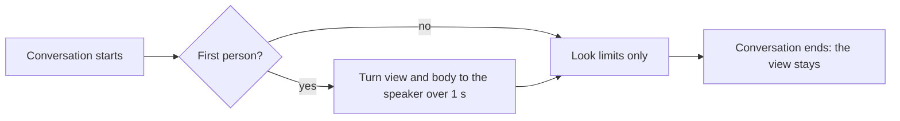

# Dialogue camera and speaker focus

When a conversation starts in first person, the player turns to look at the speaker. The speaker
stops and faces the player. The camera does not move to a new place, and nothing is given back
when the conversation ends. Topic selection is on the [dialogue runtime](/engine/dialogue.md) page.

## The turn to the speaker

The turn is set up once, when the conversation starts, and only in first person. In third person
the view does not turn, and the camera does not zoom or change its field of view.

| Quantity | Value | Setting |
| --- | --- | --- |
| Aim point | The speaker's look-at node, else its head node, else 0.9 of its height above its feet | |
| Eye | The first-person camera position, raised by the look-at offset | `fFirstPersonLookAtVertOffset` 0 |
| Duration | 1 second | `fDialogueRotationSecs:Dialogue` |
| Pitch offset | 0.17 radians (about 10 degrees) below the aim point | `fDialogueRotationPitchOffset:Dialogue` |

The target yaw is the direction from the eye to the aim point, taken the short way round, so a
speaker behind the player is a turn of up to 180 degrees. The target pitch looks at the aim point,
then 0.17 radians further down, so the face sits a little above the middle of the view.

The turn eases out. With `t` the share of the duration that has passed, the view is
`sin(t * pi / 2)` of the way from the start angles to the target angles. It moves fast at first
and slows down at the end. The player's body turns with the view, unless the player sits. The
camera position never changes, and the aim is not updated if the speaker moves.

## Looking away during a conversation

After the turn, looking further away from the speaker is slowed and then stopped. Let `a` be
the angle between the view's yaw and the direction to the speaker now. A yaw input that turns
away from the speaker is scaled:

| `a` | Scale |
| --- | --- |
| Up to the soft stop | 1 |
| Between the soft and the hard stop | `0.33 * (1 - (a - soft) / (hard - soft))` |
| Past the hard stop | 0 |

| Camera | Soft stop | Hard stop | Settings |
| --- | --- | --- | --- |
| First person | 20 degrees | 45 degrees | `fDialogueSoftStopAngle1P:Controls`, `fDialogueHardStopAngle1P:Controls` |
| Third person | 25 degrees | 55 degrees | `fDialogueSoftStopAngle3P:Controls`, `fDialogueHardStopAngle3P:Controls` |

The 0.33 is `fOutsideDialogueAngleRotationDampen:Controls`. Turning back toward the speaker is
never limited, and neither is looking up or down. With the mouse, the menu shows a pointer, and
the view turns only when the pointer is within 25 pixels of a window edge
(`fPCDialogueLookStart:Controls`), at speed 10 (`fPCDialogueLookSpeed:Controls`), in the
direction from the screen centre to the pointer.

`Skyrim.esm` also holds `fDialogZoomInSeconds`, `fDialogZoomOutSeconds`,
`fDialogFocalDepthRange`, and `fDialogFocalDepthStrength`. The game does not use them: there is
no dialogue zoom and no dialogue depth of field.

## The race menu portrait

The race menu shows the player's face from the front. OpenSky writes that view on top of the
active camera mode and remembers the player's own pose, which it puts back when the menu closes.
The game's race menu camera is not described here yet.

## Speaker focus

Starting a conversation stops the speaker, turns it to face the player, and holds its package.
Leaving gives all three back. Each change goes through the system that already owns that thing,
so nothing here can disagree with what the AI does on the next frame.

| What | How | On release |
| --- | --- | --- |
| Walking | The mover stops where it stands | Nothing. A resumed package asks for its own movement |
| Facing | A facing hold in the movement runtime | The hold ends. The actor keeps the direction it reached |
| Package | The package is suspended | The suspension lifts, and the package is selected again |

The facing hold turns the whole actor in place, at the same turn rate a walking actor uses. It
sends a "standing still" drive every frame, so the animation keeps the idle clip. It does not
count against the limit of eight movers. A turn has no path, no collision sweep, and no new
search, so the CPU budget that limit protects does not apply ([navigation](/engine/navigation.md)).
Starting a walk ends a hold, and starting a hold ends a walk, because one yaw has one owner.
During the conversation the speaker turns its head toward the player
([head tracking](/engine/head-tracking.md)).

Suspension is a latch, not a saved plan. While an actor stood in a conversation, the world moved
on. On release it needs the package its schedule names now. So the package is selected again from
scratch, as after [combat](/engine/combat.md).
