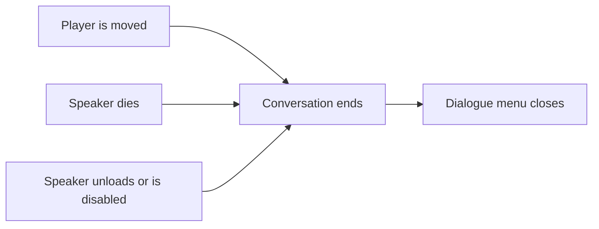

# Dialogue menu

This page covers how the player talks to an NPC: the use key on an actor, the vanilla
`interface\dialoguemenu.swf` listing that speaker's topics, the response text and its subtitle,
and the input and pause rules around them. Which topics are offered is on the
[dialogue](/engine/dialogue.md) page.

## Talk targeting

An actor under the crosshair becomes a normal crosshair target with the action "Talk". So the HUD
prompt and the compass marker reach it with no extra work. Pressing the use
key sends a talk event with the speaker's session-stable `ReferenceKey`. Dialogue selection,
"said" state, and saves all name a speaker that way.

### Why actors are not in the collision trees

The [interaction](/engine/interaction.md) ray tests the fixed collision of each cell. Actors are
not in it, and should not be. An actor has no placed collision, and it moves every frame. The
collision trees are built once per cell, so putting actors in them would mean a rebuild each time
someone took a step.

Instead, talk targeting reuses the exact test [melee combat](/engine/melee-combat.md) uses: the
closest distance between two segments. A view ray is a segment and an actor is a capsule, so one
call gives the answer. [Detection](/engine/detection.md) line of sight was not used. It answers
"can this observer see that actor", about one pair. Targeting has to rank every loaded actor
against one ray.

### Walls and filters

Talk targeting tests no walls itself. The actor hit counts only when it is nearer than the
nearest solid hit on the same ray, whether that solid thing can be used or not. So a shopkeeper
behind a closed door is hidden by a door that opens, and does not talk.

An actor is a candidate when two things hold:

| Rule | Why |
| --- | --- |
| Alive | The same death state combat reads, so the two cannot disagree |
| Not hostile | A fighting actor speaks from the combat category, and selection offers only category 0 |

Having something to say is not a rule. A speaker whose topics all fail their conditions still
opens a menu with an empty list. The condition trace can explain "this actor had nothing to say".
A prompt that silently never appears cannot be explained.

The talk distance is the interaction reach. The install gives no separate number. A different
number would make an actor the crosshair shows as a target that the use key then refuses.

## A menu that leaves the world running

In vanilla dialogue the world keeps running while the player reads the list. The speaker keeps
breathing, walking, and being heard. So each menu declares a world rule when it opens:

- pauses the world: the default for every other menu;
- leaves the world running: only the dialogue menu.

The world is paused while any open menu pauses it. So the system menu opened over a
conversation still stops the world, and closing it gives the running world back
([menu mode](/engine/menu-mode.md)).

This means the input route and the pause are separate. Held world keys are released when input
moves to the menu, not when the world pauses. Otherwise a key held into a menu that does not pause
would keep moving a camera no one steers.

## The measured movie contract

Measured with `openskycli menu dialogue` and `openskycli swf action-run --movie
dialoguemenu.swf`. The movie starts and ticks with zero faults and zero unimplemented opcodes,
over 57 display nodes.

| Path | What it is |
| --- | --- |
| `/DialogueMenu_mc` | The menu, class `DialogueMenuObj` |
| `/DialogueMenu_mc/SpeakerName` | Who is talking |
| `/DialogueMenu_mc/SubtitleText` | The line being said |
| `/DialogueMenu_mc/TopicListHolder` | Frame labels `moveDown`, `moveUp`, `topicClicked`, `fadeListIn`, `slideListIn` |
| `/DialogueMenu_mc/TopicListHolder/List_mc` | Class `TopicList`, the topic rows |
| `/DialogueMenu_mc/ExitButton` | Frame labels `up`, `over`, `down`, `disabled` |

`DialogueMenuObj` has class constants for its states: `SHOW_GREETING` 0, `TOPIC_LIST_SHOWN` 1,
`TOPIC_CLICKED` 2, `TRANSITIONING` 3. The live instance has an `eMenuState` field. The movie's
own entry points do not set it, so OpenSky writes it, reading the value from the class constant.
A movie whose state field disagrees with the screen answers keys wrongly.

The list is the same CLIK family as the other menus. `TopicList` adds `UpdateList`,
`SetSelectedTopic`, `SetEntryText`, and `RepositionEntries` on a `BSScrollingList` base with
`EntriesA`, `iSelectedIndex` (-1 for none), `InvalidateData`, and `ClearList`. `iMaxItemsShown`
is 8 and `iNumTopHalfEntries` is 4. That is why the movie has eight `Entry` clips and keeps the
selection in the middle.

`SetSelectedTopic` is not used. With `menu dialogue --down 2`, calling it with the row index
leaves the movie at row 0, and not calling it leaves the movie at row 2. So its argument is not
the index. OpenSky writes `iSelectedIndex` and then calls `UpdateList`, which moves the entry
clips.

Row fields are `text`, `topicIndex`, `topicIsNew`, and `responseHash`. The list draws a row
through the entry clip's own `SetEntryText`, not by reading named fields. `topicIsNew` is true
until the winning `INFO` has been said, read from its [said-state](/engine/dialogue.md#said-state).
`responseHash` carries the winning `INFO` FormID.

## Who owns the selection

The engine's menu model has rows, a cursor, and three states: greeting, topic list, response.
The movie's fourth state, `TRANSITIONING`, is left to the movie, because it only animates between
the others. A fourth engine state that copied an animation frame would be a second clock to keep
in step.

The engine owns the selection here, unlike the [journal](/engine/journal.md), where the movie
owns it. This follows from `SetSelectedTopic` above: the movie has no cursor to trust. The movie
still gets every key, so its focus art and sounds still run.

## Text

Measured with `menu dialogue --text`, which reads each field from all three string tables:

| Field | Table | Use |
| --- | --- | --- |
| `DIAL` `FULL` | `.strings` | The topic's name. A row shows it by default |
| `INFO` `RNAM` | `.strings` | The prompt. Replaces the topic text when present |
| `INFO` `NAM1` | `.ilstrings` | One response line the speaker says |

UESP on `RNAM`: "the player's response to a question (INFO with TCLT options). If present,
overrides the default text coming from the parent dialogue topic"
(<https://en.uesp.net/wiki/Skyrim_Mod:Mod_File_Format/INFO>). A row with no text falls back to
the topic's editor ID, then its FormID, because a row with no label cannot be chosen on purpose.

A row and a spoken line fill their text-replacement tags, such as `<Global=HirelingGold>` in a
hireling's prompt, as journal and message text do
(<https://ck.uesp.net/wiki/Text_Replacement>). The tags are read against the quest that owns the
topic, the `DIAL` `QNAM`.

The engine fills two more tags from the speaker. `<CrimeGold>` is the player's bounty with the
speaker's crime faction: "\<CrimeGold\> will be text-replaced by the bounty amount"
(<https://ck.uesp.net/wiki/Creating_a_Custom_Crime_Faction>). A guard's pay row reads "I'll pay
off my bounty. (25 gold)". `<BribeCost>` is the gold the speaker asks as a bribe
(<https://ck.uesp.net/wiki/Tutorial:_Dialogue_Speech_Checks>), the same amount
[speech checks](/engine/speech-checks.md) test, in whole gold. A tag nothing fills stays as
written, as the Creation Kit page says of a tag that fails to parse.

## Subtitles

The HUD subtitle is `/HUDMovieBaseInstance/SubtitleTextHolder/textField`. With no line, the
holder is hidden, not only emptied. It carries its own art, and an empty field in a visible
holder is an empty box on screen. The HUD's `SubtitleText` property is the field's bound
variable, so OpenSky writes both the drawn text and the variable. The vanilla movie ships a
sample text in this field, so it stays hidden until a line is set.

Which lines get a subtitle:

- The player's own lines never get one.
- No line gets one when both `bGeneralSubtitles:Interface` and `bDialogueSubtitles:Interface` are
  off, or when its text is empty.
- A line shows only while its speaker is within `fMaxSubtitleDistance:Interface` of the player.
  The default is 1250 units; the INI can change it. OpenSky reads no `Skyrim.ini` and uses 1250. A line whose `INFO` sets flag `0x200` (force
  subtitle) skips this test.
- Forced lines sort ahead of the others; after that, nearer speakers come first.
- The HUD subtitle needs `bGeneralSubtitles`. With `bShowSubtitleSpeakerName` on, the speaker's name
  comes first, in the colour `iSubtitleSpeakerNameColor`.
- A line from the actor the player talks to also goes to the dialogue menu's subtitle when
  `bDialogueSubtitles` is on.

The HUD stays under the dialogue menu in `DialogueMode`, which hides the HUD's subtitle. While a
conversation is open, the menu's own `SubtitleText` shows the line. A line is cleared when the
player moves on and when the conversation ends.

Two settings choose the lines. Dialogue subtitles cover the conversation the player is in.
General subtitles cover lines that scene actors say nearby, shown on the HUD for the line's
length.

## Input

| Event | Effect |
| --- | --- |
| Up, Down | Moves the selection. Stops at the ends, does not wrap |
| Accept | Chooses the selected topic, or moves past the current line |
| Cancel | Leaves the conversation |
| Left, Right | Nothing. It is one vertical list |
| Pointer | Not routed |

The pointer event carries a movement, but a movie hit test needs a stage position. So the
dialogue menu ignores it, like the [inventory](/engine/inventory-menu.md) and
[system](/engine/system-menu.md) menus.

## A conversation

A greeting is chosen when the conversation opens, so a say-once greeting is spent and its result
script runs. Its `TCLT` links are dropped, not used as the topic list. A greeting is said over
the offered topics, and taking its links would replace the list the player is about to read.

Choosing a topic records "said" state, runs the response's result script fragments, and returns
the linked topics. The links are kept until the line ends, not asked for again, because asking
again would run the result scripts again. A response with no links goes back to a new general
list, because a say-once line may have just changed it. A goodbye response closes the
conversation.

### What ends a conversation

A goodbye line is not the only end. The game also ends the conversation and closes the menu
when one of these happens:

| Event | Example |
| --- | --- |
| The player is put somewhere new | A load door, a script's `MoveTo` on the player, being sent to jail, serving time, or fast travel. A move inside the same cell counts too, with or without a loading screen |
| The speaker dies | Another actor kills it while the menu is open, because the world keeps running |
| The speaker stops being a full actor | It unloads, is disabled, or its AI package is stopped and reset |
| Another actor force-greets the player | The new speaker takes over the menu |

So an arrest line without the goodbye flag still leaves no menu open in the jail cell: the move
to the cell ends the conversation. The game does not end a conversation because the player walks
away from the speaker; only the player's cancel key does that. Opening the barter, gift,
container, or journal menu from the conversation does not end it.

OpenSky ends a conversation on the next world step after the player is moved, or the speaker
dies or leaves the loaded actors. A disabled actor leaves them too. A speaker that was never a
loaded actor, such as a talking activator, keeps its menu. A dead actor cannot talk, which is the
same rule talk targeting uses to leave dead actors out. An actor that force-greets the player
during another conversation closes it and opens its own.

## Movie entry points not used

The [AS2 scope decision](/decisions/swf-as2-scope.md) requires every host function OpenSky does
not implement to be a counted no-op, listed here:

| Entry point | Why |
| --- | --- |
| `OnVoiceReady`, `SkipText` | The engine side moves on when a voice file ends, so the movie needs no voice timing |
| `SetAllowProgress`, `StartProgressTimer` | The same gate from the movie's side, with its 750 ms `ALLOW_PROGRESS_DELAY` |
| `AdjustForPALSD` | Standard-definition TV layout. No use on macOS |

Each response run is said in the speaker's voice, with lip movement, through the dialogue
speech channel ([audio decoding](/engine/audio-decoding.md)). When a run's voice file plays to
its end, the menu moves on as Accept does. A run with no voice file waits for Accept. Accept
during a run cuts its voice off and starts the next one.
