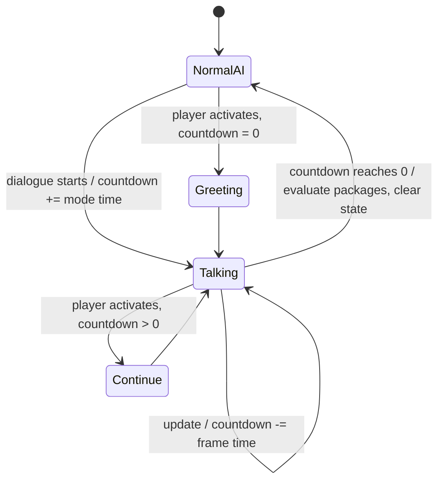

# Dialogue mode

After the player talks to an NPC, the NPC stays in talking mode for a while. It keeps facing the
player and does not go back to its packages at once. A countdown on each actor decides how long.

OpenSky does not build this yet. It ends the talking state when the dialogue menu closes.

## The countdown

- Each actor has a countdown in seconds. The player has one too.
- Starting dialogue with the player adds the game's dialogue mode time (60 seconds)
  to the actor's countdown and to the player's.
- Each time an actor starts to say a response line, its dialogue target becomes the player, and
  its countdown is written: above 1 second it gets the full time again, and at 1 second or below
  the time is added. This covers hellos, greetings, and every line inside a conversation with
  the player. It is skipped while the actor's package controls its speech, which is most likely
  scene and script speech. So a scene line most likely leaves the countdown alone.
- Starting dialogue with the player always adds the full time, with no 1 second check, and sets
  the actor's countdown to 0 when the start fails. It has two forms:
  - The player activates the NPC. The start is refused while the player is in certain states.
    On success the player is marked as in dialogue too.
  - The NPC starts it, most likely from a force-greet package or a greeting. The NPC picks its own
    greeting topic. When none fits, it sets its greeting timers to `fAIExclusiveGreetingTimer`
    (2.5 seconds) and `fAIGreetingTimer`.
- The player's own countdown gets the full time added when its start succeeds, with no 1 second
  check.
- Stopping dialogue through the same routine sets the NPC's countdown to 0, clears its dialogue
  target, and makes it evaluate its packages again. A seated or sleeping NPC takes a separate
  path. The player's countdown is set to 0 too. Which of these the closing dialogue menu calls
  was not found.
- The dialogue mode time is `fAIInDialogueModewithPlayerTimer`: 30 in the program and 60 in
  `Skyrim.esm`. `fAIInDialogueModeWithPlayerDistance` (500) is never read.
- No way for a script to start dialogue mode was found.
- Each update the countdown drops by the frame time. Talking mode lasts while it is above 0.
- A separate "aware of player" time, 5 seconds, writes the same countdown.
- "In conversation with the player" is true while the countdown is above 0. The In Game
  Dialogue package type reads it.

## While the NPC is the dialogue target

Each AI update, an NPC flagged as talking with the player does one of three things:

- **It is the conversation's current actor and is not speaking.** The countdown drops by the frame
  time. The rest of the AI update is skipped: the package does not run, and the NPC stands where
  it is. When the countdown goes below 0, the NPC evaluates its packages, and the flag clears if
  that works.
- **It is speaking and the dialogue system is busy.** It stops any movement and skips the rest of
  the update.
- **It is no longer the current actor.** It evaluates its packages and the flag clears, when the
  dialogue system is busy or the player is within `fAIActivateReach` (300 units). Otherwise it
  asks the dialogue menu to close.

Whether the NPC keeps facing or head-tracking the player during the countdown was not found.

When the player activates the NPC with the countdown at 0, a fresh greeting starts. Above 0, the
conversation goes on without a new greeting.

## In OpenSky

- Opening a conversation adds the dialogue mode time to the actor and to the player. A hello, a
  greeting, and each line of the conversation write the actor's countdown by the 1 second rule.
  The time comes from `fAIInDialogueModewithPlayerTimer`.
- Closing the conversation sets the player's countdown to 0. The actor keeps its own, and it
  drops by the frame time while the actor says no line of an open conversation.
- While the countdown is above 0, `IsInDialogueWithPlayer` is true for the actor, and activating
  it again opens the topic list without a new greeting.
- `openskycli game state social` shows each countdown under `dialogueMode`.

OpenSky holds the actor in place only while the dialogue menu is open. When the menu closes, the
actor goes back to its package while the countdown still runs. The game holds the actor for as
long as it is the conversation's current actor, and which state the closing menu leaves was not
found, so this is OpenSky's choice. Combat lines, idle chatter, and scene lines do not write the
countdown.
