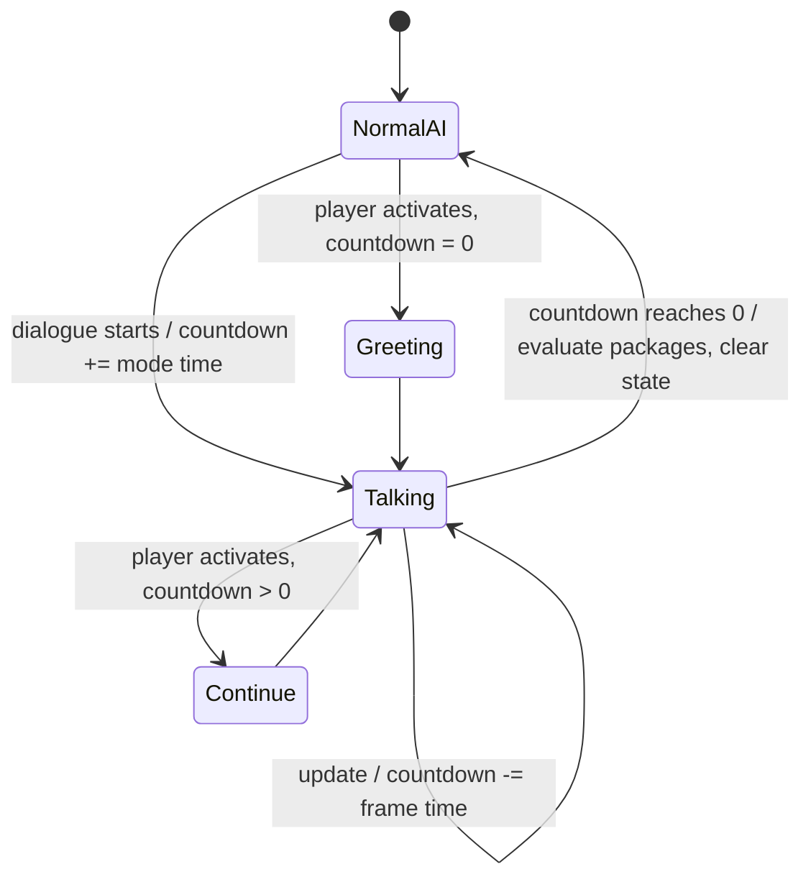

# Dialogue mode

After the player talks to an NPC, the NPC stays in talking mode for a while. It keeps facing the
player and does not go back to its packages at once. A countdown on each actor decides how long.

OpenSky does not build this yet. It ends the talking state when the dialogue menu closes.

## The countdown

- Each actor has a countdown in seconds. The player has one too.
- Starting dialogue with the player adds the game's dialogue mode time (30 seconds by default)
  to the actor's countdown and to the player's.
- An actor spoken to again while its countdown is above 1 second gets the full time again. At 1
  second or below, the time is added instead.
- Ending dialogue sets the player's countdown to 0. The NPC keeps its own.
- Each update the countdown drops by the frame time. Talking mode lasts while it is above 0.
- A separate "aware of player" setting writes the same countdown.
- "In conversation with the player" is true while the countdown is above 0. The In Game
  Dialogue package type reads it.

## While the NPC is the dialogue target

The NPC's AI update counts the countdown down. When it reaches 0, the NPC evaluates its packages
again and goes back to normal AI, and the state is cleared. It also evaluates its packages again
while a dialogue menu is open, or while the player is within activation reach.

When the player activates the NPC with the countdown at 0, a fresh greeting starts. Above 0, the
conversation goes on without a new greeting.

## Source

Behaviour described from a clean-room read of `SkyrimSE.exe` 1.7.104.0. It is not yet
confirmed in the reference game.
