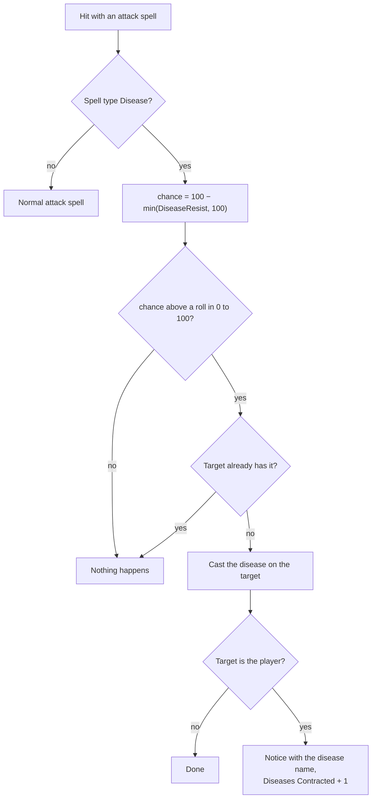

# Diseases

Some creatures carry a disease. Their hits can give it to the target. The player then sees a
notice with the disease's name.

OpenSky does not build this yet. A hit never gives a disease.

## Which creatures carry one

The disease is the attacker's race attack spell, in the race's `ATKD` attack data. The spell's type
is Disease. Examples from `Skyrim.esm`:

| Race | Disease |
| --- | --- |
| `WolfRace`, `FoxRace` | `DiseaseRockjoint` |
| `SkeeverRace` | `DiseaseAtaxia` |
| `SabreCatRace` | `DiseaseWitbane` |
| `ChaurusRace` | `DiseaseRattles` |
| The bear races | `DiseaseBoneBreakFever` |
| `HagravenRace` | `DiseaseBrainRot` |

## Contracting it

This runs on every hit that carries an attack spell from an attacker, and on a miss that casts the
spell with no target.

1. The spell must be of the Disease type.
2. resist = the target's `DiseaseResist`, cut to a whole number, or 100 with no actor target.
3. chance = 100 − min(resist, 100), in percent.
4. A roll from 0 up to 100. The disease is contracted only when chance is above the roll. Else
   nothing happens, and no notice shows.
5. The spell is cast on the target. This works on any actor, not only the player. A target that
   already has the spell is skipped, and the cast fails.
6. If the cast worked and the target is the player, the notice shows: the game's contracted
   disease text, a space, the disease's name, and a full stop. The "Diseases Contracted"
   statistic goes up by one.

So `DiseaseResist` 100 or more never contracts, and a negative value always does.

Example: a player with 50 `DiseaseResist` is bitten by a skeever. The chance is
50%, so about every second bite gives Ataxia, if the player does not have it already.

Whether a blocked hit still rolls was not found.
