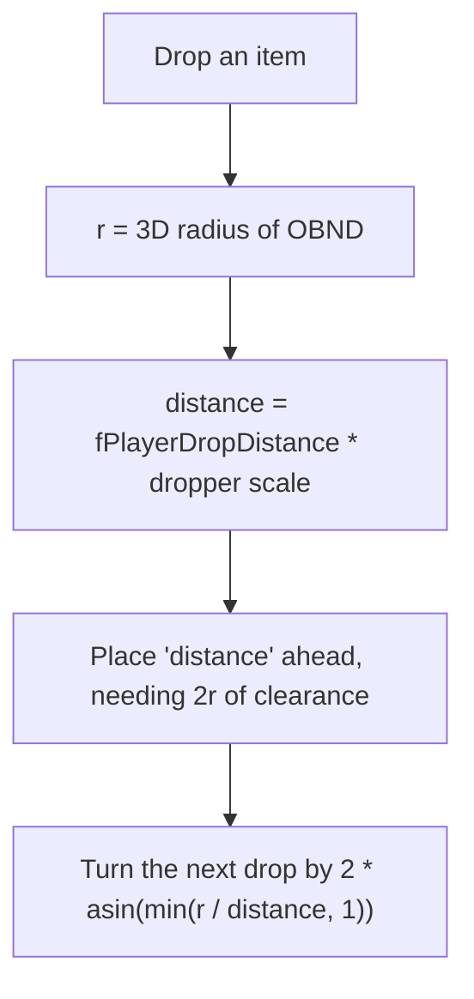

# Dropped items

An item dropped from an inventory lands in front of the actor that dropped it, clear of walls.
The size test uses the item's [object bounds](/formats/records.md#object-bounds).

## Where it lands

- `r` is the item's 3D radius from `OBND`. This holds for every carried type: `WEAP`, `ARMO`,
  `MISC`, `BOOK`, `ALCH`, `AMMO`, and a carried `LIGH`.
- The drop point is `fPlayerDropDistance` (default 100) times the dropper's scale in front of
  the dropper.
- The item needs `2 * r` of free space at the drop point.
- Each drop turns the drop direction by about `2 * asin(min(r / distance, 1))`, wrapping at a
  full turn. So several drops in a row fan out around the actor instead of piling up.

Example: a sword with a 3D radius of 40 dropped by an actor at scale 1 lands 100 units ahead,
needs 80 units of clear space, and the next drop turns by about `2 * asin(0.4)`, or 47 degrees.

