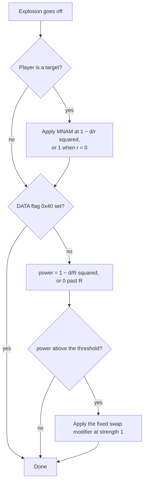
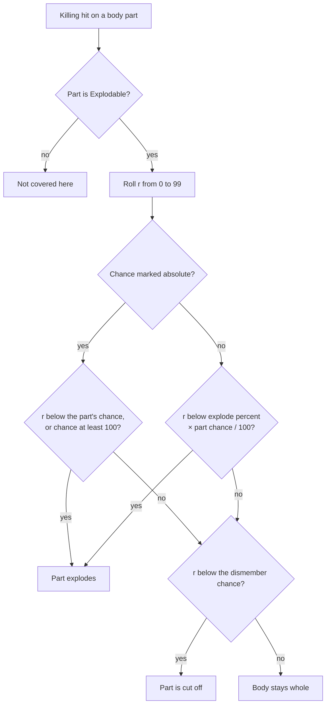

# Explosion effects

An explosion near the camera can show two screen effects: its own image space modifier, and a
fixed "swap" effect from the master file. A killing hit can also blow off a body part that is
marked as explodable.

OpenSky does not build the swap effect or exploding body parts yet. It applies only the
explosion's own image space, with a straight-line falloff
([image space triggers](/rendering/image-space.md#triggers)).

## The explosion's own image space

The `EXPL` `MNAM` image space modifier applies when the player is one of the explosion's
targets. Its strength is 1 − (d / r)², where d is the distance to the camera and r is the
explosion's image space radius. A radius of 0 gives strength 1. The swap flag below does not
block it.

## The swap effect

1. Power = 1 − (d / R)² when d ≤ R, else 0. d is the distance from the camera, or from the player
   when there is no camera position. R is the `EXPL` `DATA` radius times the explosion's scale.
2. When the power is above the game's threshold, 0.6 by default, a fixed image space modifier
   from the master file applies at strength 1.
3. An explosion whose `DATA` flags have bit `0x40` (Ignore Image Space Swap) skips step 2.

Example: an explosion with radius 200 at 100 units gives power 1 − 0.25 = 0.75. That is above 0.6,
so the swap applies. At 150 units the power is 0.44, so it does not.

## Exploding body parts

A killing hit on a body part marked Explodable in its `BPTD` record rolls r, a whole number from 0
to 99.

- If the part's chance is marked absolute, the part explodes when r is below its explode chance.
  A chance of 100 or more always explodes.
- Otherwise, it explodes when r is below the game's explode percentage (5 by default) × the part's
  chance / 100.
- A part that does not explode is cut off when r is below the game's dismember chance
  ([decapitation](/engine/ragdoll.md#decapitation)).

Vanilla data has no explodable part, so a test needs a synthetic record.

## Source

Behaviour described from a clean-room read of `SkyrimSE.exe` 1.7.104.0. It is not yet confirmed
in the reference game. The Creation Kit wiki pages "Explosion"
(<https://ck.uesp.net/wiki/Explosion>) and "BodyPartData" (<https://ck.uesp.net/wiki/BodyPartData>)
name the record fields.
