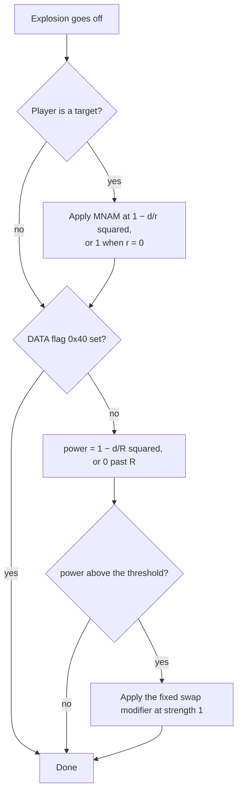
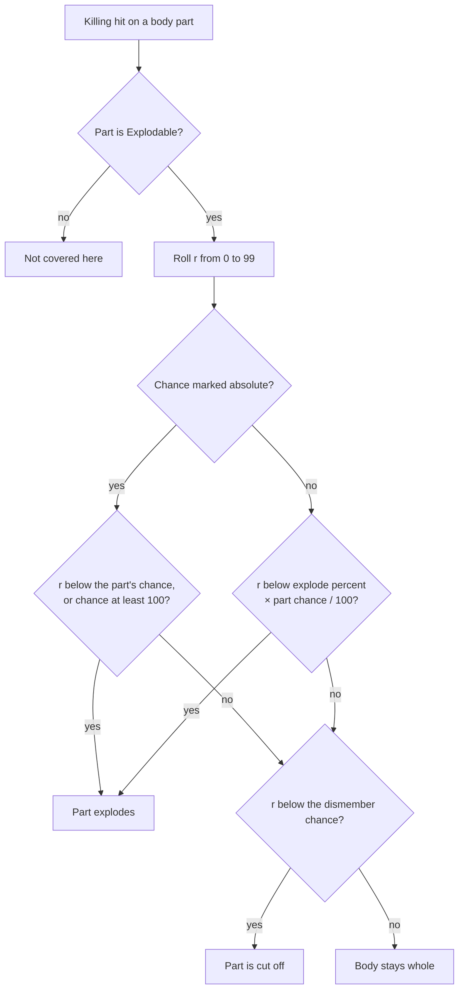

# Explosion effects

An explosion near the camera can show two screen effects: its own image space modifier, and a
fixed "swap" effect from the master file. A killing hit can also blow off a body part that is
marked as explodable.

OpenSky builds all three. The last section lists where it differs.

## The explosion's own image space

The `EXPL` `MNAM` image space modifier applies when the player is one of the explosion's
targets. Its strength is 1 − (d / r)², where d is the distance to the camera and r is the
explosion's image space radius. A radius of 0 gives strength 1. The swap flag below does not
block it.

## The swap effect

Read from the game program. The check runs at the explosion's first update.

1. Power = 1 − (d / R)² when d ≤ R, else 0. d is the distance from the player, or from the camera
   while the kill camera plays. R is the radius the explosion is spawned with, times the scale
   the spawner asks for.
2. When the power is above the threshold, a fixed image space modifier applies at strength 1. The
   threshold is `fExplosionImageSpaceSwapPower`: 0.6 in the program, and 0.75 in `Skyrim.esm`.
3. An explosion whose `DATA` flags have bit `0x40` (Ignore Image Space Swap) skips step 2.

The game finds the modifier by the fixed FormID `0x00000166`. No shipped master holds a record with
that FormID: not `Skyrim.esm`, `Update.esm`, the three DLC masters, or the Creation Club masters.
So in the shipped game the lookup finds nothing, and no swap effect shows. A plugin that adds an
`IMAD` with that FormID turns it on.

[WARNING] The program builds R from the `DATA` radius times 22 units per foot, unless `DATA` flag
bit `0x01` is set, or from a magic effect's area times 22 when the explosion comes from a spell
with an area. This read is not checked against a measurement.

Example: an explosion with radius 200 at 80 units gives power 1 − 0.16 = 0.84. That is above 0.75,
so the swap applies. At 100 units the power is exactly 0.75, which is not above it, so it does not.

## Exploding body parts

A killing hit on a body part marked Explodable in its `BPTD` record rolls r, a whole number from 0
to 99.

- If the part's chance is marked absolute, the part explodes when r is below its explode chance.
  A chance of 100 or more always explodes.
- Otherwise, it explodes when r is below the game's explode percentage (75) × the part's
  chance / 100.
- A part that does not explode is cut off when r is below the game's dismember chance (50).

The game only marks the hit with the result. Nothing in the game acts on the mark, so no part
explodes or is cut off this way. Decapitation is a separate path that does not use this roll
([decapitation](ragdoll.md#decapitation)).

Vanilla data has no explodable part, so a test needs a synthetic record.

## In OpenSky

- The explosion's own image space applies at every blast the viewer is near, also when the player
  is not one of its targets ([image space triggers](../rendering/image-space.md#triggers)).
- The swap modifier is looked up by its fixed FormID in the load order. Like the game, a load
  order without that record shows no swap effect.
- [WARNING] The swap power uses the `DATA` radius as it is, with no 22 units-per-foot factor and a
  scale of 1, as OpenSky's blast damage does. The viewer is the camera.
- Like the game, OpenSky does not roll for an explodable part. Only a decapitating blow cuts a
  body ([decapitation](ragdoll.md#decapitation)).
