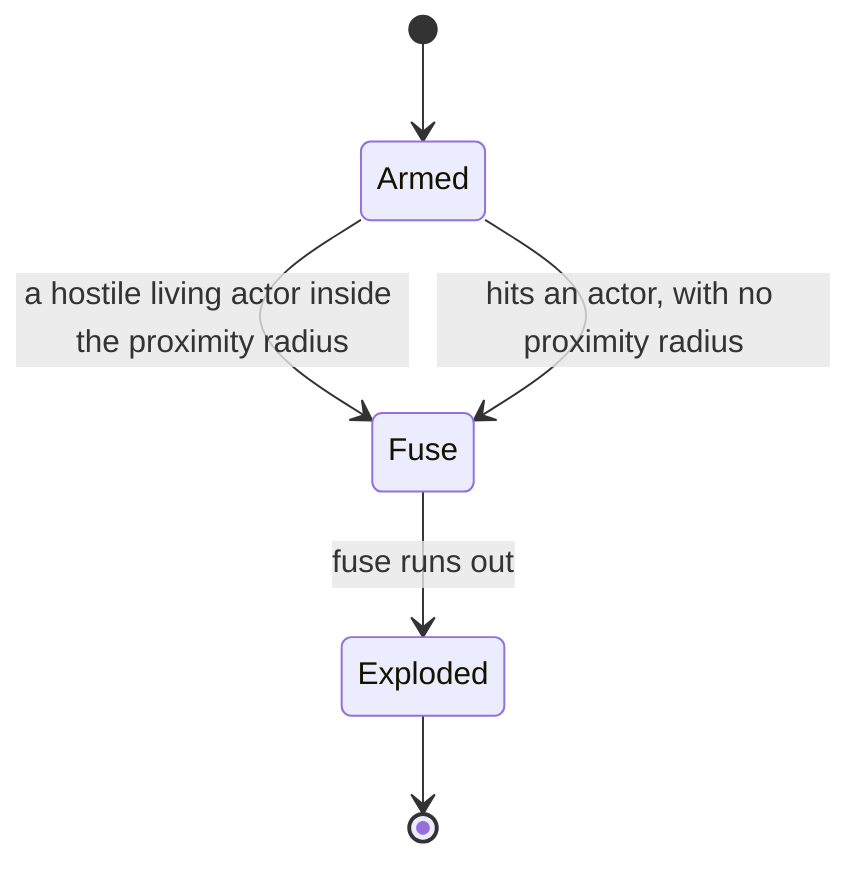

# Explosions in the game

This page gives the game's rules for a projectile that explodes, and for the explosion itself. The
`EXPL` and `PROJ` fields are on the [explosion records](/formats/explosions.md) page, with what
OpenSky does today. The push on loose bodies is on the [impulses](/engine/impulses.md#explosions)
page. The screen effects are on the [explosion effects](/engine/explosion-effects.md) page.

## When a projectile explodes

A projectile explodes only when it names an explosion and its model is loaded.

- Without the `PROJ` flag Alt Trigger (`0x4`), it explodes at its first impact.
- With Alt Trigger, it works as a mine (below).

The explosion takes the projectile's position, rotation, shooter, and weapon. The impact normal
becomes the explosion's direction. An explosion makes a noise for detection at its `EXPL` sound
level.

## A spell's explosion

A spell with several effects still sets off one explosion per impact. The explosion comes from
the spell's main effect, the same effect that gives the hand art and the projectile
([spellcasting](/engine/spellcasting.md#casting-cues)):

- The main effect has the highest cost, cut to a whole number. On a tie, the earlier effect wins.
- An effect with `MGEF` flag bit 24 (`0x01000000`) is skipped. For a concentration spell, an
  effect with no projectile is skipped too.
- The cost is the effect's stored cost, at least 0. No skill or perk changes it, so perks do not
  change which effect is the main one.
- The choice is made when the projectile is launched, not when it lands.

Which explosion the projectile carries depends on the costliest effect with Aimed delivery. That
choice uses the same cost rules, without the concentration rule. A spell with no Aimed effect
launches no projectile.

- Its area is 1 or more: the main effect's `MGEF` explosion. When the main effect has none, no
  explosion goes off.
- Its area is below 1: the `PROJ` record's own explosion.
- An area counts as 0 when the `MGEF` has the No Area flag (bit 11, `0x800`).
- The explosion of any other effect is never used.

The explosion's radius is the area of the costliest effect of any delivery whose area is at least
1, times 22, times the explosion's scale. Without such an effect it is the `EXPL` radius times the
scale. When that costliest area effect is not Hostile, the explosion is not hostile either.

Example: a Fireball has a fire damage effect, a cheap stagger effect, and a perk effect. Only the
fire damage effect is the main one, so only its fire burst and its screen effect show. An Ice
Spike never shows the burst of its Deep Freeze effect.

### How the effects reach the targets

The explosion does not carry the spell. The projectile's impact applies the effects, beside the
explosion:

- The actor the projectile hit directly gets every effect, whatever its area.
- The search radius around the impact point is the largest whole-number area among the effects,
  times 22. Effects with `MGEF` flag bit 25 (`0x02000000`) are left out of that largest area.
  With a radius of 0 no search runs.
- Each effect reaches each found actor within its own area times 22 of the impact point. An effect
  with area 0 reaches only the direct target.
- The caster, the direct target, and an actor with no loaded model are left out of the search.
- Each effect is added through the normal path, so its own conditions decide whether it applies.
- A chain explosion (`EXPL` flag `0x80`) on the largest-area effect, or on the projectile, skips
  the search. An effect whose own explosion is a chain explosion is not spread to the area
  targets.

A flame projectile works differently: after its explosion, the spell reaches every actor inside
the explosion's real radius, with no check per effect.

## Mines



- The proximity radius is the `PROJ` explosion proximity. In an exterior cell it is 1.6 times
  larger.
- Only a living hostile actor sets it off. The shooter does not.
- When an actor comes in range, the fuse is set to 0.2 seconds.
- The player must also pass a roll. The chance starts at 100 and goes through the perk entry
  point Calculate Mine Explode Chance. If the roll fails, that mine never checks the player again.
- While the fuse runs, a light blinks every 0.25 seconds. In the last 2 seconds the blink speeds
  up toward every 0.1 seconds.
- A mine with no proximity radius that hits an actor gets a short fuse.
- With no trigger, the fuse never ends.

Example: a rune with proximity 150 lies outside. A hostile wolf comes within 240 units. After
0.2 seconds the rune explodes.

## Damage

An explosion hits each object inside its radius once. The falloff is `1 - (d / R)^2`, where `d`
is the distance from the centre and `R` the `EXPL` radius. It is 0 at and past the radius.

When the source weapon has a skill, the damage is scaled by the shooter's skill:

```text
player: 1 + 0.5 x skill / 100
NPC:    1 + 2 x skill / 100
```

- An object that is not an actor takes the damage times the falloff as destruction damage
  ([destruction](/engine/papyrus-destruction.md#in-the-game)).
- An actor needs a clear line from the explosion, unless the `EXPL` flag Ignore LOS (`0x10`) is
  set. The line starts 24 units from the centre along the explosion's direction, and ends at the
  actor's centre, or at the camera for the player. When the explosion points almost straight
  down, a hit closer than 3 units to the start does not block the line.
- The shooter never takes the explosion's damage.
- The `EXPL` enchantment is cast from the shooter. It reaches the shooter only when it is not
  hostile.

Example: damage 50, radius 200, an object 100 units away. The falloff is `1 - 0.25 = 0.75`, so a
barrel there takes 37.5 destruction damage.

## Knockdown

The `EXPL` flags give three modes. Every mode needs a falloff above 0.15.

| Flags | Knocks down |
| --- | --- |
| Knock Down Always (`0x4`) | Always |
| Knock Down By Formula (`0x8`) | By the formula below |
| Both | Always, but never the player |

The formula only runs when the actor lives through the hit:

1. Knocked down when the damage is more than 75 percent of its base health.
2. Else, when the damage is more than 50 percent of its current health, a roll decides. The chance
   is `damage x 0.3 / 50`, at most 0.25.

Example: damage 30 on an actor with base health 200 and current health 50. 15 percent of the base
is not above 75. 60 percent of the current health is above 50. The chance is `9 / 50 = 0.18`.

A dead or ragdolled actor gets the push instead. Which actors can be knocked down, and what a
race with No Knockdowns gets instead, is the same as for an attack's knockdown
([attack data](/engine/attack-data.md#knockdown)).

## Push

The push is on the [impulses](/engine/impulses.md#explosions) page. Two more rules:

- With the `EXPL` flag Push Explosion Source Ref Only (`0x20`), only the bodies of the source
  reference are pushed.
- A living actor that walks on a character controller is not pushed.

## What it leaves

- **Placed object.** A new reference of the `EXPL` placed object is made at the explosion's
  position and rotation, in the same cell, with the same owner.
- **Vertical offset.** When a magic effect places its explosion on an actor, the explosion's
  height is the actor's height times the `EXPL` vertical offset multiplier, above the actor's
  feet.
- **Water.** An explosion whose centre is lower than the water height minus a tenth of its radius
  makes a splash. The splash size is the radius divided by 250.
- **Life.** The explosion is removed when its age reaches its duration.

- **World orientation.** With the Always Uses World Orientation flag (`0x2`), the explosion's
  rotation is set to zero, so it lines up with the world axes and not with the impact.
- **Chain.** The Chain flag (`0x80`) makes a chain explosion. A chain explosion skips the spell's
  area target search. 2 `Skyrim.esm` explosions set it.
- **Noise.** An explosion with damage above 0 that hits an actor makes a noise at that actor at the
  `EXPL` sound level.

What the spawn projectile does was not found. 7 `Skyrim.esm` explosions name one, such as
`ChainLightningMassExplosion` and `FireStormExplosion02`. No vanilla `EXPL` has scripts.

## Where OpenSky differs

- The placed object faces along the projectile's flight, or has no rotation for an explosion
  with no direction. Its owner is the crime owner of the explosion's source.
- A spell hit sets off the main effect's explosion at the struck actor. OpenSky does not choose
  between that and the `PROJ` explosion by the area of the costliest Aimed effect, and skips no
  effect without a projectile for a concentration spell.
