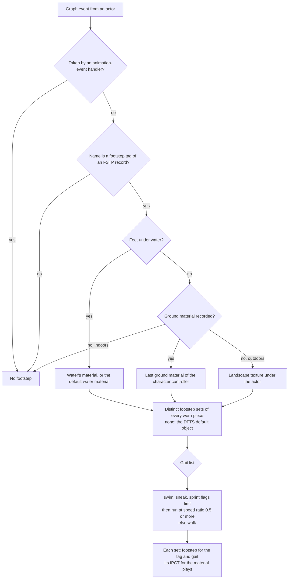

# Footstep sounds

The player's footsteps have no step timer. The vanilla movement clips carry their own footstep
marks: annotations in the animation files, raised as events by the behavior graph. `0_master.hkx`
declares `FootLeft` and `FootRight` as the first two of its 1,217 events. So the graph already says
when a foot lands, at the moment the animation plants it. A rhythm computed from speed would drift
away from the animation the player sees ([behavior runtime](/engine/behavior-runtime.md)).

The records and the chain from tag to sound file are on the [footstep records](/formats/footstep.md)
page. How a surface names its material is on the [material types](/formats/material-type.md) page.

## The route

Once per frame:

1. As each fixed step runs, the fired events of the third-person graph are queued. Only that graph
   feeds the queue. Both graphs run the same clips and fire the same events, so reading both would
   play every step twice.
2. The audio update reads the queue and passes the names to the footstep player, with the current
   gait and the capsule's feet position. The queue is read even outside walk mode and with no
   player attached, so an unread queue cannot flush all at once when audio is turned on. The whole
   update is skipped while the world is paused, and a paused frame fires nothing, so the two agree.
3. Each name is offered to the current gait's footstep list, and whatever resolves plays. The graph
   fires many other names, from combat and magic. Those cost one string compare and are dropped.

## Which sound

The ground material under the capsule is passed along too. The impact table is keyed by it, so
snow, wood, grass, and gravel choose different `IPCT` records and different sounds
([walk mode](/engine/walk-mode.md)).

The footstep set comes from `ARMA` `SNDD` on the armature in the feet slot of the built body. With
none, it is `DefaultFootstepSet`. Worn parts come before skin parts in a resolved appearance, so
boots win over the bare foot they cover with no extra ranking.

Footsteps are positional, placed at the feet, not at the listener. That is what makes third person
sound right.

A routed step also shows the `IPCT` impact model at the feet, such as dust
([impacts and decals](/rendering/decals.md)).

## What the game does

Behaviour described from a clean-room read of `SkyrimSE.exe` 1.7.104.0, 2026-11-16, which
returned behaviour only. Not yet confirmed in the reference game.

- The tag list comes from the `FSTP` records in the data, such as `FootLeft`, `FootRight`,
  `FootSprintLeft`, `FootScuffLeft`, `FootBack`, `JumpUp`, and `JumpDown`. The player and NPCs
  follow the same rules; only the sound's placement differs a little for the player.
- There is no ground check. A foot tag sent in the air plays, on the last ground material. There is
  no rate limit, no minimum time between steps, and no merging of one tag sent twice in a frame.
  So the step rate is the rate of the foot marks in the clips that play, and a clip that runs too
  fast is heard at once ([shared nodes](/engine/behavior-clips.md#behavior-references)).
- Two different worn sets play two sounds per step.
- A hard landing of the player, with fall damage above 0, plays a heavy landing sound above a
  fall-damage threshold and a light one below it. The threshold starts at 500.

OpenSky differs in three ways: it reads only the set in the feet slot, it takes the gait from its
own gait state, and it plays no hard-landing sound.
