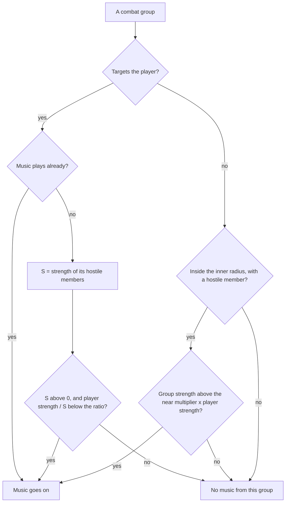

# Game setting rules

Each section gives the rule that one game setting, or one small group, takes part in. The
values are those of `Skyrim.esm`, read with `openskycli gmst list`. A rule that OpenSky runs is
linked to its page. The other rules wait for their system; the [gap report](/tools/gaps.md)
lists their settings until then.

## Arriving at a furniture or marker

A package location at a reference has a radius R. The arrival test depends on the target:

| Target | Arrival radius | Heading tolerance |
| --- | --- | --- |
| `XMarker` or `XMarkerHeading` | max(R, `fAIMarkerDestinationRadius`) (50) | `fHeadingMarkerAngleTolerance` |
| Furniture (`FURN`) | max(R, `fAIFurnitureDestinationRadius`) (150) | `fFurnitureMarkerAngleTolerance` (10 degrees) |
| Anything else | max(R, `fAIDistanceRadiusMinLocation`) | `fDefaultAngleTolerance` |

The height tolerance is max(R, `fAIMinLocationHeight`). The actor has arrived when the height
difference is inside the height tolerance and the horizontal distance is inside the arrival
radius.

`fAIFurnitureDestinationRadius` is also the arrival radius of the path to a furniture entry
point. `fFurnitureMarkerAngleTolerance` is how far the actor may face away from the marker's
heading before it starts the enter animation.

For example, a package with radius 0 targets a chair. The actor has arrived within 150 units of
it, and must face within 10 degrees of the marker's heading. The Creation Kit wiki gives the
same table of radii ([Category:Package Templates](https://ck.uesp.net/wiki/Category:Package_Templates)).
See [furniture](/engine/furniture.md).

## Dialogue mode with the player

An actor has a countdown, in seconds, for being in dialogue with the player. When the actor
starts a line to the player, or a dialogue with the player starts, the countdown is set to
`fAIInDialogueModewithPlayerTimer` (60) if it is above 1, and raised by that value otherwise.
It falls with real time. At 0 the actor leaves dialogue mode and goes back to its package.

So an actor waits up to 60 s after its last line before it walks off. See
[dialogue mode](/engine/dialogue-mode.md).

## The aim of an NPC with a bow

A shot from a bow or crossbow by any actor but the player leaves the aim line by a random
angle:

```text
k     = clamp((100 - Archery skill) x 0.01, 0, 1)
angle = random in 0 ... fBowNPCSpreadAngle x k      degrees
turn  = random in 0 ... 360                         degrees around the aim line
```

With `fBowNPCSpreadAngle` 4, an archer with skill 50 shoots up to 2 degrees off. An archer with
skill 100 or more shoots straight. See [archery](/engine/archery.md).

## The wait between detection idle lines

After a combat group says an idle detection line, the next one may come after a random time
between `fCombatDetectionDialogueIdleMinElapsedTime` (10) and
`fCombatDetectionDialogueIdleMaxElapsedTime` (25) seconds. The draw is uniform. A new group
starts with one such wait for each idle subtype, so it does not speak at once. The other
detection subtypes use `fCombatDetectionDialogueMinElapsedTime` and `...MaxElapsedTime`.

The Creation Kit wiki says the same in its
[Detection Tab](https://ck.uesp.net/wiki/Detection_Tab) page. See
[combat detection dialogue](/engine/combat-detection-dialogue.md).

## When combat music starts

The game looks at every combat group:



The ratio is `fCombatMusicPlayerTargetedThreatRatio` (1.0). The near test uses
`fCombatMusicPlayerNearStrengthMult` and `fCombatMusicNearCombatInnerRadius`. Once the music
plays, a near group keeps it going while it is inside `fCombatMusicNearCombatOuterRadius`.

For example, with a player strength of 100, enemies with a total strength of 120 give 0.83, so
the music starts. A total of 80 gives 1.25, so weak enemies start no music. The strengths are on
the [combat strength](/engine/combat-strength.md) page.

## How often a threat ratio changes

Each actor in combat works out its threat ratio again when more than
`fCombatThreatRatioUpdateTime` (5) seconds of combat time have passed since the last time. The
ratio is the strength of the actor's own side divided by the strength of the enemy side, and
100 when it cannot be worked out. So a fight's "who is winning" answer, which `GetThreatRatio`
reads and which drives fleeing, changes at most every 5 s.

## An explosion that fills the view

When an explosion starts, the game measures the distance d from the viewpoint to it:

```text
power = 1 - (d / radius)^2     inside the radius, else 0
```

If the power is above `fExplosionImageSpaceSwapPower` (0.75), and the explosion's flag "Ignore
Image Space Swap" is off, the game hides the explosion's model and applies a full-strength image
space modifier instead. With a radius of 300, that happens inside 150 units. See
[explosion effects](/engine/explosion-effects.md).

## The strength of a speaker's expression

A speaking actor has an emotion strength from 0 to 100. At the start of a line it is drawn at
random around the line's own emotion value v:

```text
low  = max(v - fGameplayiSpeakingEmotionMinDeltaChange % of v, 0)
high = min(v + fGameplayiSpeakingEmotionMaxDeltaChange % of v, 100)
```

Both are 100 in `Skyrim.esm`, so a line with value 40 gets a strength from 0 to 80. The value is
drawn again after a time between `fGameplaySpeakingEmotionMinChangeValue` and
`fGameplaySpeakingEmotionMaxChangeValue` seconds, both 1.5, but only while it equals
`iGameplayiSpeakingEmotionListenValue` (50). After the voice ends, a strength above 50 falls by
`iGameplayiSpeakingEmotionDeltaChange` (10) per update until it is 50.

## The force that holds a grabbed object

The player's grab holds an object with a spring. Its largest force depends on the object's
mass m:

```text
w     = clamp(m, fZKeyMaxForceWeightLow, fZKeyMaxForceWeightHigh)        0 and 150
scale = fZKeyMaxForceScaleHigh - (w - low) / (high - low) x (ScaleHigh - ScaleLow)
force = fZKeyMaxForce x scale                                            100 x scale
```

The scale runs from `fZKeyMaxForceScaleHigh` (1) for a light object to
`fZKeyMaxForceScaleLow` (0.2) for a heavy one. A mass of 75 gives a scale of 0.6 and a force of
60. A mass of 150 or more gives 20, so a heavy object hangs behind the hand. Telekinesis does
not use these settings. See [grab](/engine/grab.md).

## A killing blow that breaks a body part

A killing blow on a body part (`BPTD`) rolls one number from 0 to 99. E is the part's
explodable chance, used only when the part has the Explodable flag.

| Case | Result |
| --- | --- |
| The part's absolute-chance flag (0x40) is on and E is 100 or more | The part explodes |
| The flag is on | It explodes when the roll is below E |
| The flag is off | It explodes when the roll is below `iCombatExplodePartChance` x E / 100 |
| It did not explode | It is cut off when the roll is below `iCombatDismemberPartChance` (50) |

With `iCombatExplodePartChance` 75 and E 40, a roll of 0 to 29 explodes the part and 30 to 49
cuts it off. With E 100, a roll of 0 to 74 explodes it and no roll cuts it off.

## Single texts and names

| Setting | Rule |
| --- | --- |
| `sContractedDisease` | When the player gains a disease spell, the HUD shows the setting, a space, the disease name, and a full stop: "You have contracted Rockjoint." Only for the player. See [diseases](/engine/diseases.md) |
| `sRandomDoorTeleportFailureMessage` | A door with a random teleport list and no fixed destination picks a destination when it is used. If none is found, the activation fails with this message |
| `sDefaultCubeMap` | Water with cube-map reflections in an interior uses the cell's water environment map (`CELL XWEM`). If the cell has none, it uses this texture |
| `sRefAttachNodeName` | A reference attached to another one (`REFR XATR`) hangs below the node with this name, `REF_ATTACH_NODE`, in the parent's model, and moves with it |
| `sParticleArrayAttachExcludeList` | A comma-separated list of node names. An effect that emits particles from the nodes of a target's model skips a node on the list. The node's children are still used |
| `sVerletCape` | The node with this name, `vamplordcapemesh` in `Dawnguard.esm`, moves as cloth on the actor that has it |
