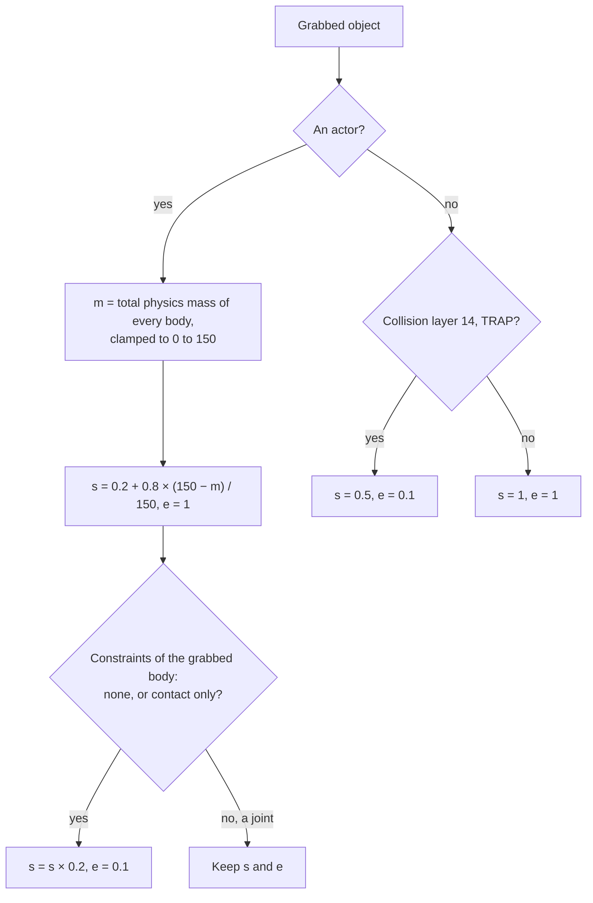
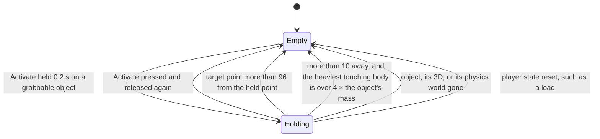

# Grab

The player can hold a loose object or a dead body in front of the camera, carry it, and let go.
A spring pulls the object toward a point ahead of the eye.

Telekinesis and the magical grab-actor effect use the same spring with their own values, and are
not on this page.

All values below are the ones that apply in play. Where `Skyrim.esm` overrides the program's
built-in default, the page gives the plugin value.

## Starting a grab

The player holds Activate on the crosshair reference for at least 0.2 seconds while holding
nothing. Then:

- The object needs 3D with a collision body, and must not be held already.
- Its root body's physics mass must be 100 or less. The game also has a running limit of 50, but
  no rule was found that reads it.
- A living actor can be grabbed only when the "grab the living" control option is on, which it
  is not by default, or through the grab-actor or telekinesis effects. Otherwise the actor must
  be dead or dying.
- A non-actor body that is keyframed or fixed is let go at once.

The grab most likely reaches as far as the crosshair activation pick.

## Holding

- The hold distance is the distance from the player's eye to the grabbed point, at the moment of
  the grab. It is never less than the player's collision radius + 5.
- Each frame the target point = the eye position + the look direction × the hold distance. So
  when the player turns, the object swings around the player at the same distance.
- A ray toward the target point shortens it for that frame when something is in the way.

The spring:

| Term | Value |
| --- | --- |
| Damping | 0.5 |
| Elasticity | 0.2 × e |
| Object damping | 0.75 |
| Maximum force | 100 × s |

s and e are the force scale and the elasticity scale:

Example: a body of total mass 90 gives s = 0.2 + 0.8 × 60 / 150 = 0.52. With a ragdoll joint on the
grabbed body, the maximum force is 52.

## Letting go

Releasing the Activate key that started the grab keeps the object held. On letting go, the spring
is removed and the object keeps its speed. Grab has no throw. It was not found whether opening a
menu lets go.

While the player holds an item whose carry weight is over 75, the player cannot run.

## In OpenSky

- The "Grab objects" setting on the launcher's settings page turns the grab on or off.
- A tap of Activate on a grabbable object activates it as before. Only a hold of 0.2 seconds
  grabs.
- A loose object is held by its body. A dead actor is held by the ragdoll body nearest to the
  grabbed point. The grab of a living actor is not built.
- The let-go rule for a heavier touching body is not built: no contact query reaches the held
  body yet. The stretch past 96 still lets go.
- `openskycli game debug grab <ref>` turns the view to a reference and grabs it, and
  `state grab` shows the hold ([game commands](../tools/game-commands.md)). The hold point is
  ahead of the view, so without the turn a reference off the crosshair is past the stretch
  limit at once. The hold lasts until `debug grab` with no reference or a press of Activate.
