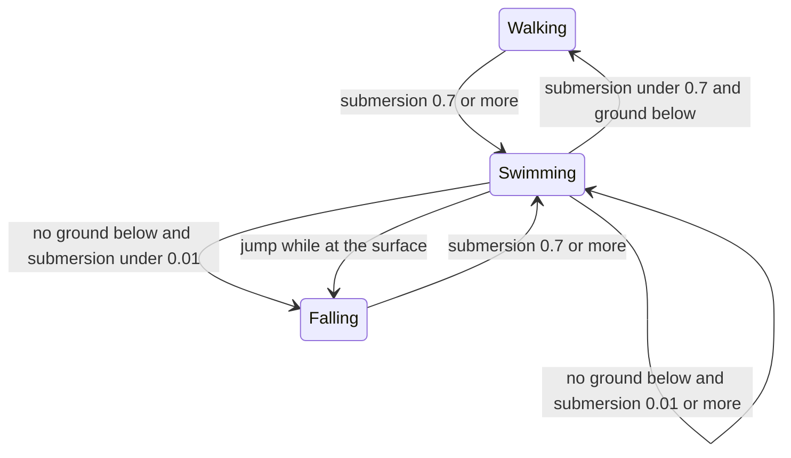

# Ground and water contact

This page describes the game's rules for a character's body against the ground and in water.
They hold for the player and for every NPC. The capsule, the collision queries, and OpenSky's
own values are on the [walk mode](walk-mode.md) page.

Lengths are game units. The game's physics uses its own unit: 1 physics unit is 69.99 game
units.

## One kind of ground

The game does not treat the landscape apart from placed objects. Terrain, a wooden dock, a
stair, and a rock are all collision surfaces in one physics world. Every rule below looks at
the surface the body touches, whatever made it.

So the steepness of a surface counts only where the body touches it. A dock that stands over
a steep river bank is walked as a dock. The bank under it does not matter.

## Walkable slopes

A surface is walkable ground when it is at most 47 degrees from horizontal. In numbers: the
up part of the surface normal (a unit vector that points straight out of the surface) is at
least cos 47° = 0.682. No game setting changes this value.

The same rule holds going up and going down. A surface steeper than 47 degrees does not
support the body. The character is then not on the ground: gravity pulls it, and the contact
with the steep surface turns that fall into a slide down along it. There is no separate slide
speed. The character is not stopped at the edge of a steep face; it walks into it and slides
back.

The body also leans with the ground it stands on, by at most 47 degrees forward or back.

## Staying on the ground

While a character is on the ground, each update looks straight down from the body for ground,
about 70 game units (1 physics unit) deep.

- Ground found, and walkable: the character stays on the ground. Gravity for that update is 4
  times stronger, and the movement is turned to follow the ground plane. This keeps the body
  on a downhill slope or a stair going down, instead of stepping off into the air.
- Ground found, but steeper than 47 degrees: the character counts as on a too-steep slope and
  slides, as above.
- No ground within the probe: the character starts to fall, and keeps its vertical speed.

While walking, the wanted movement has no vertical part. Only gravity, the ground probe, and
collision move the body up or down.

## Steps

The game has no step height. The capsule's round bottom rides up over a stair riser or the
edge of a plank, pushed by ordinary collision. An edge low enough for the curve to climb is
climbed; a higher one stops the body like a wall.

When one update takes longer than 0.05 seconds and the character moves at 25 units per second
or more, the update is split into 2 equal moves, each with half the velocity and half the
time. The count is 1 + floor(20 × update time), at most 2. A character that stands still, or
whose input and position did not change, always takes 1 move.

## Falling and jumping

| Phase | Gravity |
| --- | --- |
| Rising, after a jump | 1 × gravity |
| Falling | 1.35 × gravity |
| On the ground, ground found below | 4 × gravity |

A jump starts at `sqrt(2 g h)`, where `h` is the jump height (76 units in `Skyrim.esm`). The
47-degree rule decides whether the surface a falling character lands on is ground.

## Water

### How deep a character is

Each update the game computes the submersion, a fraction from 0 to 1:

```text
submersion = min((water surface - feet height) / H, 1), and 0 when the feet are above water
```

`H` is the height of the actor's bounding box times its scale. Example: a 128-unit tall
character with its feet 96 units under the surface has submersion 96 / 128 = 0.75.

| Submersion | Meaning |
| --- | --- |
| 0.01 or more | In water: wading, splashes, and harmful water apply |
| 0.7 or more | Starts swimming |
| 0.875 or more | Head under water: the breath timer runs |

For a 128-unit character, swimming starts with the feet 89.6 units under the surface, and the
head goes under at 112 units.

### When swimming stops



Depth alone starts swimming, but depth alone never ends it. A swimmer leaves the water only
when it is shallower than 0.7 and has walkable ground below it, found by the same ground
search as walking. The difference between the two rules keeps a swimmer at the edge of deep
water from switching every update. A swimmer that is lifted clear of the water with no ground
under it falls.

### Floating depth

A swimmer floats at a fixed point on its body:

```text
float point = feet + 0.5 × body height × float level
```

| Character | Float level |
| --- | --- |
| The player | 1.3; 1.6 in one of the two views, most likely third person |
| Every NPC and creature | 1.6 |
| A character whose `WaterWalking` actor value is not 0 | 0.1, so it stands on the surface |

While the float point is more than 10 units under the surface, the swimmer is pushed up with
an acceleration equal to gravity. Within 10 units no push is added, so the float point rests
about 10 units under the surface. Example: with a body height of 128 and float level 1.3, the
float point is 83.2 units above the feet. The feet rest about 93 units under the surface. At
float level 1.6 the float point is 102.4 units up, and the feet rest about 112 units under.

A swimmer whose float point is within 350 units of the surface counts as at the surface. A
jump there ends swimming, and the jump height is 2 times the normal height. So a jump at a
low quay or a boat lifts the swimmer out of the water.

### Getting out onto a shore

A swimmer has the same capsule and touches the same landscape and meshes as a walker. Nothing
special lifts it onto a shore. When it swims into rising ground, ordinary collision pushes the
capsule up along the slope. As the ground rises, the feet rise, the submersion falls under
0.7, the ground search finds ground, and the swimmer walks out.

A shore steeper than 47 degrees gives no ground. A swimmer there stays in the water, and only
a jump at the surface gets it out.
