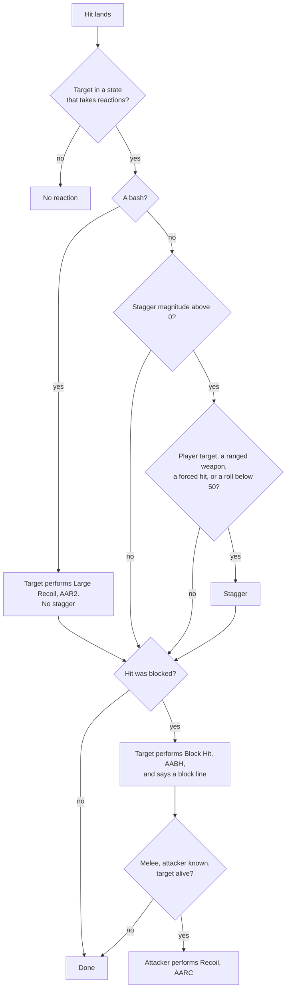

# Hit reactions

A hit can make its target recoil, stagger, or play a block reaction. The game picks the reaction
from the hit as a whole. It does not pick a reaction by the body part that was hit.

OpenSky follows this rule; [in OpenSky](#in-opensky) says what it leaves out.

All values below are the ones that apply in play. Where `Skyrim.esm` overrides the program's
built-in default, the page gives the plugin value.

## No reaction by body part

Two game options, one for hit-location idles and one for staggers, are never read. So there is no
reaction idle per body part.

## Which reaction

- The game files two hit flags together as "bash". One of them gives the Large Recoil, most
  likely the bash itself. A hit with that flag never staggers.
- A hit with a magnitude above 0 always staggers, with no roll, in these cases:
  - the target is the player and `bPlayerAlwaysStaggered` is on, which it is;
  - the hit has the first "blocked" flag;
  - the hit has the second "bash" flag, the one that gives no Large Recoil;
  - the weapon is a bow, a staff, or a crossbow.
- That a power attack always staggers is not confirmed.
- Any other hit staggers on a roll: a whole number from 0 to 99 below `iStaggerAttackChance`, 50.
- The hit's critical flag shows the "critical strike" message, and its sneak attack flag the
  "sneak attack" message.
- One kind of melee hit does not make the attacker recoil when blocked. What it is was not found.
- How long a recoil or a block hit holds the actor was not found. A stagger marks the actor as
  staggered for at most `fStaggerMaxDuration`, 3 seconds.

## Stagger magnitude

The magnitude is worked out when the hit is made.

1. The weapon factor W: 1 for a shield, 0.5 for a two-handed sword or axe, a bow, or a crossbow,
   0.2 for any other weapon, and 1 with no weapon.
2. S = the attack data's stagger value, or 0 when it has none.
3. N = 0.5 + 0.01 × the attacker's `Block`.
4. M = the target's `Mass`.
5. The state factor K starts at 1. It is × 1.5 while the target recoils, × 1.5 while it runs, and
   × 0 while it blocks.
6. magnitude = max(0, N / M × K × W × S).

Example: an attacker with 40 `Block` bashes with a shield (W = 1, S = 1) at a running target of
`Mass` 1. N = 0.9, K = 1.5, so the magnitude is 1.35, cut to 1 when the stagger starts.

## Starting a stagger

1. The target needs 3D and an AI process, and must not be staggered already.
2. The perk entry points change the magnitude: first the attacker's, then the target's.
3. The magnitude is clamped to at most 1. At 0 or below, nothing happens.
4. The graph variable `staggerMagnitude` is set to it, and `staggerDirection` to the angle from the
   target's heading to the attacker, as a part of a full turn (0 to 1). With no attacker it is 0.
5. The target performs Stagger Start (`AAS1`). On success it is marked staggered, for at most 3
   seconds.

## In OpenSky

The player's hit on an NPC, an NPC's blow on the player, and an arrow that lands on an NPC or
on the player go through the rule above.

- S comes from the attack data of the attacker's race for the attack's graph event. An attacker
  without attack data uses its weapon's stagger value.
- A target runs when it is the player at a run or sprint, or an NPC that closes on its target.
- A target recoils while it plays the recoil of its own blocked blow.

`openskycli game state assist` lists the last 8 hits under `hitReactions`, each with the values
of the magnitude, the `staggerMagnitude` and `staggerDirection` written to the graph, and which
of `largeRecoil`, `blockHit`, and `attackerRecoils` it gave.

- An arrow has no attack data, so S is the stagger value of the bow. A bow always staggers when
  the magnitude is above 0. A spell projectile has no stagger value, so it never staggers by
  this rule; a spell staggers through its own effect.
- The first "blocked" flag changes nothing in OpenSky: a blocking target has the state factor 0,
  so its magnitude is 0.
- [WARNING] The second "bash" flag is not read, because which hit sets it is not known. The
  critical and sneak attack messages are shown by the damage code, not here.
- [INFO] The staggered mark lasts as long as the combat machine's stagger phase, not 3 seconds.
