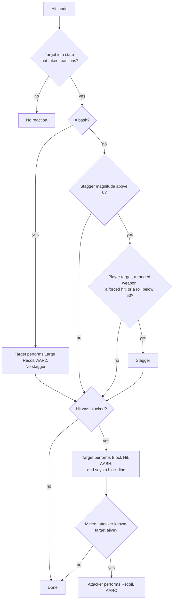

# Hit reactions

A hit can make its target recoil, stagger, or play a block reaction. The game picks the reaction
from the hit as a whole. It does not pick a reaction by the body part that was hit.

OpenSky's own stagger rule is in [melee combat](/engine/melee-combat.md#stagger). It is a reading of
the game settings, with no source for how they combine. This page gives the game's rule.

All values below are the ones that apply in play. Where `Skyrim.esm` overrides the program's
built-in default, the page gives the plugin value.

## No reaction by body part

Two game options, one for hit-location idles and one for staggers, are never read. So there is no
reaction idle per body part.

## Which reaction

- The hit kind that gives a Large Recoil is most likely a bash.
- The player is always staggered by a hit that has a magnitude, because a game option says so and
  is on.
- Some hit kinds, most likely a blocked hit or a power attack, always stagger.
- Any other hit staggers on a roll: a whole number from 0 to 99 below 50.
- One kind of melee hit does not make the attacker recoil when blocked. What it is was not found.

## Stagger magnitude

The magnitude is worked out when the hit is made.

1. The weapon factor W: 1 for a shield, 0.5 for a two-handed sword or axe, a bow, or a crossbow,
   0.2 for any other weapon, and 1 with no weapon.
2. S = the attack data's stagger value, or 0 when it has none.
3. N = 0.5 + 0.01 × the attacker's `Block`.
4. M = the target's `Mass`.
5. The state factor K starts at 1. It is × 1.5 while the target recoils, × 1.5 while it runs, and
   × 0 while it blocks.
6. magnitude = max(0, N / M × K × W × S).

Example: an attacker with 40 `Block` bashes with a shield (W = 1, S = 1) at a running target of
`Mass` 1. N = 0.9, K = 1.5, so the magnitude is 1.35, cut to 1 when the stagger starts.

## Starting a stagger

1. The target needs 3D and an AI process, and must not be staggered already.
2. The perk entry points change the magnitude: first the attacker's, then the target's.
3. The magnitude is clamped to at most 1. At 0 or below, nothing happens.
4. The graph variable `staggerMagnitude` is set to it, and `staggerDirection` to the angle from the
   target's heading to the attacker, as a part of a full turn (0 to 1). With no attacker it is 0.
5. The target performs Stagger Start (`AAS1`). On success it is marked staggered, for at most 3
   seconds.

## Source

Behaviour described from a clean-room read of `SkyrimSE.exe` 1.7.104.0. It is not yet confirmed
in the reference game. The action codes are `DOBJ` default objects.
