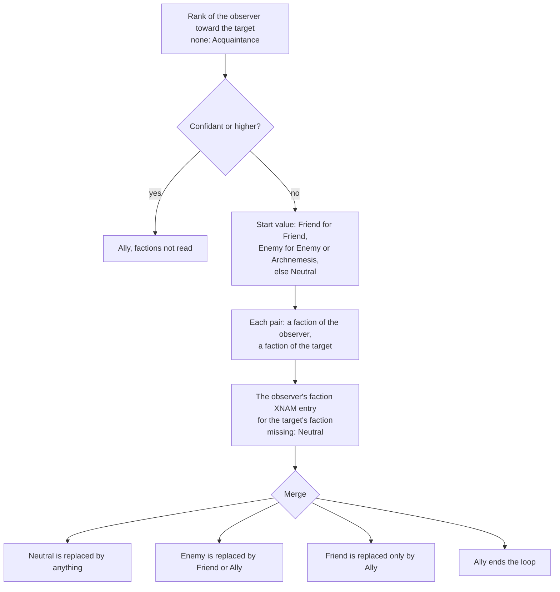

# Hostility

The derivation answers what one actor makes of another. Two facts come out, and they are different:

- the reaction: what the records say about the pair;
- the hostility: whether that reaction, with this actor's own aggression, means a drawn weapon.

The [combat loop](/engine/combat.md) asks it about the player. The records are on the
[factions](/formats/factions.md) and [relationships](/formats/relationships.md) pages.

## Order of the terms

Asked what `observer` makes of `target`, the derivation takes the first term that answers:

| Order | Term | Source of the answer |
| --- | --- | --- |
| 1 | Session override | The stored hostility: `StartCombat` or the player's blow |
| 2 | Crime | Guards and a bounty ([guard response](/engine/guard-response.md)) |
| 3 | Relationship | A rank a script set, else the `RELA` rank between the two `NPC_` bases |
| 4 | Faction | The `FACT` relations between the two actors' memberships |
| 5 | Default | Neutral |

Only row 3's place comes from a source. The Creation Kit wiki says "relationships override factions"
(<https://ck.uesp.net/wiki/Relationship>). The rest of the order is OpenSky's:

- The override is first because it records something that happened this session. An actor the
  player stabbed does not calm down because the records say they are friends.
- Crime is next, because a bounty is also something the player did.
- Faction comes before the default.

## The four reactions

The Creation Kit uses four reactions, from friendliest to most hostile: `ally`, `friend`,
`neutral`, and `enemy`. A `FACT` `XNAM` holds one directly. A `RELA` rank maps onto them in the
groups the wiki gives:

| Reaction | Relationship ranks |
| --- | --- |
| `ally` | Lover, Ally |
| `friend` | Confidant, Friend; the game starts a Confidant at `ally` (below) |
| `neutral` | Acquaintance, Rival, Foe |
| `enemy` | Enemy, Archnemesis |

Rival and Foe are Neutral, not Enemy. Two actors who dislike each other do not attack on sight
unless one of them is Very Aggressive, which is how strangers are treated too.

A raw value outside either named range gives no reaction, not a guessed one, and the relation index
counts the `XNAM` entries it dropped. The vanilla install has none.

## How the game combines rank and factions

In the game the relationship rank and the faction relations are not separate rows. The rank gives a
start value, and every faction pair then merges into it. The friendliest reaction that is not
Neutral wins:

- A membership with rank -1 takes no part.
- Only one direction is read: the observer's factions' relations toward the target's factions. The
  target's relations back are not read.
- So one Friend pair beats any number of Enemy pairs, and a faction Friend also beats an Enemy that
  came from the rank.
- The same combined reaction feeds the aggression test below and Assistance: "helps allies" helps an
  Ally only, "helps friends and allies" an Ally or a Friend.
- Toward the player, a crime faction or a faction that marks the player as an enemy makes the
  observer regard the player as an Enemy before the rank and factions are read.

Vanilla depends on this rule. At Helgen, the Imperial soldiers and the Stormcloak prisoners are in
`CWImperialFaction` and `CWSonsFaction`, which are enemies, and both sides are also in
`MQ101TemporaryFriendsFaction`, whose only relation is Friend to itself. The shared Friend pair makes
them Friends, so nobody fights during the execution. `MQ103TemporaryFriendsFaction` and
`MQ306TemporaryFriendsFaction` work the same way.

Worked example: an Imperial Soldier regards a Stormcloak prisoner. No `RELA` record names them, so
the start value is Neutral. `CWImperialFaction` toward `CWSonsFaction` gives Enemy, which replaces
Neutral. `MQ101TemporaryFriendsFaction` toward itself gives Friend, which replaces Enemy. The result
is Friend, and an Aggressive soldier attacks only an Enemy.

A script-set rank wins over the written one inside row 3. That is what `Actor.SetRelationshipRank`
means, and it is the only way a relationship with the player can count: the player has no `NPC_`
base for a `RELA` record to name.

## Aggression draws the weapon

The reaction alone decides nothing. The Creation Kit puts that on the actor, in the `AIDT`
Aggression value, "in conjunction with Faction Relationships"
(<https://ck.uesp.net/wiki/AI_Data_Tab>):

| Aggression | Attacks on sight |
| --- | --- |
| Unaggressive | Nobody |
| Aggressive | Enemies |
| Very Aggressive | Enemies and neutrals |
| Frenzied | Everybody |

In the game, hostility by aggression has more cases than this table:

- An Unaggressive actor is hostile only to an Enemy that carries a special "attack on sight"
  mark.
- An Aggressive actor is hostile to an Enemy only. A Very Aggressive one is hostile to an Enemy
  or a Neutral. A Frenzied one is always hostile.
- A target that fights the observer is hostile, unless the observer counts it as an Ally or a
  Friend. That exception does not hold when the target is Frenzied.

An aggression value the spec does not name attacks nobody. An actor with no readable `AIDT` is
unaggressive. Guessing upward, into a drawn weapon, is the harmful direction.

No `FACT` relation and no `RELA` record names the pair, so the reaction is the default, Neutral. The
bandit is Very Aggressive, and Very Aggressive attacks neutrals. A Whiterun guard next to it gets
the same Neutral reaction and stays calm, because a guard is only Aggressive.

Confidence is decoded but not used here. "Cowardly actors NEVER engage in combat" is about engaging,
and hostility records regard.

## Memberships at runtime

The derivation reads the runtime faction membership component
([factions](/formats/factions.md#runtime-membership)), not the `NPC_` record. So an actor a quest
added to the Companions stays in after a reload, and an actor the player was never near costs
nothing until something asks.

The player's memberships are seeded from the `Player` actor record (`Skyrim.esm` `000007`). That
record lists `PlayerFaction`, which many `FACT` relations name. For example,
`RiftenRatwayFactionEnemy` is an enemy of `PlayerFaction`, so an Aggressive member attacks the
player on sight.

A new game and a loaded save replace the stored memberships. An actor is then seeded again the
first time something asks, as after a restart of the app.

Seeding walks the actor's template chain once per actor per session. The derivation itself is not
cached. It is two component reads, a pair lookup, and a walk of two short lists. A cache would have
to be cleared on every world state write, and actor values are written sixty times a second.

## Friendly fire

A blow from the player on a friend or an ally does not always make it hostile. The actor counts
the player's blows and attacks only when the count passes what it allows
([Friendly Fire](https://ck.uesp.net/wiki/Friendly_Fire)):

| Reaction to the player | In combat | Out of combat |
| --- | --- | --- |
| Friend | `iFriendHitCombatAllowed`, 3 | `iFriendHitNonCombatAllowed`, 0 |
| Ally | `iAllyHitCombatAllowed`, 1000 | `iAllyHitNonCombatAllowed`, 3 |
| Neutral or enemy | attacks at once | attacks at once |

- A count of 1000 or more has no limit. The ally's count then stays at 1.
- A blow less than `fFriendMinimumLastHitTime` (0.5 seconds) after the last one does not count.
- A count is forgotten `fFriendHitTimer` (10 seconds) after its last blow.
- "In combat" means the struck actor is fighting at that moment.

For example, the player's arrow hits a friendly guard who fights a dragon. The guard counts one
blow and keeps fighting the dragon. The fourth blow, each more than half a second apart and within
10 seconds, turns the guard on the player.

The player's followers are left out: a blow on an actor the player commands never provokes it.
