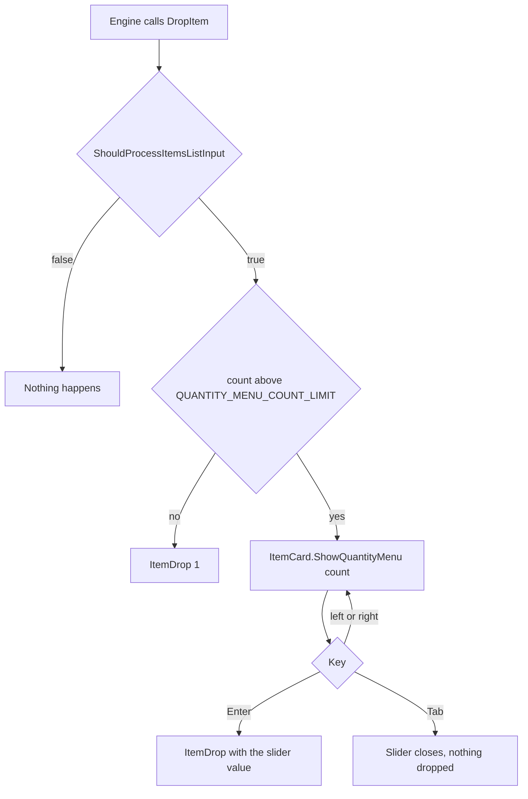

# Inventory menu

The inventory menu lists what the player carries, filters it by category, and equips, unequips,
drops, or uses the selected row. It can show itself through the vanilla `Interface\inventorymenu.swf`
movie. It is a [menu mode](/engine/menu-mode.md) consumer. Like the
[system menu](/engine/system-menu.md), it works with no install, renderer, or movie. Only the movie
layer needs them.

This menu fills the inventory list data that the [ActionScript scope](/decisions/swf-as2-scope.md)
decision left for later: `_CategoriesList`, `EntriesA`, and `iSelectedIndex`.

## Row list

The row list is built from the player's inventory state and the item index (see
[runtime state](/engine/runtime-state.md)). A row has the item's FormID, name, count, weight, value,
equipped flag, and record type.

Three rules are choices, not results:

- Gold is a readout, not a row. The inventory stores money as a normal `MISC` stack, so as a row it
  would show "Gold001". It still counts toward carried weight. Hiding the row is a display choice,
  not an accounting one.
- An item no loaded plugin describes still gets a row, named by editor ID or FormID. The player
  really carries it, and hiding it would lose it.
- Rows sort by name, then FormID. So two items with the same name always have the same order.

A weapon or ammunition without the Creation Kit's Playable box gets no row, such as a creature's
claws. The Creation Kit says such a weapon "is invisible to the player and cannot be used", and
that playable ammunition is what the player can "see in containers". Unequipping one is refused
with `sCantUnequipGeneric` ([refused actions](#refused-actions)). Sources:
<https://ck.uesp.net/wiki/Weapons>, <https://ck.uesp.net/wiki/Ammo>.

Categories group items by record type, in the vanilla tab order: Favorites, All, Weapons (`WEAP`
and `AMMO`), Apparel, Potions, Scrolls (`SCRL`), Food, Ingredients, Books, Keys (`KEYM`), and Misc.
Favorites takes the rows the player marked, of any type. Food takes the `ALCH` records with the food
flag, and Potions takes the rest, poisons included. Misc also holds soul gems (`SLGM`), alchemy
apparatus (`APPA`), and lights that can be carried, such as torches (`LIGH`). A potion with the
forge keyword goes under Misc too. This matches the game's `filterFlag` for each item kind
([item kinds and tabs](#item-kinds-and-tabs)). The order is the one the game shows. The movie
does not define it: `InventoryDefines` holds no category list ([list data](#list-data)). An item
of unknown type shows under Misc, so All is not the only way to find it. The menu opens on All, as
the game does.

Each tab takes its name from a string setting: `sFavorites`, `sAllItems`, `sWeapons`, `sApparel`,
`sPotions`, `sScrolls`, `sFood`, `sIngredients`, `sBooks`, `sKeys`, and `sMisc`. Without a plugin
that sets one, the tab keeps OpenSky's English name.

## Imported parts

`inventorymenu.swf` places `ItemCard_mc`, `InventoryLists_mc`, and `BottomBar_mc`, but defines none
of them. They come from three movies under `Inventory components/`. Without merging those movies in,
the menu has no list at all. See [SWF display list imports](/formats/swf-display-list.md#importassets-57-and-importassets2-71).

## List data

These paths were read from the installed movie. All three lists come from the imported parts.

| Part | Path |
| --- | --- |
| Menu (`InventoryMenuObj`) | `/Menu_mc` |
| Category list | `/Menu_mc/InventoryLists_mc/CategoriesListHolder/List_mc` |
| Item list | `/Menu_mc/InventoryLists_mc/ItemsListHolder/List_mc` |
| Gold | `/Menu_mc/BottomBar_mc/PlayerInfoCard_mc/PlayerGoldValue` |
| Carry weight | `/Menu_mc/BottomBar_mc/PlayerInfoCard_mc/CarryWeightValue` |

Both lists are `Shared.BSScrollingList` objects with `EntriesA` and `iSelectedIndex`. OpenSky writes
one plain object per row into `EntriesA`: `text`, `index`, `count`, `weight`, `value`, `equipped`,
`equipState`, `favorite`, and `enabled`.

`InventoryScrollingList.SetEntryText` draws a row from these fields, read from the installed movie:

| Field | What the row draws |
| --- | --- |
| `text`, `count` | The name, with `(n)` after it for more than one |
| `soulLVL` | The soul in a soul gem, in brackets after the name |
| `bestInClass` | The `BestIcon.png` star after the name |
| `negativeEffect`, `isStealing` | The name in red |
| `enabled` | The name in grey when false |
| `equipState` | The equip icon: the frame `None`, `Equipped`, `LeftEquip`, `RightEquip`, or `LeftAndRightEquip` for 0 to 4 |
| `favorite` | The favourite icon, but only when `equipState` is 0 or 1 |

The numbers of `equipState` are the `ES_` constants of `InventoryDefines`: `ES_NONE` 0,
`ES_EQUIPPED` 1, `ES_LEFT_EQUIPPED` 2, `ES_RIGHT_EQUIPPED` 3, and `ES_BOTH_EQUIPPED` 4. OpenSky
sends 2 for the item in the left hand, 4 when a second copy is in the right hand, 3 for any other
worn weapon, 1 for anything else worn, and 0 for the rest. A two-handed weapon gets 3; which icon
the game shows for it is not confirmed ([unverified values](/engine/unverified-values.md)).
The magic menu sends a readied spell's hands the same way, and `negativeEffect` for a harmful
effect on the player. `soulLVL`, `bestInClass`, and `isStealing` are not sent.

`InventoryDefines` holds no category list. It names the item card pages (`ICT_`), the equip states
(`ES_`), and `QUANTITY_MENU_COUNT_LIMIT`, 5. The tabs come from the engine, as below.

A category row also needs a `flag`. `InventoryLists.SetCategoriesList` builds each category as
`text`, `flag`, `bDontHide`, `savedItemIndex`, and `filterFlag`, and a `flag` of 0 makes the row a
divider, which draws no name. OpenSky gives each tab its own bit, `1 << index`, and sets `bDontHide`,
so the movie hides no tab and its category indices stay the engine's.

After it writes both arrays, OpenSky calls the category list's own `InvalidateData`, then the
`InvalidateListData` callback. `InvalidateListData` redraws the category list but does not hand
the new array to that list's filter. The filter then matches no row, and the column stays empty.
`InvalidateData` does hand it over, as `SetCategoriesList` does.

An item row has no `filterFlag`. The item list's filter keeps a row whose `filterFlag` is missing or
shares a bit with the selected tab's `flag`. The movie sets that filter only when its centred
category changes, so with a `filterFlag` the rows are hidden after the engine changes the tab. The
engine has already filtered the rows. The cost: the bottom bar's button reads
`filterFlag & entryList[0].flag`, the Favorites bit, to choose between `$Favorite` and
`$Unfavorite`, so it always shows `$Favorite`.

The order of calls matters, and was measured. `InvalidateListData`, a `GameDelegate` callback the
movie registers for itself, rebuilds a list and resets `iSelectedIndex` to -1. A selection written
before it is lost. So OpenSky writes the rows, then calls `InvalidateListData` by name through the
delegate, then sets the selection. Calling it on a display path instead finds nothing.

Gold and carry weight are text fields on the player info card, not properties of the bottom bar.
They are set with the GFx `SetText` extension.

## Item kinds and tabs

In the game each item row carries a `filterFlag`, a bit chosen by the item's kind. The movie fills
each tab, All and Favorites included, from these bits; the engine has no list for them.

| Item kind | `filterFlag` |
| --- | --- |
| Weapons and ammunition | 2 |
| Armour and clothing | 4 |
| Potions that are not food | 8 |
| Scrolls | 16 |
| Food: a potion with the food flag | 32 |
| Ingredients | 64 |
| Books | 128 |
| Keys | 256 |
| Anything else: gold, soul gems, lockpicks, torches, misc items | 512 |

A potion that is not food goes to 512 when it has the keyword in the default object `FORG`, which
`Skyrim.esm` fills with `CraftingSmithingForge`. A row also gets bit 1 when one of its stacks is a
favourite. In the container, barter, and gift menus the other side's rows get the whole value
shifted left by 10 bits, so a bit at 1024 or above marks a row of the other side.

The engine sends the tabs as `text`, `flag`, and `bDontHide` triples after one null value. The text
comes from the localized strings. Only an
all tab and the divider have `bDontHide` true.

| Tab, English text | `flag`, player side | `flag`, other side |
| --- | --- | --- |
| FAVORITES | 1 | - |
| ALL | 0x3FF | 0xFFC00 |
| WEAPONS | 2 | 0x800 |
| APPAREL | 4 | 0x1000 |
| POTIONS | 8 | 0x2000 |
| SCROLLS | 16 | 0x4000 |
| FOOD | 32 | 0x8000 |
| INGREDIENTS | 64 | 0x10000 |
| BOOKS | 128 | 0x20000 |
| KEYS | 256 | 0x40000 |
| MISC | 512 | 0x80000 |

Each menu sends its own list:

- Inventory: Favorites, then the player block, whose all tab reads ALL.
- Barter: the merchant's block with the merchant's name on its all tab, a divider (`""`, 0, true),
  then the player's block under the player's name.
- Container: when a follower's items are exchanged, the container's whole block under its name;
  otherwise one tab with the container's name and flag 0xFFC00. Then the divider and the player's
  block under the player's name.
- Gift: one block, the player's when the items come from the player, else the other side's.

The game has no warning for an item with a low value for its weight. The inventory, barter, and
container movies have only the plain value and weight fields.

## Navigation

The movie owns the focus, as in the game. It opens on the category list alone, in the
`ONE_PANEL` state of `InventoryLists_mc`. Every arrow key goes to the movie through the engine's
`InputDelegate` step ([AS2 input](/engine/as2-input.md#focus-and-menu-navigation)):

| State | Key | What the movie does |
| --- | --- | --- |
| One panel | Up, down | Moves the category selection |
| One panel | Right (`strShowItemsCode`), or Accept | `ShowItemsList`: the item panel slides out, and focus moves to the rows |
| Two panels | Up, down | Moves the row selection |
| Two panels | Left (`strHideItemsCode`) | `HideItemsList`: the item panel closes, and focus goes back to the categories |

The category list is a centred list: it draws the entry at its scroll position large, and its keys
move the scroll position and `iSelectedIndex` together. So when the engine writes the category
selection, it also sets the scroll position through the list's `scrollPosition` setter. Otherwise
the large entry stays one row away from the selected one.

After each key, the engine reads the movie's selections. A new category refilters the rows,
and the first row is selected, so the movie's row index is not taken. Otherwise the engine
takes the movie's row. Then it writes the rows again.

The item keys need the `TWO_PANELS` state. The movie's `ShouldProcessItemsListInput` answers
false in any other state, so `DropItem` does nothing. The panel slides out over a few frames,
through state 5, `TRANSITIONING_TO_TWO_PANELS`, and the lists take no keys until the slide ends.
`ShowItemsList` resets the row selection and fades the item card in only when a row is selected,
so the write after the key sets the row back. A later write fades the card in only while two
panels show.

Activate, drop, favourite and the left hand act only while the item panel shows. Accept on
the category list opens the rows, as right does. With no movie, left and right change the
category in the engine, and up and down move the row.

## Actions

- Activate equips a row, or unequips it if it is equipped. This is the vanilla toggle.
- The right mouse button is `LeftEquip`: it puts a one-handed weapon into the left hand, or
  takes the left-hand weapon off ([the left hand](/engine/inventory-state.md#the-left-hand)).
  On any other row it acts as Activate.
- Eating an ingredient also teaches its first effect, and using a poison puts it on the drawn weapon
  ([alchemy](/engine/alchemy.md)). Any other row says so and changes nothing.
- R drops the row. A stack of more than five opens the quantity slider first; a smaller one drops
  one copy. The limit is `QUANTITY_MENU_COUNT_LIMIT` in the movie's `InventoryDefines`
  ([quantity](#quantity)).
- Space marks the row as a favourite, or unmarks it. The game uses F; OpenSky's menu bindings have
  no F, so the jump key stands in.

Every change reads the inventory again and writes it to the movie, so weight and gold stay current.

The movie's own outbound calls, read from `InventoryMenu` in the installed movie:

| Call | Arguments | When |
| --- | --- | --- |
| `ItemSelect` | the hand slot, or none | a mouse press on a row, or the engine's `AttemptEquip(aiSlot)` callback; it equips the selected row |
| `ItemDrop` | the amount | after the drop key, see [quantity](#quantity) |
| `QuantitySliderOpen` | true or false | an item card sub-menu opens or closes |
| `UpdateItem3D` | true or false | true when a row is highlighted or the item panel opens, false when it closes |
| `CloseMenu` | none | Tab, or the fade after Tab ends |

`ItemSelect` carries a hand slot, not a row index. The row is always the list's selection.

## Refused actions

`ItemRefusalRule` refuses some actions with a HUD notice, from string settings:

| Action | When | Notice |
| --- | --- | --- |
| Drop | A quest item | `sDropQuestItemWarning` |
| Drop | A key (`KEYM`) | `sNoKeyDropWarning` |
| Drop | The player is in the air | `sNoJumpWarning` |
| Drop | An equipped item while the player attacks | `sDropEquippedItemWarning` |
| Drop | No resident cell to drop into | `sNotEnoughRoomWarning` |
| Use | Eating or drinking a quest item | `sNoEatQuestItem` |
| Equip | While the player attacks | `sAnimationCanNotEquipWeapon`, or `sAnimationCanNotEquipArmor` for armour |
| Unequip | While the player attacks | `sAnimationCanNotUnequip` |
| Unequip | A non-playable item | `sCantUnequipGeneric` |
| Favourite | Not a weapon, armour, ammunition, potion, food, ingredient, or scroll | `sCantHotkeyItem` |

Which actions refuse when is OpenSky's reading of the settings' words. The rule also holds the texts
`sCantEquipGeneric`, `sCanNotEquipWornEnchantment`, and `sCantRemoveWornItem`, for gear the
player's race cannot wear, an enchantment that cannot apply, and a worn quest item moved to a
container.

## Quest items

An item is a quest item while a running quest holds it in a reference alias with the Quest Object
flag ([Quest Alias Tab](https://ck.uesp.net/wiki/Quest_Alias_Tab)). A stopped quest clears its
aliases, so the item is free again. A quest item:

- cannot be dropped, eaten, stored in a container, or sold. Each refusal shows
  `sDropQuestItemWarning`, or `sNoEatQuestItem` for eating.
- stays when a script calls `RemoveAllItems` with `abRemoveQuestItems` false
  ([RemoveAllItems](https://ck.uesp.net/wiki/RemoveAllItems_-_ObjectReference)).
- keeps the inventory of the container that holds it through a [cell reset](/engine/cell-reset.md).
- reads `[quest]` on its row and "quest item" on its item card in `openskycli game state`. The
  vanilla `inventorylists.swf`, `itemcard.swf`, and `inventorymenu.swf` read no quest field, so
  the movie shows no marker.

The game marks one reference as the quest item. OpenSky's inventory counts items by base form,
so every copy of the alias reference's base is a quest item while the alias holds it.

## Quantity

The drop key does not decide the count itself. The engine calls the movie's `DropItem` callback,
which `InventoryMenu.InitExtensions` registers. The movie then follows these steps:

`ShowQuantityMenu(aiMaxAmount)` sets the slider's maximum and its value to the stack count, so it
starts at the whole stack. The slider is the item card's `QuantitySlider_mc`. While it is open,
the card's `HandleQuantityMenuInput` reads the keys: `ENTER` accepts and `TAB` cancels. Left and
right reach the focused slider and move it by one. The value is rounded down before it is sent.
Opening and closing the slider calls `QuantitySliderOpen(true)` and `QuantitySliderOpen(false)`.

The engine sends left, right, accept, and cancel to the movie while the slider is open. Up and down
do nothing there. Worked example on the install: a stack of 12, three presses of left, then
accept, sends `ItemDrop(9)`.

Without a movie, the engine shows its own prompt with the same start and limits. Left and right
change the count by 1, and down and up by 10, which is OpenSky's own step. Accept or R drops that
many, and cancel drops none. A movie that ignores `DropItem` also falls back to this prompt.

The container and barter movies use the same slider and the same keys
([barter](/engine/barter.md#quantity-and-selling-for-less)).

## Favourites and hotkeys

A favourite is saved per player in the `FAVS` chunk
([actor chunks](/formats/opensky-save-actor-chunks.md#favs-favourites)). A favourite can be bound
to one of the hotkeys 1 to 8. Binding a key takes it from the item that held it, and unmarking a
favourite frees its key. In play, the number keys 1 to 8 are the input actions `Hotkey1` to
`Hotkey8` ([control map](/formats/controlmap.md)). A hotkey equips its item, or unequips it when
it is equipped. A potion, food, or ingredient is used, and a poison goes on the weapon. A key with
no item, or an item no longer carried, shows a notice and does nothing.

## Item card

The item card describes the selected row: its name and kind, value and weight, damage or
armour rating, its effects, and whether it is a favourite or stolen. An ingredient's unknown effect
shows as `?`. The damage and rating are the player's own, after the weapon's or armour type's
skill and the perks ([UESP Weapons](https://en.uesp.net/wiki/Skyrim:Weapons#overview),
[UESP Armor](https://en.uesp.net/wiki/Skyrim:Armor)):

- Damage: `round((WEAP DATA damage + tempering) × (1 + skill / 200) × Mod Attack Damage perks)`.
- Armour: `ceiling((ARMO DNAM / 100 + tempering) × (1 + 0.4 × skill / 100))` × the piece's
  perks, such as Agile Defender. Clothing has no skill term. The barter bar adds armour spells.

The movie shows the same card. On a change of row, the menu calls `RequestItemCardInfo` through
`GameDelegate`. The engine answers through the `UpdateItemCardInfo` callback the menu registers,
with one object that becomes `ItemCard_mc.itemInfo`. These fields and numbers were read from the
installed `itemcard.swf` and its `InventoryDefines`:

| Field | Meaning |
| --- | --- |
| `type` | the card page: `ICT_ARMOR` 1, `ICT_WEAPON` 2, `ICT_MISC` 3, `ICT_BOOK` 4, `ICT_FOOD` 5, `ICT_POTION` 6, `ICT_INGREDIENT` 8, `ICT_KEY` 9, `ICT_SOUL_GEMS` 12 |
| `name`, `value`, `weight` | the header line |
| `damage`, `armor` | the weapon and armour numbers |
| `effects` | the effect text of a potion, food, weapon, or armour piece |
| `itemEffect0` to `itemEffect3`, `numItemEffects` | an ingredient's known effects; the movie shows `$UNKNOWN` for an index below `numItemEffects` that has no name |
| `charge` | a weapon's charge left, in percent; the Charge button reads it |
| `description` | a book's `CNAM` line. When it is not empty, the movie goes to its `Books_Description` frame and shows it in `BookDescriptionLabel` |

OpenSky sends the card after each change it writes to the lists. A scroll uses the potion page,
which lists effects; the game's page for a scroll is not confirmed. The card's warmth and skill
text are not filled.

### Recharging

The movie's Charge button calls `AttemptChargeItem`. When the card's `charge` is below 100 it
calls `GameDelegate` `ShowSoulGemList`. OpenSky then sends a card of type `ICT_LIST` (14) with
`name` set to `sChooseSoulGem` ("Choose Soul Gem to Use"), `currentCharge` in percent, and
`listItems`: one object per filled soul gem the player carries, with `text`, such as
"Grand Soul Gem (Petty)", and `chargeAdded` in percent. A press on a row calls
`ItemCardListCallback` with its index, and that gem recharges the weapon as described in
[item enchantments](/engine/item-enchantments.md#recharging). With no filled gem, the HUD shows
`sNoChargeItems` ("No items to charge enchantment") instead. A worn piece has no charge, so
only weapons and staves offer it. Where the game puts the title is not confirmed.

## Item preview

The selected row's model turns beside the list. With a movie, the movie decides when it shows: the
last `UpdateItem3D` call shows it or hides it. Without a movie, the selected row always shows.

The model path is the record's `MODL`, or the male world model for armour. It is drawn unlit with
its diffuse texture, in front of the world, through the menu scene that the [crafting
menu](/engine/crafting.md#crafting-menu) uses. It draws into a thin slice of depth near the camera,
so the world cannot cover it. The model turns at 0.6 radians a second; the game's rate is not
measured. A model with a `BSInvMarker` is first turned by the marker's angles, and its fit size is
multiplied by the marker's zoom ([NIF extra data](/formats/nif-extra-data.md#inventory-marker)). A
model that fails to load logs its reason and draws nothing.

## Gift menu

`Actor.ShowGiftMenu` opens `Interface\giftmenu.swf`. The movie uses the same list clips as
the inventory movie. With `abGivingGift` true the list holds the player's items, and each
pick moves one to the actor; with false it holds the actor's items. The other arguments follow
the [CK wiki](https://ck.uesp.net/wiki/ShowGiftMenu_-_Actor):

| Argument | Default | What OpenSky does |
| --- | --- | --- |
| `apFilterList` | `None` | Shows only an item that is in the list, or that has a keyword in the list |
| `abShowStolenItems` | `false` | Hides stolen copies unless it is true |
| `abUseFavorPoints` | `true` | Ignored. No source says how many favour points an item is worth |

The game's native is latent: it returns when the menu closes, with the favour points spent or
gained. OpenSky's native returns at once, with 0.

## Not done yet

- The opening state with the category list alone and focused (see [navigation](#navigation)).
- The `ItemRotating` callback, which the movie registers for a turn of the item by the mouse, is
  never called. The item turns on its own.

The container and barter menus reuse this row list and list code, one pane per side
([barter](/engine/barter.md)).
