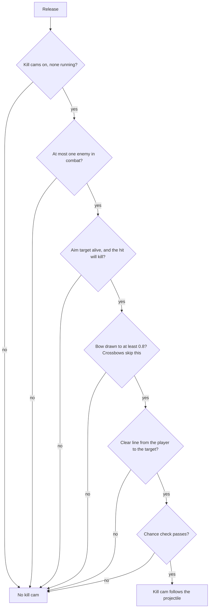

# Kill cam, cinematic camera, and camera shake

A kill cam is a short scripted camera sequence after a killing blow. The game picks it from
the `CPTH` camera path tree and plays the `CAMS` shots of the chosen path. The records and the
walk that picks the shots are on the [camera records](/formats/camera-records.md#shot-selection)
page.

## When it plays

A kill cam plays when all of these are true:

- The player made the kill. OpenSky learns of a death in the ragdoll death sweep, which
  does not record the killer, so it treats the player as the attacker of every hostile death.
- The dead actor was hostile to the player.
- No other hostile actor in combat is left. Vanilla shows kill cams only on the last enemy.
- A roll against `fKillCamBaseOdds` times the player's own chance passes. The install sets
  `fKillCamBaseOdds` to 1. This stands in for the game's kill cam frequency option.

A player [kill move](/engine/paired-animations.md#kill-moves) starts its kill cam at once and
skips the odds and the last-enemy rule. The kill-move idle already tested the last enemy. The
death at the end of the kill move starts no second kill cam.

Differences from the game:

- For a spell, the release check counts the spell's harmful Health value modifiers before
  resistance, so a target that resists the spell can still get a kill cam that ends with it
  alive.
- A melee kill without a kill move finds no kill-cam path and ends on an `Exit` path: no
  kill cam plays.

## Bow and spell kill cams in the game

The game decides a ranged kill cam at the release: when the bow, crossbow, or staff looses, or the
spell leaves the hand. This is before the projectile lands. A melee kill uses kill moves instead.



The target is the aim help target ([projectiles](/engine/projectiles.md#aim-help-in-the-game)), or
when there is none, the result of a wider search around the aim.

The chance check passes at once when the target is 2500 units or more away, when its level is
higher than the player's, or when the player's health is below 5 percent. Otherwise:

```text
chance % = max(distance / 25, 50) - bonus
```

The bonus is 20 for a sneak kill with a bow or crossbow while undetected, 0 for a target that is a
hostile threat, and 10 for any other target. It goes up by 10 more when the target's level is below
0.3 times the player's. Example: a target 1500 units away that is no threat gives
`max(60, 50) - 10 = 50` percent.

During the shot:

- The `CAMS` location and target can be the projectile. `ArrowCloseUp` in `Skyrim.esm` flies with
  the projectile, with a global time of 0.33, a max time of 5 s, and a min time of 0.05 s.
- A shot's player and target time multipliers of 0 or less fall back to 6 for the player and 1 for
  the target.
- The shot ends at 20 seconds at most, or 6 seconds while the target is not dead yet.
- The projectile turns toward the target by up to 15 degrees, aimed to make up for gravity.
- The camera stops following the projectile when its impact is resolved.

## Playing a shot

A shot plays in stages, one per `CAMS` action group (shoot, fly, hit, zoom).

- The eye follows the `NiCamera` in the shot's mesh. The mesh is authored around the
  anchor actor (`CAMS` location) in the actor's own frame, so OpenSky turns the track by the
  actor's heading and adds the actor's position. The track layout is on the
  [NIF](/formats/nif.md#camera-animation) page.
- With `CAMS` flag 0x02, or with no track, the camera looks at the chest of the shot's target
  actor. Otherwise it looks down the track's own +X axis, the Gamebryo camera forward axis.
- A stage lasts as long as its track: stop time minus start time. `CAMS` max time caps it,
  and min time is a floor. A shot with no track and no max time lasts 1.5 seconds. A shot whose
  min and max times are both 0 has no length: `ExitPlaybackCamHolder`, the only shot of every
  `Exit` path, is such a shot, so a walk that ends on an `Exit` path plays no kill cam.
- The camera runs at real time while the world runs slower. The world scale is the global
  time multiplier times the slower of the player and target multipliers, clamped to
  0.01...1. OpenSky has one world clock, so it cannot slow the player and the target by
  different amounts.
- A shot that names an `IMAD` starts it when its stage starts.
- The eye goes through the dialogue camera's collision probe, so it does not end inside a
  wall.

The cinematic pose writes on top of the active camera mode, like the
[dialogue camera](/engine/dialogue-camera.md). When it ends, the player's own view comes back.
A cinematic pose outranks a dialogue pose.

## Camera shake

`Game.ShakeCamera(source, strength, duration)` adds a wobble to the eye: three sine waves that
fade to zero over the duration. Full strength moves the eye by up to 6 units. A source actor
farther away shakes less, falling linearly to zero at 2,048 units. The masters set no
`fCameraShakeTime`, so a duration of zero or less uses 1 second. These numbers are OpenSky's
choice; no source gives the game's.

The shake adds to whatever pose is active: the player camera, the dialogue camera, or a
kill cam. `Game.ForceFirstPerson` and `Game.ForceThirdPerson` set the camera mode directly.

OpenSky's choice: the shot looks at a point 96 units above the actor's feet, times its scale,
and one frame steps the shot by at most 0.1 s, so a stall does not skip a stage.
