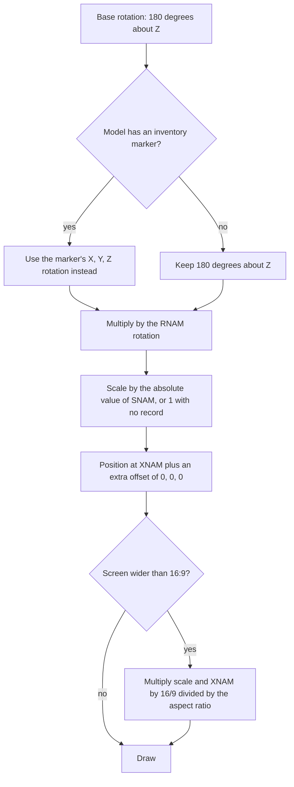

# Loading screens

A door to another cell replaces the whole scene. While the new cell builds, the game shows a
loading screen: a slowly turning object on a dark background, with a tip below it. The record
and how a screen is picked are on the [loading screen records](/formats/loading-screens.md)
page.

## Timeline

1. A door transition starts. The view goes dark at once, and the world pauses. No screen is
   picked yet, because the destination's location is not known until its cell record is read.
2. The destination scene is ready. OpenSky picks a screen for the destination's `XLCN`
   location and shows it.
3. The screen holds for at least 1.5 seconds from that point. Then it fades out over 0.4
   seconds, and the world runs again.
4. A transition that fails keeps the old scene, so the cover lifts at once.

A fast travel works like a door. The view goes dark at once, because the destination's
location is known only when its cell is built. Then the screen is picked for that location,
and it holds until the near grid around the marker and its first distant ring are in, or
for at most 60 seconds.

Loading a save, Continue, a launcher start, and a script's `MoveTo` of the player to a reference
outside the loaded cells also show a screen. It is picked at once, because the save's place is not
read yet. It holds until the player stands there, and then until the near grid around the player
and its distant ring are in, as at a session start, or for at most 90 seconds, a limit OpenSky
chose. A new game's first move works the same way, so the cart ride never starts with only the
player's own cell in full detail.

A session that starts in the world, not at the title screen, also starts behind a loading
screen. It is picked at once and holds until the near grid and the first ring of
[distant LOD](/engine/distant-lod.md) are in, or for at most 60 seconds. So the world never opens
with bare sky past the grid edge. Then the same minimum and fade apply.

In the game, the screen holds as long as the load takes. OpenSky builds a cell much faster,
so without a minimum the screen would flash for one frame and the tip could not be read. The
1.5 seconds and the 0.4-second fade are OpenSky's choice.

## Drawing

- The cover is its own render layer. While it shows, the renderer draws only the cover: the
  screen's `STAT` model, placed in front of the camera. The world, the player body, and the
  first-person arms are not drawn.
- The object starts at the `RNAM` rotation, `SNAM` scale, and `XNAM` offset. The player turns
  it with the mouse or the left and right keys, inside the `ONAM` range. A screen with no range
  does not turn. Source: CK wiki [LoadScreen](https://ck.uesp.net/wiki/LoadScreen), "Rotation
  Offset Constraints: how far the user can rotate the model".
- OpenSky places the camera at 2.5 times the model's radius times its scale, and at least 48
  units, so the whole object fits on screen. It moves the eye sideways and up by the `MOD2`
  path keys, and back by a key's distance only where it is farther than the fit distance. The
  game's own placement is in [the game's scene](#the-games-scene) below.
- The cover has its own light: a white light from above, behind the eye, and to the left,
  over a grey ambient, with no fog, so the loaded world's light, such as a dark blue night,
  does not tint it. The main menu logo brings its own light ([title menu](/engine/main-menu.md)).
- The HUD is hidden while the cover shows, and returns when the cover is gone.
- During the fade, the world draws again under a black panel whose opacity falls to zero.
- A screen with no model shows the tip on black.
- The cover stands on black and takes no weather fog, also when no cell is loaded behind it.

## The game's scene

The game draws the screen as a small scene of its own, apart from the world. The world's
weather, fog, and light do not reach it.

### Camera

The camera does not depend on the model's size. It stands at a fixed point, (-50, 600, 80), and
looks at (-50, 0, 0), so it looks along -Y and a little down. The near plane is 15 units and the
far plane 20480.

The field of view value is 75, but the projection does not read it as degrees. The horizontal
half-width of the view is `0.75 × tan(fov × π / 1200)`. The vertical half-height is that value
times the screen's height divided by its width. Example: at 75, `tan(0.196) = 0.199`, so the
half-width is 0.149 and the full view is about 17 degrees wide. This narrow view is why a model
fills the screen from 600 units away.

The `MOD2` path replaces the camera position. The game plays the path's `CameraPath` sequence
and reads the world position `p` of its `CameraPathNode`. The camera then stands at
`(-50 - p.x, 600 - p.y, 80 + p.z)`: X and Y are subtracted, and Z is added. The camera's
rotation is the node's world rotation times the base look-at rotation. The path time is the
seconds since the path was loaded, and the first pose is taken at 0.001 seconds. The sequence
in the file decides whether the path loops or stops at its end.

Each of the five vanilla path meshes holds one `NiCamera` under a `CameraPathNode`, with 60
seconds of translation keys and no rotation. The keys start 250 to 300 units back for the four
zoom paths, and 25 back and 35 up for `LSCameraPanDown01`, and they reach about zero at 30
seconds. Measured with `openskycli nif 'meshes\Cameras\<name>.nif' --sequences`.

Example: `LSCameraPanDown01` loops over 60 seconds. Its node moves from (0, -25, 35) to
(0, 0, 0) at 30 seconds and back. So the camera moves from (-50, 625, 115) to (-50, 600, 80),
and back.

### Model

The model stands at the scene origin.

- The inventory marker rotation is three unsigned 16-bit milliradians; multiply by 0.001 for
  radians.
- The forward part of `XNAM` is 0 on every vanilla record, and its up part is about minus half
  the model's height. So a model whose origin is at its feet is centred on the view axis.
- `RNAM` is three signed 16-bit whole degrees, turned into radians. The rotation is built as
  `Rx · Ry · Rz`.

### Player input

The player can change the view only while a loading screen shows, not on the main menu logo.

| Input | Effect |
| --- | --- |
| Hold the left mouse button, drag sideways | Turns the model about Z by `pixels × frame seconds × 0.02` radians |
| Hold the left mouse button, drag up or down | Changes the field of view by `pixels × frame seconds × 0.6` |
| Thumbstick X | Turns the model by `-x × 0.45` radians per second |
| Thumbstick Y | Changes the field of view by `-y × 5` per second |

- The turn adds up over time. It is not reset and does not spring back.
- A field of view change is ignored unless the result is strictly between 60 and 95.
- `ONAM` holds the minimum and maximum turn in signed 16-bit degrees, -180 and 180 by
  default. A limit applies only when the minimum is above -180 or the maximum below 180. The
  turn stops exactly at the limit.
- The model does not turn on its own.

### Light

Three lights stand at fixed points in the scene. They do not follow the camera. Each has a
radius, so they act as point lights.

| Light | Position | Colour (RGB) | Radius | Dimmer |
| --- | --- | --- | --- | --- |
| 1 | (-160, 160, 128) | (0.96, 0.96, 0.82) | 1500 | 1.6 |
| 2 | (160, -96, 160) | (0.70, 0.81, 0.80) | 1024 | 3.0 |
| 3 | (128, 160, -96) | (1, 1, 1) | 1024 | 0.1 |

- Only light 1 casts a shadow. The shadow is omnidirectional, with a bias of 30.64 and no
  falloff.
- The ambient light has one colour for each of the six axis directions (+X, -X, +Y, -Y, +Z,
  -Z). All six are black. So a side that no light reaches is dark.

### Mist

The backdrop is a mist of particles, `meshes\Interface\INTMenuFogParticles.nif`, on black.
Nothing else is drawn behind the model.

- Its effect shader uses the texture `textures\effects\fxsteamthinanim.dds` and the palette
  `textures\effects\gradients\gradsteamthin.dds`, with a base alpha of 0.55.
- It stands at the scene origin, turned -180 degrees about Z.
- Its controllers run on the scene's own time. The file holds the sequences `AutoPlay` (alpha
  0 to 0.55 over 0.1 seconds), `AutoLoop` (loops), `AutoFadeOut` (1 second), and `UVscroll`
  (an 11.667-second loop).

`Skyrim.esm` has a `UILoadscreenMist` sound descriptor (`0009611D`, UI category, not looping,
`UI_LoadScreen_Mist_01.wav`). No record, no movie, and no part of the game refers to it, so
the game does not play it.

### Timing

- The model appears at once; its fade-in lasts 0.0001 seconds.
- After the load, the game fades the world in from black over 1.0 second. A second value of
  1.5 seconds sets a minimum hold before that fade.
- The loading movie runs 30 frames at 30 frames per second. Its fade-in starts at frame 2 and
  its fade-out at frame 21, so the text fades in over about 0.63 seconds and out over about
  0.33 seconds.

## The loading movie

The tip and the level meter come from the game's own movie, `interface\loadingmenu.swf`, so
the tip uses the game's font. It draws on the SWF overlay layer, and the HUD movie under it is
hidden. These facts were measured with `openskycli swf action-list --movie loadingmenu` and
`swf movie-probe`:

- The menu clip is `/Menu_mc`, class `LoadingMenu`. It holds `LoadingText` inside
  `LoadingTextFader`, and the level meter `LevelMeterRect`.
- `FadeInMenu` calls `GameDelegate.call("RequestPlayerInfo")` and
  `GameDelegate.call("RequestLoadingText", [], this, "SetLoadingText")`, then plays the root
  clip's `fadeIn` label. The text answer goes to `SetLoadingText(text)`. The fader clip calls
  `refreshLoadingText` again at the end of its own fade, so the movie asks for a tip more than
  once.
- `SetLevelProgress(level, percent, show)` writes the level number and fills the meter;
  `percent` runs from 0 to 100.
- `FadeOutMenu` plays the root clip's `fadeOut` label.

OpenSky answers `RequestLoadingText` with the screen's `DESC` text and calls
`SetLevelProgress` with the player's level after `FadeInMenu`. It calls `FadeOutMenu` when the
cover starts its fade. Until the movie is decoded, the tip shows in the UI overlay in the
system font.

## Checking it in the game

`openskycli game debug loadscreen <editor ID>` holds one screen, and
`debug loadscreen` with no ID releases it.
`openskycli game debug fasttravel <marker name>` travels as the map does. `state menu` shows
`loading`: whether the cover is up, the screen, its camera path, the player's turn, and
whether the loading movie is up.

## Differences from the game

- [WARNING] OpenSky fits the camera to the model's radius with a normal field of view. The game
  uses a fixed camera at 600 units with a narrow view, and replaces the camera position with the
  `MOD2` path.
- [WARNING] OpenSky lights the model with one white light over a grey ambient. The game uses
  three fixed point lights over a black ambient, and light 1 casts a shadow.
- [WARNING] OpenSky draws plain black behind the model. The game draws the mist particles.
- [WARNING] OpenSky ignores the inventory marker rotation, the wide-screen scale, and the field
  of view input.
- [INFO] The game does not play the `UILoadscreenMist` sound, and neither does OpenSky.
