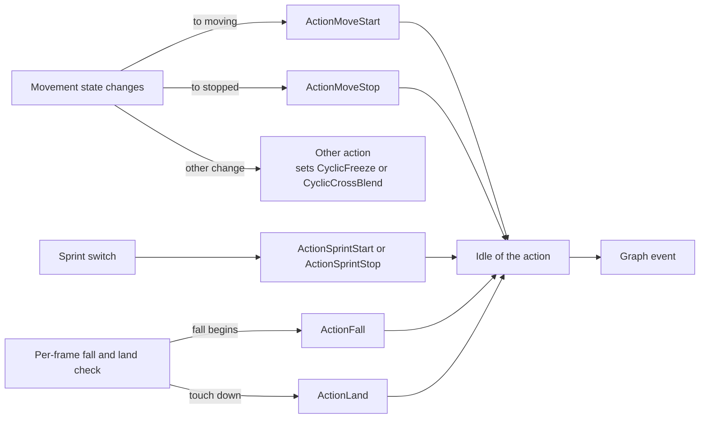

# Locomotion graph

The movement bridge is where input, the behavior graph, and the character controller meet. Its rules
for moving the capsule are on the [walk mode](walk-mode.md) page. This page covers what it
does to a graph instance ([behavior graph runtime](behavior-runtime.md)). The same step
also writes what the actor does, such as an attack or a cast
([actor state graph variables](actor-state-graph.md)).

## One step

Once per fixed 1/120 s step, in this order:

1. write the engine's state into graph variables;
2. raise the events for the changes the step crossed;
3. update the graph;
4. read root motion and the fired events back out.

A step of zero length does none of it.

## Names

Every name comes from the census of the install's own behavior files
([HKX behavior graph objects](../formats/hkx-behavior.md)), not from memory. `0_master.hkx` alone
declares 230 variables and 1,217 events, and a name that only sounds right resolves to nothing.

| Variable | Type | Written as |
| --- | --- | --- |
| `Speed` | real | The gait speed divided by the actor's scale, or 0 when standing |
| `Direction` | real | Fraction of a turn clockwise from facing, in [0, 1): 0 ahead, 0.25 right, 0.75 left |
| `TurnDelta` | real | Turn rate in degrees per second, positive left |
| `IsSprinting`, `IsSneaking` | bool | The resolved gait |
| `iIsInSneak` | int32 | The same sneak state, in its int spelling |
| `bInJumpState` | bool | True while off the ground |
| `SpeedWalk`, `SpeedRun` | real | The configured gait speeds |

The engine never writes `SpeedSampled`. The graph's speed sampler writes it from `Speed`
through the [speed data](../formats/speed-data.md) table, so the blend plays feet at the speed the
body moves. `TurnDelta` is the yaw rate times -57.2958, the game's heading turning clockwise
(clean-room read of `SkyrimSE.exe`, 2026-11-07).

The `Direction` unit comes from the graph data. `MT_Direction_Blend` in `mt_behavior.hkx` is a
cyclic parametric blender over 0 to 1, with `MT_ForwardBlend` at 0, `MT_RightBlend` at 0.25,
`MT_BackwardBlend` at 0.5, and `MT_LeftBlend` at 0.75 (`openskycli hkx --blenders`).

Events: `moveStart` and `moveStop`, `SprintStart` and `SprintStop`, `SneakStart` and `SneakStop`,
`SwimStart` and `SwimStop`, and `JumpUp`, `JumpFall`, and `JumpLand`. Each is raised only when the
state changes, in a fixed order. So a step that changes several things raises the same sequence on
every run.

Ground events start only once the capsule is standing. A door is a reset, and a fresh controller
spends one step finding the ground. Without this rule, every door would report a fall and a landing
the player never made.

## How the game drives the graph

Behaviour described from a clean-room read of `SkyrimSE.exe` 1.7.104.0, 2026-11-16, which
returned behaviour only. Not yet confirmed in the reference game.

The game does not raise `moveStart`, `SprintStart`, or `JumpLandEnd` by name; those names are not in
the program. It performs action records (`AACT`) from `Skyrim.esm`, and the idles attached to those
actions send the graph events.

- The player's actions, and maybe a mount's, go through one shared action queue. NPCs perform them
  directly.
- The landing sends only `ActionLand`. Nothing on that path sends `ActionMoveStart` or
  `ActionSprintStart`, on landing or after the landing clip.
- The program handles these graph variables by name: `Speed`, `Direction`, `SpeedSampled`,
  `IsSprinting`, `iSyncSprintState`, `iSyncForwardState`, `iSyncIdleLocomotion`, `bInJumpState`,
  `VelocityZ`, `bCrashLand`, and `LandTypeIndex`. A read of `bInJumpState` blocks mounting. Which of
  them are written every frame was not found.

OpenSky raises the graph events directly from its own state changes, as listed above, with no
action records in between. Of the variables above it also writes `VelocityZ`; it writes no
`bCrashLand` or `LandTypeIndex`.

## Reporting a name the graph does not declare

Writing a variable and raising an event both answer whether the graph declares the name. The bridge
records both answers instead of dropping the write. A graph that spells a name differently, such as
a mod or a non-player graph, is recorded as a named miss, not as movement that does
nothing. The vanilla `0_master.hkx` has no misses for all ten variables and all eleven events.

A bridge with no graph is a supported setup. Movement still works, and the writes are dropped.

`IsFirstPerson` is the one variable written per instance. It is false on the third-person graph and
true on the first-person one ([first person](first-person.md)).
