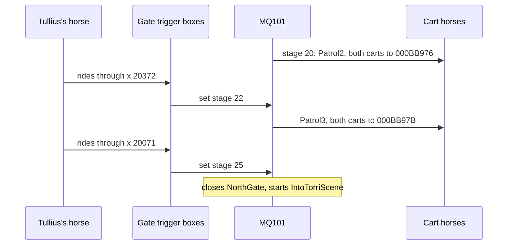

# Opening cart ride

The opening quest `MQ101` (`0003372B`) drives two carts into Helgen. Each cart is pulled by a cart
horse that walks a patrol package. Trigger boxes on the road set the quest stages, and the stages
switch the horses to their next patrol. All values on this page were read from `Skyrim.esm` and the
quest's scripts on the install.

## The horses

| Alias | Reference | Base |
| --- | --- | --- |
| `CartHorse1` | `MQ101Cart1HorseREF` (`000B9DF2`) | `MQ101CartHorse` (`000B9E1D`), race `CartHorseRace` (`000DE505`) |
| `CartHorse2` | `MQ101Cart2HorseREF` (`000BB971`) | `MQ101CartHorse` (`000B9E1D`) |
| General Tullius's horse | `MQ101TulliusHorse` (`000A9DE7`) | `MQ101Horse` (`000654E5`) |
| Hadvar's horse | `MQ101HadvarHorse` (`000654E1`) | `MQ101Horse` (`000654E5`) |

Cart 2 carries the player.

## Packages by stage

Each cart horse's alias holds these packages, highest priority first. The first one whose
condition holds runs.

| Package | Procedure | Runs while `MQ101` is at |
| --- | --- | --- |
| `MQ101StayAtCurrentLocationExterior` | Travel | stage 60 or later |
| `MQ101CartHorse<n>Patrol5` | Patrol | stage 37 up to 60 |
| `MQ101CartHorse<n>Patrol4` | Patrol | stage 30 or later |
| `MQ101CartHorse<n>Patrol3` | Patrol | stage 22 or later |
| `MQ101CartHorse<n>Patrol2` | Patrol | stage 20 or later |
| `MQ101CartHorse<n>Patrol1` | Patrol | stage 15 up to 20 |
| `DefaultStayAtCurrentLocationSkipFallout` | Travel | always |

Every patrol uses the template `PatrolStaticPathing` (`0001722F`) at walk speed, with a point radius
of 50 units. Its four Bool inputs are false, false, false, true: not repeatable, not started at the
nearest marker, no horse riding, and static pathing. So each patrol walks its markers once and ends
at the last one, and the horse stands there until a later stage picks a new patrol.

## The routes

| Package | Markers |
| --- | --- |
| `MQ101CartHorse1Patrol2` (`000C28D5`) | `000BB973` (21406, -79363), `000BB975` (20853, -79361), end `000BB976` (20299, -79374) |
| `MQ101CartHorse2Patrol2` (`000C28D7`) | `000A9DD4` (22580, -79865), `000BB973`, `000BB975`, end `000BB976` |
| `MQ101CartHorse1Patrol3` (`000BB981`) | `000BB977` (20037, -79425), then the shared chain, end `000BB97B` (17926, -81652) |
| `MQ101CartHorse2Patrol3` (`000BF47A`) | the same markers as cart 1 |

The shared chain of Patrol3 is `000BB978`, `000BB979`, `000BB97A`, `000BB980`, `000BB97F`,
`000BB97E`, `000BB97D`, and `000BB97C`. Patrol4 starts at `000BF469` for both horses. Patrol5
starts at `000BF474` for horse 1 and `000BF472` for horse 2. The end fragment of Patrol5 sets stage
41 for horse 1 and stage 39 for horse 2.

Both carts are sent to the same end marker: `000BB976` from stage 20, and `000BB97B` from stage
22. The data never sends one cart on ahead of the other. The second cart stops behind the first
only because the first cart is in its way.

## The gate triggers

The gate triggers are thin trigger boxes across the road. Each runs the script
`defaultSetStageTRIGSpecificActor`. When an actor enters whose base is exactly the box's trigger
actor, and the prerequisite stage is done, the script sets the stage once and disables the box.

| Trigger | Where | Length across the road | Sets stage | Needs stage |
| --- | --- | --- | --- | --- |
| `00084058` | x 21457 | 1,350 | 20 | 15 |
| `000C1F80` | x 20372 | 530 | 22 | 15 |
| `000AA79E` | (20071, -79438, 8684) | 1,450 | 25 | 20 |
| `000AA79D` | (19617, -80097) | 1,300 | 26 | 20 |

For example, `000AA79E` has half extents of 55 by 725 by 199 units and a turn of 0.0146 radians,
so it is a wall about 1,450 units long that runs north and south across the road at x 20071.

The trigger actor of every gate box is the base `MQ101Horse`. That is the base of General Tullius's
and Hadvar's horses, not of the cart horses. So the cart horses can never set stages 20, 22, 25, or
26. The riders' horses must ride through the boxes. Tullius's package `MQ101TulliusPatrol3` (stage
20 or later) runs `000F7B4F` (x 21302), `000F7B50` (x 20930), `000F7B51` (x 20312), and
`000F7B4E` (19995, -79306), then to `MQ101TulliusToElenwenMarker`. That path crosses x 20372 and
x 20071, so Tullius's horse can set stages 22 and 25. Hadvar's route was not traced.

## Stage fragments

The quest fragment script `QF_MQ101_0003372B` does this at each stage:

| Stage | What it does |
| --- | --- |
| 20 | Opens `EastGate`, changes the music, and asks `CartHorse1`, `CartHorse2`, and Hadvar to pick their packages again on their next AI update |
| 22 | Enables a crowd sound marker |
| 25 | Closes `NorthGate`, sets its lock level to 5, and starts `IntoTorriScene` |
| 26 | Closes `EastGate` and sets its lock level to 5 |

Stage 25 changes no cart package. The carts drive on toward `000BB97B` from stage 22, before and
after stage 25 alike, until stage 30 picks Patrol4.

## Tullius at the gate

Before stage 20, General Tullius waits on his horse beside the road with
`MQ101TulliusHoldPosition`. Its conditions are `MQQuickstart` equal to 0 and `MQ101` below stage
20. From stage 20 his patrol `MQ101TulliusPatrol3` holds instead. The stage 20 fragment does not
ask Tullius to pick, and a stage change alone makes no actor pick
([package schedules](package-schedules.md#when-to-pick-again)). So Tullius changes to his
patrol at his next regular pick, 0 to 15 real seconds after stage 20, while the cart horses
change on their next AI update. His patrol rides on the carts' line, from `000F7B4F` at
(21302, -79358), so he must pass that marker before the carts close the road. A rider's pick moves
its horse at once; the horse picks no package of its own.
