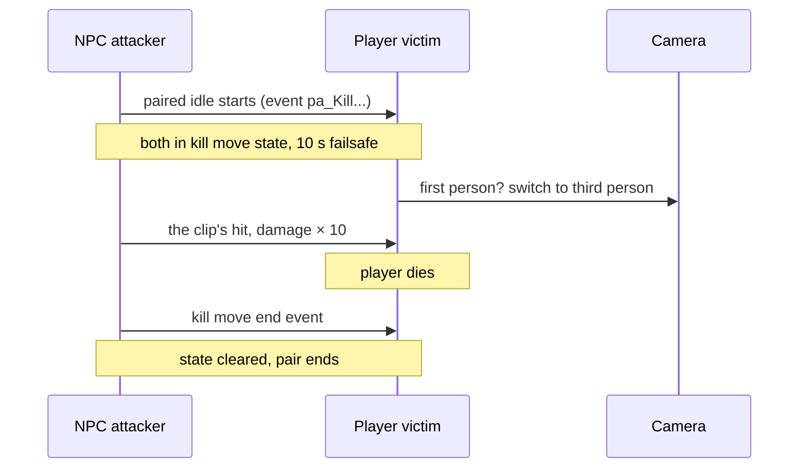

# Paired animations

A paired animation is one clip that animates two actors at once: a kill move, the vampire
feed, the vampire lord feed, the werewolf mauling, the mount. The clip file is named
`Paired_<name>.hkx`. Track 0 is `PairedRoot`. The other tracks are named after the bones of
both actors: one actor's plain, such as `NPC Root [Root]`, and the other's with `2_`, such as
`2_NPC Root [Root]`. Each graph state plays the clip through a `BSSynchronizedClipGenerator`,
whose `m_SyncAnimPrefix` names the tracks that state reads
([behavior clips](/engine/behavior-clips.md#clip-synchronization)).

The facts on this page were read from the install with `openskycli hkx` and
`openskycli animation` (see [Checking it](#checking-it)).

## Which event each actor takes

An `IDLE` whose event starts with `pa_` is a paired idle, such as `1HMKillMoveC`
(`pa_KillMoveC`) or `IdleVampireStandingFront` (`pa_VampireFeedStanding_Front`). The lead,
the actor that starts it, takes the event. The partner takes the same event with `pa_`
toggled. Each event enters its own state, and each state reads its own half of the clip:

| Graph | Event | State |
| --- | --- | --- |
| `1hm_behavior.hkx` | `pa_KillMoveC` | `Player_KillMoveC` |
| `1hm_behavior.hkx` | `KillMoveC` | `NPC_KillMoveC` |
| `0_master.hkx` | `pa_VampireFeedStanding_Front` | `VampireFeedStanding_Front_Player` |
| `0_master.hkx` | `VampireFeedStanding_Front` | `VampireFeedStanding_Front_Victim` |
| `werewolfbehavior.hkx` | `pa_KillWerewolfPairedMaulingWithHuman` | `pa_KillWerewolfPairedMaulingWithHumanClip` |
| `0_master.hkx` | `KillWerewolfPairedMaulingWithHuman` | `KillWerewolfPairedMaulingWithHumanClip` |
| `0_master.hkx` | `HorseEnter` | `MountSynced` |
| `horsebehavior.hkx` | `pa_HorseEnter` | `MountSynced` |

The mount goes the other way round: the rider takes `HorseEnter` and the horse
`pa_HorseEnter` ([riding](/engine/riding.md)). Toggling `pa_` covers both.
[WARNING] The `pa_` rules are OpenSky's reading of the vanilla names and graphs.

## Starting a pair

1. The idle tree runs with the target as the condition Target and picks the idle.
2. The lead's graph takes the event. If it does not, no pair starts.
3. The partner's graph takes the partner event. If it does not, the lead plays alone. An actor
   past the graph distance setting runs no graph, so it plays no half.

These start a pair:

| Source | Lead | Partner |
| --- | --- | --- |
| `PlayIdleWithTarget` | The actor | The target, or else the actor's combat target ([CK wiki](https://ck.uesp.net/wiki/PlayIdleWithTarget_-_Actor)) |
| `StartVampireFeed` | The vampire | The target, through the `IdleVampireFeed` tree |
| A killing swing ([kill moves](#kill-moves)) | The attacker | The actor in front |
| `openskycli game debug paired` | The first actor | The second actor |

`StartVampireFeed` plays the tree under `IdleVampireFeed`. Its children test the target and
pick the bed, bedroll, or standing feed. Only the standing feeds are paired; the bed feeds
play on the vampire alone. `StartCannibal` plays the tree under `IdleCannibalFeed`, which
picks the standing or the crouching feed. Neither is paired.

## Kill moves

A kill move is a paired idle that a killing swing plays instead of the swing. The rules come
from the vanilla idle tree and a clean-room read of the game.

1. A normal or power attack starts. A bash never plays a kill move.
2. The actor nearest in front, inside the swing's reach, is the target. The swing's hit on it
   is worked out with every perk and block term, and then with difficulty.
3. The attack kills when that hit takes the target's health to 0 or below and zero health
   kills the target. An essential actor never dies, and a protected one dies only to the
   player. A dead target is never killed again. The CK wiki page
   ([ShouldAttackKill](https://ck.uesp.net/wiki/ShouldAttackKill)) suggests the reverse for a
   dead target; the clean-room read says false.
4. The idle tree runs under `ActionRightPowerAttack` for a power attack, else under
   `ActionRightAttack`, with that answer as `ShouldAttackKill`. The vanilla roots run it on the
   subject with an empty target, so it reads the subject's own attack. The kill-move roots sit
   before the attack idles, and their other conditions test the angle, the target's height,
   the `KillMove` global, and the last-enemy rule for the player.
5. When the chosen idle is paired, the pair starts and the swing does not. Otherwise the swing
   plays as usual.
6. The victim dies when its half sends `2_KillActor`.

An NPC plays kill moves on other NPCs through the same steps. While either actor plays a kill
move, it leaves the fight, and any other hit on it deals ten times its damage. A player kill
move always shows the [kill cam](/engine/kill-cam.md).

### The player as the victim

- A kill move starts when a paired idle whose animation event begins with `pa_Kill` starts. Both
  actors enter a kill move state, and the victim records the attacker as its partner. A failsafe
  timer of 10 seconds starts.
- While the victim is in that state, every hit on it deals ten times its damage. So the player
  dies from the clip's own hit, not when the clip starts.
- The kill move end event clears the state and ends the pair.
- When the player is the victim and the camera is in first person, the game switches to the
  third-person camera.

Whether an NPC may pick the player is decided by the idle data in `Skyrim.esm`. The kill-move
roots `KillMoveFrontSideRoot` (under the power-attack root) and `KillMoveFrontSideRoot00` (under
`NonMountedCombatRight`) hold these conditions. All are joined by AND, except one pair joined by
OR.

| Run on | Condition | Meaning |
| --- | --- | --- |
| Attacker | `GetTargetHeight` from −35 to 35 | The target stands at about the same height |
| Attacker | `GetGraphVariableInt IsEquipping` ≠ 1 | Not drawing a weapon |
| Attacker | `IsWeaponMagicOut` = 1 | The weapon is out |
| Attacker | `GetGlobalValue KillMove` = 1 | Kill moves are on |
| Attacker | `GetEquippedItemType` (right hand) ≠ 12 | Not a crossbow |
| Attacker | `GetAttackState` ≠ 6 | Not in that attack state |
| Attacker | `IsStaggered` ≠ 1 | Not staggered |
| Attacker | `ShouldAttackKill` = 1 | This swing kills |
| Attacker | `GetRelativeAngle` from 90 to 270 | The angle to the target |
| Target | `GetPairedAnimation` = 0, and ≠ 1 | Not in a paired idle already |
| Target | `IsFurnitureAnimType` ≠ 1, 2, and 4 | Not sitting, sleeping, or leaning |
| Target | `GetIsID AstridEnd` = 0 | Not Astrid at the end of her quest |
| Attacker OR target | `GetIsID Player` = 0, OR `IsLastHostileActor` = 1 | The attacker is not the player, or the target is the last enemy |
| Target | `GetActorValue Paralysis` = 0 | Not paralysed |

So the last-enemy rule binds only the player as attacker. No condition stops an NPC from choosing
the player as victim. The race and weapon idles below these roots test the target's race and
keywords, `IsEssential`, and `GetRandomPercent`.

Example: a bandit with a sword swings at the player, on level ground. The swing would kill. If the
`KillMove` global is 1, every row passes, and the idle tree may pick a kill move.

The data does not show whether the controls lock during the kill move.

## Reaching the mark

Every track is relative to `PairedRoot`, so two actors on the same root line up. The mark is the
lead's feet and heading. Once the partner's graph runs its `BSSynchronizedClipGenerator`, the
partner moves from where it stood to the mark over the generator's `m_fGetToMarkTime`. With
`m_bReorientSupportChar` set it also turns from its own heading to the lead's, along the shorter
way. Without it, it keeps its heading and stands on the mark at once. A get-to-mark time of 0, or
a partner whose graph shows no synchronized clip after one update, stands on the mark at once.

The rules come from a clean-room read of the game that returned behaviour only: the move is
linear in time, with no easing. Which of the two actors the game moves, and how it places the
mark, were not found. OpenSky keeps the lead still.

## Whose event is it

The kill-move clips hold no annotations. The clip triggers in each half's graph state send
the events, and each half has its own prefix. In `pa_KillMoveC` the lead's half sends
`NPCSoundPlay.NPCKillMelee`, `NPCHitFrame`, `NPCKillMoveEnd`, and `NPCpairedStop`. The
victim's half sends `2_DeathEmote`, `2_KillActor`, `2_KillMoveEnd`, and `2_PairEnd`.

While an actor plays a half, OpenSky takes `2_` or `NPC` off its graph's events and acts on
the rest at that actor. So `2_KillActor` kills the victim, and `NPCSoundPlay.NPCKillMelee`
plays the sound at the killer, once. Outside a pair the prefix stays, because creature
graphs send their own names that start with `NPC`. [WARNING] Taking the prefix off is
OpenSky's reading of the names.

The creature clips do hold annotations, on the human's `NPC Root [Root]` track: the vampire
lord feed has `NPCSoundPlay.NPCVampireLordFeed`, the mount `SoundPlay.NPCHorseMount`. Each
actor hears only the annotations of the tracks it plays.

`PlayAnim01` is on the human's root track of `Paired_WW_PairedMaulingWithHuman.hkx`, five
times between 1.667 s and 3.333 s. No graph on the install has a transition on it, so it
changes no graph state. OpenSky sends it, like every annotation, to the scripts and effect
graphs that listen on the actor. [WARNING] What else the game does with it is not known.

## Ending a pair

The pair ends when either half sends `PairEnd` or `pairedStop` (any case), after its prefix
comes off. A pair whose end event never comes ends after `PairedAnimationCore.maximumSeconds`
(30 s). [WARNING] The time limit is OpenSky's choice.

While a pair plays, `GetPairedAnimation` is 1 for both actors
([condition functions](/engine/condition-functions.md)). `IsInKillMove` is true when the
pair's event starts with `pa_KillMove`. [WARNING] OpenSky's reading of the event names.

## Clips that store a NaN

About 25 vanilla kill-move clips store a NaN on one translation track. OpenSky reads that part
as its identity, so the clips play ([animation](/formats/hka-animation.md#vector-track)).

## Checking it

- `openskycli hkx <graph> --transitions <text>` lists each transition event with that text
  and the states it enters.
- `openskycli hkx <graph> --raise <event>` prints `paired clip <prefix>|<clip>` for each
  paired clip the event reaches.
- `openskycli animation <clip> --annotations` prints the track groups and each annotation
  with its track.
- `openskycli game debug paired <ref> <target> <idle>` plays a paired idle in the running
  game, and `state paired` shows each pair: its idle and event, and each actor's paired
  clips.

## Where OpenSky differs

- An NPC plays no kill move on the player. The game plays them, and then the player dies
  in the kill move.
- The dual-wield and left-hand kill moves, such as the DLC2 heart rip, are not tried. A
  swing tests only the right-hand action trees.
