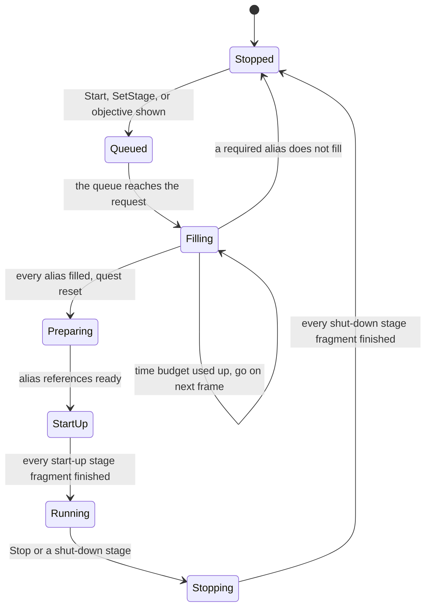

# Quest state

A quest is a `QUST` base record, not a placed reference. The [world state store](runtime-state.md)
does not mind: state is keyed by the record's `ReferenceKey`, as
[global variables](global-variables.md) are, so the journal, snapshot order, and save all
apply. Quest changes never belong to a cell, because a quest is in none. The records are on the
[quests](../formats/quest-records.md) page.

## The component

The quest component holds the running, completed, and failed flags, the set of stages ever reached,
the journal's newest log entry (a stage and the items of it that passed), and a table of objective
states (displayed, completed, failed). Its initializer enforces two rules, so
two stores with the same state snapshot and save the same way:

- Reached stages are sorted, with no duplicates.
- Objectives are sorted by index, one entry each, and never an entry with all three flags false.
  That is an objective nothing touched, and storing it would make two equal worlds compare unequal.

Like inventory, it is a full override. An untouched quest has no component, and the first change
copies its baseline in. Quest state is saved in the `QSTS` chunk, and the log entry in the
`QJLG` chunk beside it.

## Rules

Every rule is from the Creation Kit wiki.

- The current stage is the highest reached, not the last set. `GetCurrentStageID` "obtains the
  highest completed stage in this quest". The `GetStage` condition shows the same: with stages 10,
  30, and 75 reached it returns 75 "even when stage 30 is completed after stage 75".
- A stage is done only if it was visited. After setting 0, 40, 20, and 60, `IsStageDone` "returns
  false for stages 10, 30 and 50 ... because these stages have not yet been visited". So reached
  stages are a set, not a high-water mark.
- Setting a stage already reached changes nothing. Setting a lower stage later leaves the current
  stage as it was, and makes the lower stage report done.
- Completing does not stop. `CompleteQuest()` "flags this quest as completed" and says nothing about
  running. A quest is usually stopped afterwards by a shut-down stage.
- The three objective flags are independent. `SetObjectiveDisplayed`, `SetObjectiveCompleted`, and
  `SetObjectiveFailed` each take their own Bool, and none clears another.

## Baselines

One thing comes from plugin data: a quest with the `DNAM` start game enabled flag reports running
without being touched, and stays clean while it does. The completed and failed bits in the same
field describe the quest's design, not a session, so a new game starts every quest not completed.

Vanilla's real start machinery is not modeled. Skyrim starts quests through story manager events
(the `QUST` `ENAM` event and the `SMEN`, `SMQN`, and `SMBN` node tree), through the seven-day
repopulation timer, and through dialogue. A quest that vanilla starts from an event stays dormant
here until something starts it. Quest scripts and stage fragments are on the
[Papyrus quest scripts](papyrus-quests.md) page.

## Changing a quest

| Operation | Effect | Refused when |
| --- | --- | --- |
| Start, stop | Moves the running flag only. Stopping keeps stages and the completed flag | Unknown quest |
| Complete | Sets completed, and leaves the quest running | Also: quest not running |
| Set stage | Starts a stopped quest, records the stage, applies its items the first time, then a shut-down stage stops it | Also: unknown stage, alias fill refused |
| Set objective displayed | Sets the flag. Showing one starts a stopped quest | Also: unknown objective |
| Set objective completed, failed | Sets one flag | Also: unknown objective, quest not running |
| Fail all objectives | Fails every shown objective, completed ones too | Also: quest not running |
| Reset | Drops the runtime state, so the quest derives from plugin data again | Never. Returns false if clean |

A refusal writes nothing. Each is a caller bug that a silent no-op would hide inside a quest that
never moves on.

Setting a stage on a stopped quest starts it, as the [Quest Stages
Tab](https://ck.uesp.net/wiki/Quest_Stages_Tab) says of setting a stage. Stage flags are plain
record data, and a stage index may repeat within a `QUST`, so the flags of every matching stage are
combined.

## Starting a quest

A quest start from a script does not happen inside the call. `Start()`, `SetStage()` on a
stopped quest, and showing an objective of a stopped quest each put a start request into the
[story manager](story-manager.md)'s queue as a `QSTR` event, and the script waits. The
queue runs once per frame, oldest first, with a small time budget per frame.

- **Queued.** The request lives only in the queue; the quest is unchanged. `IsRunning()` and
  `IsStarting()` are false, `IsStopped()` is true, and `GetStage()` and `IsStageDone()` still
  answer from the last run, or 0 and false for a quest that never ran.
- **Filling.** The aliases fill in list order. The time budget is checked between aliases and
  every 5 candidates of a Find Matching Reference search. When it runs out, the fill goes on
  from the same alias in a later frame. Only one quest at a time waits like this. A failure
  clears the aliases, and every waiting script gets `false`.
- **Reset.** After the last alias fills, the quest is reset: every stage is marked not done, the
  current stage becomes 0, objectives reset, and `IsCompleted()` becomes false. A quest resets
  when it starts, not when it stops, so a stopped quest keeps its stages until the next start.
  From here `IsStarting()` is true and `IsRunning()` is false.
- **Preparing.** The alias references are made ready, including references in cells that are
  not loaded. This usually ends on a later frame. Then "Create Reference" aliases are created,
  "Initially Disabled" aliases are disabled, and alias scripts bind to their references.
- **Start-up.** On the next quest update, the quest and alias scripts reset and `OnInit` runs.
  Next, a quest the story manager started gets its `OnStory` event; a quest started by a script
  gets none. Then every stage flagged "Start Up Stage" runs and is marked done at once, and the
  current stage becomes the highest of them. Stage 0 runs only when it has this flag.
- **Running.** Once every start-up fragment has finished, `IsRunning()` becomes true, and every
  waiting `Start()` returns `true`. With no start-up fragments, start-up and running come in
  the same update. `Start()` does not wait for `OnInit` to finish.

So a start takes at least two frames.

OpenSky queues a start that a script asks for, and runs it over two script steps. The first
step after the call fills the aliases and resets the quest. The next step attaches the scripts,
runs the start-up stages, and reports the quest as running once their fragments have finished.
The calls answer as the table below says. These parts differ from the game:

- The whole fill happens in one step. There is no time budget, so no fill goes on in a later
  frame.
- A stop finishes at once, so there is no stopping phase.
- A quest that the story manager, the journal, or the session start begins still starts at once.
- The save keeps the queue and the phase of each start. It does not keep which script waits, so
  a script that waited when the save was made gets no answer after a load.

What a call answers:

| Call | Answer |
| --- | --- |
| `Start()` on a running quest, or one in start-up | `true` at once; nothing is queued |
| `Start()` on a quest that is filling or preparing | Waits for the same start as the first caller |
| `Start()` on a "Run Once" quest that has run | `false` at once; nothing is queued. A start marks the quest as run only when it succeeds |
| `Start()` on a quest with a story manager event (`QUST` `ENAM`) | `false` at once, with the log error "attempting to start event scoped quest outside of story manager". `SetStage()` on such a stopped quest does the same |
| `Start()` otherwise | Waits; `true` when the quest runs, `false` when a required alias does not fill. The quest's story manager conditions are not checked |
| `SetStage()` on a stopped quest | Queues the start; the log adds " (quest will be started first)". The stage is set when the quest runs, in the same frame, after the start-up stages. The call returns once that stage's fragments have finished, or `false` when the start fails |

`SetStage()` also answers `false` when the stage does not exist, when it is done and the quest
does not allow repeated stages, and when the stage has no log entries; the stage is still
marked done then.

A second `Start()` before the queue reaches the first queues a second request, which finds the
quest started and does nothing. Both scripts get the one result. `Stop()` on a quest that is not
yet running does nothing, so the queued start still runs. A quest stopped during start-up
releases its waiting scripts with `true`.

The save keeps the story manager queue with its waiting starts, the quests in start-up, running,
and stopping, and the start-up fragments still to run. The Papyrus save keeps which scripts wait
for which start or stage. So a save made before the queue reached a request still starts the
quest after a load, and the waiting script still gets its answer.

## Stage items

A stage holds items (log entries), each with conditions, text, and flags. "The script fragments will
be run for all entries where the conditions pass" (Quest Stages Tab). When a stage is first set:

- Every passing item's fragment runs ([Papyrus quests](papyrus-quests.md)).
- The passing items with text become the journal's log entry. "Only the most recent log entry is
  displayed", so a later stage replaces it.
- A Complete Quest item completes the quest.
- A Fail Quest item fails the quest and every shown objective, completed ones too, as
  [FailAllObjectives](https://ck.uesp.net/wiki/FailAllObjectives_-_Quest) does. The HUD shows
  "<quest> failed".

Without a condition evaluator, such as in a unit test, the items with no conditions apply, or the
first item when all have conditions.

Readers use a quest seam shaped like the global one: the session override wins, the baseline is next,
and no answer means the form ID names no quest. It can be built from the live store or from a
snapshot. Four `CTDA` functions read it ([conditions](../formats/conditions.md)). A quest parameter
naming no quest is a failure with its own tally bucket.

## Aliases

A quest points at the world through aliases, not form IDs. A reference alias is a numbered slot on
the `QUST` record, and dialogue, packages, journal text, and the quest's scripts point at the slot.

The alias table is its own component, keyed like the quest. It is separate because the lifetimes
differ: stage and objective state survives a stop, and the alias table is cleared by one. Fills are
sorted by alias ID, one each. Reference fills and location fills are separate lists, because a
location is a base record, not a placed reference. Reference fills store a `ReferenceKey`, and
location fills a resolved form ID. Neither stores a raw form ID. Reference fills are saved in `QALS`
and location fills in `QLOC`.

## When aliases fill

The Creation Kit's alias page (<https://ck.uesp.net/wiki/Alias>): "the aliases are not actually
'filled' until the quest starts running". So starting fills, stopping clears, and reset clears. A
start-up stage fills too, because it starts the quest. Starting a quest that already has a table
changes nothing, so a second `Start` never moves an alias a script is holding.

The fill follows four rules from the same page:

- Order is the list order, not the fill type: "The list of aliases is an ordered list - when the
  quest starts, aliases are filled in order", and "dependencies can only be to aliases higher in the
  list".
- Optional decides whether an empty alias stops the start: "If unchecked, the quest will fail to
  start if it cannot fill this alias." The start then fails and writes nothing.
- Force Into Alias takes the last writer: "The last 'source' alias that is filled will be the one
  that determines the final value for the specified 'target' alias."
- One quest does not fill two aliases with the same reference: "Normally, the game will not fill two
  aliases on the same quest with the same reference". The flag that allows it is checked on the
  second alias.

## What an alias gives

A filled reference alias can give its reference factions, spells, keywords, and items. The Creation
Kit's alias tab page (<https://ck.uesp.net/wiki/Quest_Alias_Tab>) states each one:

- Factions (`ALFC`): "The aliased reference will be considered a member of the specified factions
  while in the alias." The faction goes when the reference leaves the alias: the alias is cleared,
  the quest stops, or the alias is forced to another reference. "The behavior is as though
  RemoveFromFaction is called on the reference as it is leaving the alias." The removal happens even
  when another filled alias gives the same faction to the same actor.
- Spells (`ALSP`): "added to the reference that fills the alias, and removed when the reference
  leaves the alias."
- Keywords (`KWDA`): "considered to have the specified keywords while in the alias."
- Items (`CNTO`): "added to the reference's inventory when the reference is placed into the alias."
  The page says nothing about taking them back, so they stay.
- Factions and packages on a reference that is not an actor are ignored.

A load restores the actor's factions, spells, and inventory from the save, so a load gives nothing
again.

Example: the follower quest forces the hired actor into its follower alias. That alias holds the
current follower faction. Each follower topic, such as follow, wait, trade, and dismiss, needs that
faction, so the actor offers them only while in the alias.

## What does not fill yet

Specific Reference (`ALFR`) and Specific Location (`ALFL`) fill. From Event fills when the
[story manager](story-manager.md) starts the quest: `ALFD` names the event data member, and
a reference alias takes a reference member while a location alias takes a location member. A quest
started any other way has no event, so the alias is counted and left empty.

Unique Actor (`ALUA`) names an `NPC_` base. The reference comes from the `LCUN` lists of the
`LCTN` records, which pair each unique base with its placed actor. Those lists cover 2,741 of the
2,900 Unique Actor aliases in `Skyrim.esm`. They miss some actors, such as `Ralof` and `Hadvar`.
For a base the lists miss, OpenSky takes the one placed actor of that base in the persistent
cell children of the load order. `Ralof` and `Hadvar` each have exactly one, in the `Tamriel`
persistent cell. A base placed more than once takes its one actor that starts enabled. A base
with no persistent actor takes its one loaded actor: `Madesi` stands at his Riften market stall
as a temporary reference, so only the loaded cell knows him. A base with no answer is still
counted and left empty and never fails the start, the same as an unimplemented fill. Every
other fill type is counted and left empty, and an unimplemented fill type never fails a quest
start.
Location Alias Reference (`ALFA` plus `ALRT`) names a location alias and a location ref type
(`LCRT`). The reference comes from that location's `LCSR` and `ACSR` lists: the first one of that
type that no other alias of the quest holds. The opening's cart drivers fill this way: two
`MQ101CartDriver` entries in `HelgenLocation` fill `ImperialSoldier01` and `ImperialSoldier02`.
The location alias must come earlier in the list, as `Helgen` does in `MQ101`. When the location
lists no free reference of the type, its child locations are searched: every location whose
`PNAM` chain reaches it, nearest first. A miss in the whole tree fails a required alias. An empty
location alias may be OpenSky's gap, so it is counted and never fails the start.

Create Reference to Object (`ALCO` plus `ALCA`) makes a new reference of the `ALCO` base
([Quest Alias Tab](https://ck.uesp.net/wiki/Quest_Alias_Tab)). The low 16 bits of `ALCA` name the
alias to create at, and bit `0x8000` switches "create at" to "create in". `Skyrim.esm` has 630
such aliases: 441 create at and 189 create in, and 365 of them create an `NPC_`. The Helgen
headsman of `MQ101` is one. OpenSky creates at: the new reference is a spawn where the anchor
alias's reference stands, loaded or not, so the save keeps it and a cell build places it. A
spawn whose base is an `NPC_` builds as an actor with its cell's `ACHR`s. The reference is made
only after the pass allows the start, so a refused start leaves nothing in the world.

Not done for this fill: "create in" (the new item goes into the anchor's inventory), the level
(`ALCL`) of a leveled base, and deleting the reference when the quest stops.

External Alias Reference (`ALEQ` plus `ALEA`) takes whatever alias `ALEA` of quest `ALEQ` holds
when this quest starts ([Quest Alias Tab](https://ck.uesp.net/wiki/Quest_Alias_Tab)). It fails
when that quest is not running, its alias is empty, or the reference is inside a container. The
location form fills from a location alias the same way. `MQ101DragonAttack` takes `Alduin`,
`Ralof`, `Hadvar`, and the prisoners from `MQ101` this way. OpenSky reads the other quest's alias
table when it runs. A required alias that stays empty stops the start, as other required aliases
do. The "Allow Dead" and "Allow Disabled" rules do not apply to this fill. [WARNING] OpenSky has
no check for a reference inside a container.

### Find Matching Reference

An alias with no fill subrecord but with match conditions, or with a near alias (`ALNA`), is a
Find Matching Reference fill ([Quest Alias Tab](https://ck.uesp.net/wiki/Quest_Alias_Tab)). Each
candidate runs the alias's match conditions with the candidate as subject, the quest as the
alias quest, and the aliases filled so far. A dead candidate needs "Allow Dead" (`FNAM` bit 4),
and a disabled one "Allow Disabled" (bit 7). A destroyed candidate needs "Allow Destroyed". Most
likely it is a reference with the destroyed mark that `SetDestroyed` sets and `GetDestroyed`
reads; its health and its destruction stage are not read. A candidate that another quest's alias
reserves needs "Allow Reserved". A reference another alias of
the quest holds needs "Allow Reuse in Quest". "Closest" (bit 13) takes the candidate nearest the
player; otherwise a random match fills the alias. The conditions run first, then these flag
checks. A deleted reference and the player are never candidates.

A dead actor whose base has "Respawn" set and whose cell is due to reset still passes without
"Allow Dead".

The game searches in three steps, and stops at the first that finds a candidate:

1. The loaded area: the loaded exterior cells, or the current interior.
2. Unless "In Loaded Area" (bit 5) is set: every interior cell and every worldspace, loaded or
   not.
3. Unless "In Loaded Area" is set: the references a location stores for its unloaded cells. A
   pick from this step can create the actor at its stored place.

"Closest" (bit 13) takes the candidate nearest the player; a candidate from step 3 has no place
to measure, so it is never the closest. Without "Closest", the pick is random with the same
chance for each candidate. A pick that another alias of the quest holds is dropped, and the
pick is made again, unless "Allow Reuse in Quest" (bit 3) is set. The game caches the result of
one set of conditions, and spreads a long fill over several frames.

A specific reference or a unique actor fill does not need the reference to be loaded. The alias
conditions still run on it.

### Dead and disabled outside the loaded area

A reference in the loaded area, and a persistent reference in a cell that is not loaded, both
answer from their own state: the actor's dead state and the reference's disabled flag, as the
save restored them. The conditions run on the real reference.

A reference that a location stores for a cell that is not loaded (step 3) has no state in
memory. The game checks it from saved data before the conditions, without loading the cell:

- **Dead:** the candidate counts as dead when the dead count of its base actor is above 0, the
  number `GetDeadCount` reports. So once one actor of that base has died, every stored reference
  of that base counts as dead.
- **Disabled:** a reference with an enable parent follows the parent's state, inverted when it is
  set opposite to the parent. Otherwise its own saved enable state counts, and without one the
  plugin's "Initially Disabled" flag.

Its conditions then run on a blank stand-in actor with the candidate's base, form ID, and cell,
and nothing else. `GetDead` and `GetDisabled` answer false on it, `GetIsID` answers correctly,
and `GetDistance` is not reliable, because the stand-in has no position.

### Flags by fill type

| Fill | "Allow Dead", "Allow Disabled" | "Allow Reserved", "Allow Destroyed" | Condition subject |
| --- | --- | --- | --- |
| Find Matching Reference | Apply | Apply | The candidate |
| Specific Reference | Do not apply: a dead or disabled reference fills | "Allow Reserved" applies; a deleted reference fails | The reference |
| Unique Actor | Apply; an actor not in memory is checked by the step 3 rules | Apply | The player |
| Create Reference | | | The player |

A near alias with type 0 ("Linked Ref Child") narrows the candidates to the references whose
untagged linked ref (`XLKR`) is the near alias's reference.

OpenSky runs steps 1 and 2. For step 2 it reads every persistent `REFR` and `ACHR` of the load
order once, at load, because an alias can only hold a persistent reference. A step 1 match wins;
step 2 tries only the references step 1 did not see. The references of step 3 are persistent too,
so step 2 already holds them. A candidate outside the loaded area answers from the saved state:
it is disabled by its enable parent, its saved enable state, or its "Initially Disabled" flag,
and dead when the save marks it dead. One with a location ref type also counts as dead once an
actor of its base has died. Its conditions run on the persistent record, not on a blank
stand-in. A miss fails a required alias once every step that applies has run.

A "find matching reference from event" fill also runs the match conditions on the event's
reference, and a reference that fails them does not fill the alias.

Refusing a start because of a gap in OpenSky would present an engine gap as game behaviour.
Only a fill that searched the place the game searches and found nothing fails a required
alias.

The reuse rule refuses the fill, not the start. The page says the rule "is not required for all fill
types" and names one exception, so which types it covers is not documented. Failing the start would
refuse thirteen quests `Skyrim.esm` ships that way.

Also not done:

- Near alias types other than "Linked Ref Child".

`Skyrim.esm` has 12,891 aliases across 1,607 quests. 5,591 fill: 2,688 specific references,
162 direct locations, and 2,741 unique actors. No quest is blocked from starting. The largest
gaps are Location Alias Reference (2,036, 15.8%), From Event (1,771, 13.7%), and aliases with no
fill subrecord at all (1,678, 13.0%).

## Who reads aliases

An alias seam over the plugin index and the session's tables answers by alias number and by name,
from the live store or a snapshot. A script property and a quest alias run-on carry a number. A
`CIS1` or `CIS2` condition override carries a name.

- Conditions: run-on 5 (quest alias) takes its alias number from `CTDA` parameter 3 and its quest
  from the list's owner. A `CIS1` or `CIS2` name resolves for a filled alias and stays unresolved for
  an empty one ([condition evaluation](conditions.md)).
- Script properties: an alias-typed `VMAD` property binds to the filled reference. An empty one keeps
  the compiler default and is counted.
- Alias scripts: the alias script sections of the `QUST` `VMAD` start on the reference in their alias
  and end with the quest ([Papyrus quest scripts](papyrus-quests.md)).
