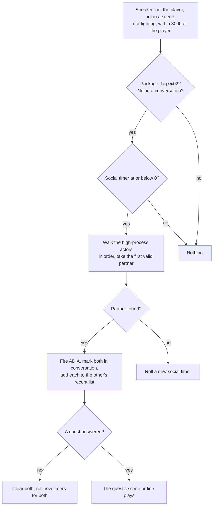
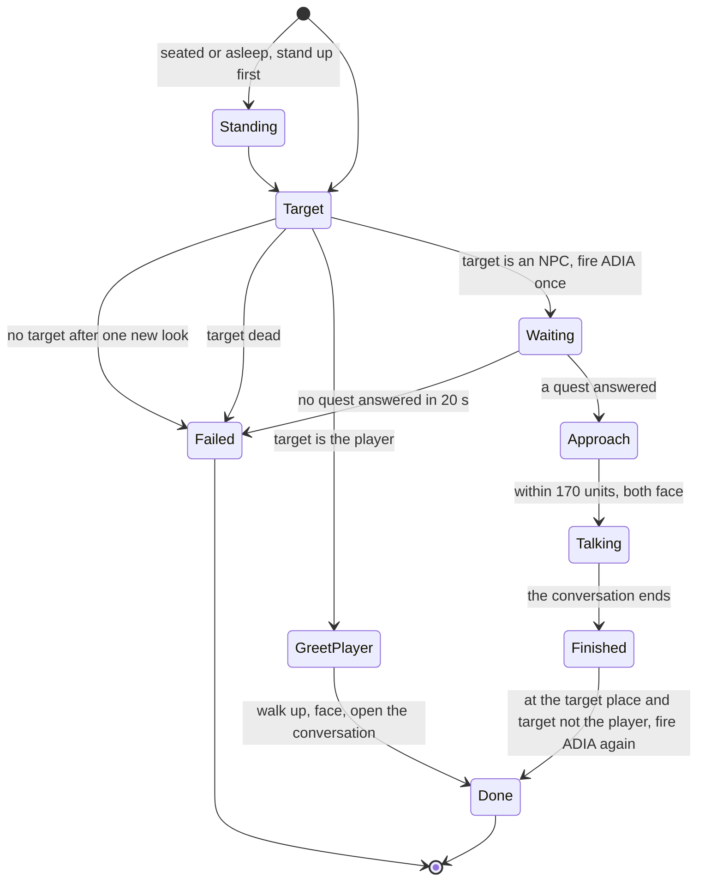

# Random conversations and NPC social events

NPCs in the game talk to each other, say hello in passing, watch a fight, and react to a dead
body. Talking, hellos, and bodies each send a [story-manager](/engine/story-manager.md) event,
and vanilla quests start from them: `ADIA` (actor dialogue), `AHEL` (actor hello), and `DEAD`
(dead body). The quest then plays the conversation as a [scene](/engine/scenes.md) or a line.
The engine itself says nothing between two NPCs: with no quest to answer `ADIA`, no line plays.

Sources: the Creation Kit pages "Scene" (section "Controlling Random Conversations"),
"Actor Dialogue Event", "Actor Hello Event", and "Package" (the interrupt flags).

## Package interrupt flags

An actor's current package decides what it may do. The package `PKDT` interrupt flags:

| Flag | Meaning |
| --- | --- |
| 0x01 | Hellos to the player ([dialogue](/engine/dialogue.md#speech-timers)) |
| 0x02 | Random conversations, and hellos in passing |
| 0x04 | Observe combat behaviour |
| 0x08 | Greet corpse behaviour |
| 0x80 | Idle chatter ([dialogue](/engine/dialogue.md#speech-timers)) |

An actor with no package takes part in nothing. A sandbox package whose "Allow Conversation"
option is on sets flag 0x02 on the running package when the procedure starts. Sandboxing adds
no other rule: the actor then follows the random conversation check below. A commanded follower
follows the flags of the package it runs, like any other actor.

## Settings

| Setting | `Skyrim.esm` | Meaning |
| --- | --- | --- |
| `fAISocialTimerForConversationsMin` | 10 | Shortest wait between tries, seconds |
| `fAISocialTimerForConversationsMax` | 30 | Longest wait between tries, seconds |
| `fAISocialRadiusToTriggerConversation` | 500 | Furthest partner, exterior |
| `fAISocialRadiusToTriggerConversationInterior` | 500 | Furthest partner, interior |
| `iAISocialDistanceToTriggerEvent` | 200 | How close a scene's pair must be before the talk starts |
| `fAISocialchanceForConversation` | 10 | Percent chance that a watcher of a fight comments |
| `fAISpectatorRememberThreatTimer` | 5 | Seconds a watcher remembers a threat |

`fAISocialchanceForConversationInterior` is in `Skyrim.esm` but the game never reads it. A random
conversation has no chance roll.

The game also has values that are not in `Skyrim.esm`:

| Value | Meaning |
| --- | --- |
| 3000 units | Both actors of a conversation must be this close to the player |
| 120 s | How often an actor forgets its recent partners |
| 20 s | How long `DialogueActivate` waits for a quest to answer its `ADIA` |
| 170 units | How close the speaker walks before the talk starts |
| 384 units | Added to the partner's radius for the walk's target place |
| 500 units | The scene's trigger distance when the speaker sees the partner, or both sit or sleep |
| 400 units | How far an actor reacts to a body |
| 20 s | How long a checked body waits before another actor reacts to it |
| 1000 units | A watcher of a fight stops watching beyond this distance |
| 20 s | Shortest time between two comments of one watcher |

## Random conversations (`ADIA`)

The check runs each frame for each actor in high process (the actors near the player that get
full AI). One actor's check:

The social timer is rolled between the two timer settings when the actor enters high process
and again after each try. It counts down only while the actor is not in a scene.

A valid partner:

- is not the player, has no combat target, and is not disabled or deleted;
- is not in a conversation, has no request waiting, and is not sleeping;
- is within the social radius of the speaker (the interior setting indoors). Indoors the height
  difference must also be under 90 units.

Both actors must also be alive, not knocked down, and not unconscious. Both must run a package
with flag 0x02, be within 3000 units of the player, stand or sit (not part way into or out of a
seat), say no line, and not talk with the player. No pair is searched while an NPC's talk
package aims at the player.

Each actor keeps a list of recent partners, and a partner on the list is skipped. A timer of
120 s empties the whole list, then starts again. It counts down only on frames when the check
runs, so an actor whose check stops keeps its list.

The event carries the speaker's location, `R1` the speaker, and `R2` the partner.

## Walking together

The answering quest's scene takes the pair. Both get an In Game Dialogue package. The target
place is the partner, with the partner's radius plus 384 units. The scene's trigger distance is
`iAISocialDistanceToTriggerEvent`, raised to 500 units when the speaker sees the partner or both
sit or sleep, plus 20 when the speaker sits.

- The scene pauses while the speaker walks. The partner gets a short wait package, so it stays
  where it is.
- The speaker stops within 170 units of the partner, or the package's own radius when it has
  one. A height difference of more than 20 units adds 20 units to the radius.
- Once the speaker stands still, both turn to face each other, the partner gets the wait package
  again, and the scene resumes.
- A speaker that enters combat on the way gives up the walk.
- The speaker walks. It runs only when the actor always runs. The walk has no time limit: the
  speaker paths again when its goal is more than 100 units from the partner.

## The `DialogueActivate` procedure

The package's topic parameter is not used. Only the target and the place are.

While it waits for an answer, the target gets the short wait package, when the target is in
high or middle-high process.

## Hellos in passing (`AHEL`)

`AHEL` comes from head tracking, not from the conversation check. It fires when an actor that is
not the player and not in a scene, and that walks along a path, picks a new head-tracking
target. The target must be another NPC, not the player and not in a scene, and the actor's
package must have flag 0x02. The event carries the location, `R1` the
actor, and `R2` the target. It does not use the greeting distance or timers of hellos to the
player.

## Watching a fight

Watching a fight is a reaction to detection. An actor starts to watch when it detects a fighter
and:

- the fighter is not the player, is alive, is in combat, and is not fighting the watcher;
- the watcher is not in combat, has no combat target, is not fleeing, and is not already
  watching;
- the watcher stands, sits, or sleeps, and runs a package with flag 0x04.

The watcher gets its actor base's spectator override package when it has one, otherwise a
Spectator package, unless it already runs a Guard-type package. A watcher in a scene does not
change package: the scene is told instead, and the scene's "observing combat" flags decide
whether it pauses or ends ([scenes](/engine/scenes.md#actor-behaviour-flags)).

While it watches, the actor checks its place about every 1.5 s, and stops watching beyond
1000 units. It comments with a line of subtype `ObserveCombat` at the
`fAISocialchanceForConversation` chance, at least 20 s apart. It remembers a threat for
`fAISpectatorRememberThreatTimer` seconds. A watcher is not free for a random conversation,
because it is in no state to talk: its new package has no flag 0x02.

## Finding a body (`DEAD`)

Finding a body is also a reaction to detection. It needs:

- a dead body within 400 units that no actor has reacted to in the last 20 s;
- a finder whose package has flag 0x08.

Then:

1. `DEAD` fires with `R1` the finder, `R2` the body, and the finder's location.
2. The finder ends any dialogue it is in.
3. The finder gets its actor base's dead-body override package when it has one, otherwise a
   ReactToDead package aimed at the body.
4. The body's timer starts at 20 s, so no other actor reacts to it until the timer ends.
5. Inside ReactToDead, within 400 units of the body, the finder says a `NoticeCorpse` line once.
   The killer says nothing.

## What a save keeps

For each high-process actor, the save keeps the idle chatter timer, the time of the last
conversation step, the recent-partner timer, the social timer, the waiting request, the greeting
timers, the partner, and whether it is in a conversation
([actor process data](/formats/ess-actor-process.md#high-block)). The recent-partner list itself
is not saved. Each body keeps its 20 s timer.

## Where OpenSky differs

- The social pass runs every 30 frames, not every frame. Times are counted in real seconds.
- A pair waits 2 s for a quest to answer its `ADIA` with a scene. The game waits as long as its
  story manager queue takes. A `DialogueActivate` package waits the game's 20 s.
- A hello in passing needs a walker that moved 8 units since the last pass. Its look target is
  the nearest free NPC within 384 units, the distance at which an NPC notices the player.
  A new target sends `AHEL` and turns the head for 10 s.
- The partner's wait package, the watcher's Spectator package, and ReactToDead are not
  packages: the actor's own package is held, and its head turns to the other actor. The finder
  of a body says its `NoticeCorpse` line where it stands; it does not walk to the body.
- A watcher rolls its comment chance on each pass.
- The speaker's sitting and sleeping are not read: the extra 20 units for a seated speaker and
  the stand-up step of `DialogueActivate` are not built.
- With the player as its target, `DialogueActivate` opens the conversation where the actor
  stands.
